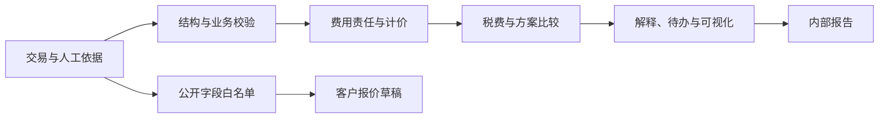

# COCUDTT · 国际贸易成本与贸易术语方案分析

面向外贸业务人员的本地测算工具：录入交易、合同报价与费用，查看费用承担依据、买方落地成本及可评估的卖方利润，比较不同 Incoterms® 2020 方案。项目由国际经济与贸易学习中的报价测算问题出发，近期重点是**中国一般贸易进口、单商品一票**。

**不登录、不上传交易数据。计算、项目文件与报告均在浏览器本机处理。**

> 本工具仅供学习与内部测算参考，不构成法律或专业贸易建议。实际合同请以 Incoterms® 官方文本及当地法规为准。

## 版本与入口

更新于 **2026-10-20**。本 README 介绍已验收并整合至 `main` 的开发功能。当前重点是新手／专业双模式工作台，让首次使用者先完成核心输入，再按需要核对专业资料；源码、离线工具与验证记录见 main。

| 入口 | 内容与状态 |
|---|---|
| [在线演示](https://codeding-101.github.io/COCUDTT/) | 新手默认、专业功能保留的本地工作台体验版 |
| [`main` 分支](https://github.com/codeding-101/COCUDTT/tree/main) | 当前验收源码、离线工具、文档与测试 |
| [运输关联集成 PR #29](https://github.com/codeding-101/COCUDTT/pull/29) | 已合并main；贯通0.9、界面、文件与内部审计 |
| [项目说明页源码](https://github.com/codeding-101/COCUDTT/blob/main/project-introduction.html) | 产品工作流、设计取舍与能力边界，可与工具一起离线打开 |

日常试用可从[main下载源码 ZIP](https://github.com/codeding-101/COCUDTT/archive/refs/heads/main.zip)，解压后双击根目录的 `trade-cost-engine.html`。运行离线工具无需安装 Node.js；开发与构建时才需要。

首次进入新手工作台可先看四步引导；已有草稿或不自动显示时，从快速开始下方的“使用引导”重新打开。首次使用建议：载入“中国进口 · 合成示例”观察公式，再用“中国进口 · 开始录入”填写自己的数据。先录入交易与商品、报价与方案；通过“快捷修改主要运费与保险费”明确选定既有记录并修改原币金额，复杂费用仍在完整明细，汇率和税务在“高级设置”，摘要下可展开“读懂本次计算”，或查看完整计算过程。手机可通过“高级设置 · 费用、汇率与税务”进入独立全屏面板，完成后返回测算。专业模式展示全部原有功能；切换不改变业务数据。输入失焦或回车后重算，参考测算与业务确认状态分别提示。请定期另存项目JSON，浏览器草稿不是备份。

第六十二轮的[独立成分工作区](https://github.com/codeding-101/COCUDTT/blob/main/docs/fee-tax-attachment-workspace-validation.md)继续可用，入口是“高级设置 → 费用与税务成分 · 独立内部假设”。先在配对面板捕获当前完整修订，再创建附件、选择映射并明确取用原币事实；未提交编辑不进入导出，数据未知不补零，假设不写项目费用或税基。

第六十八轮的[精度工作台](https://github.com/codeding-101/COCUDTT/blob/main/docs/fee-precision-selection-workspace-validation.md)已接入，入口是“高级设置 → 精度与换汇政策 · 内部核对”。先提交完整配对及成分附件，再明确新建；原值/候选/差额、双来源失效、草稿恢复/冲突备份和内部审计保持，政策不写费用或税基。

第七十九轮接入[真实工作台投影与只读整批预览](https://github.com/codeding-101/COCUDTT/blob/main/docs/runtime-fee-preview-validation.md)：实际10组状态投影为严格快照，原始FX/租约、未提交输入、读取代次、文件保存证据与内部资料完整保留。封套内新增默认折叠的整批预览，逐笔列出拟新增或仅引用、原币原金额和来源映射；来源不符、未知历史及未完成操作阻断。取消、修改后改回和跨标签变化撤销旧预览，完成时再比对完整捕获。检查备份可另存，未知保存证据保持null。新增30项，完整110文件4255项本机授权执行通过，新原生流程23项/四种宽度通过；既有41套原生浏览器回归通过，上一公开版两种版式六份客户HTML/Excel/PDF逐字节一致。实际费用与回执仍零写入，下一步准备完整运行提交候选，再接明确整批确认与提交后故障恢复。

## 解决什么问题

外贸报价测算常把费用承担、货损风险、付款安排和海关计税混在一起，也容易漏掉未知费用、失效汇率或不同方案的运价差异。本项目把这些问题分别记录，给出可追溯的计算过程和待核对事项。

- 比较同一笔交易的不同术语、实际合同报价与运输费用。
- 查看逐笔费用由谁承担、命中什么规则、为何计入或排除。
- 核对中国进口计税输入、海关汇率有效期及支持范围内的税费计算。
- 将内部成本资料与客户报价说明分开导出。
- 在独立副本上做假设分析，保留原交易和原确认记录。

**稳优先的原则：**未知不补零，付款不推定风险转移，运费终点不代替交货点，软件检查通过不等于专业或真实业务认证。

## main开发版已实现的能力

| 能力 | 当前支持范围 |
|---|---|
| 最近项目 | 手动加入的完整内部项目快照、最多3份，打开/删除/清空分别确认，原文备份；同浏览器同来源，非自动历史或文件备份 |
| 固定合成演示 | 可离线打开的双汇率教学、固定项目下载、四组独立金额与待办核对；不是实际税率或业务认证 |
| 新手／专业工作台 | 四步首次使用引导、核心字段、逐笔运保费快捷录入、七类字段帮助、原币/汇率/汇总教学展示、手机全屏高级设置、只读精度/单位提醒、当前结果摘要、输入待更新及错误定位；切换不改业务数据 |
| 术语与方案比较 | 11 种术语、六种计价方式、逐术语实际报价及原有模拟基准 |
| 费用与运输 | 适用术语、互斥运价组、合同承担约定；运输分段、交货点与运费终点分别记录 |
| 保险与集装箱提醒 | CIF/CIP 保障资料、保额及范围核对；THC、demurrage、detention、查验等费用预设和提醒 |
| 集装箱账单 | 独立面板录入箱组/日历日/免费期/阶梯、来源核对及已有费用只读引用；逐日/逐阶审计，联合/分开候选保留 |
| 配对交接与提案编辑 | 项目/账单完整打开/另存、实时失配、独立快照恢复；明确编辑新建提案、来源确认与失效，不写成本 |
| 新业务副本 | 明确接受复制范围，生成并另存独立配对；重建资料/提案/映射身份、撤销已知确认，旧输入待复核，原业务保留 |
| 费用边界核对 | 页面展示原币金额、跨标签箱日覆盖和税务/精度待办；原提案与费用保持 |
| 核对记录与交接 | 明确启用配对1.1、五类受限假设、来源确认/失效、编辑草稿/恢复、内部导出及合成体验入口；不清除原待办 |
| 集装箱账单文件层 | 独立草稿JSON 1.0打开/另存、Schema/两模板下载、独立自动草稿和恢复备份；内部HTML/Excel记录快照，不自动纳入费用 |
| 中国进口 | 独立申报日期、人民币计税、海关汇率适用期、支持范围内的税基和税款舍入；资格及来源待核对 |
| 解释与可视化 | 费用推理链、真实替值公式、去重依据、运输风险流程及费用/税基图 |
| 假设分析 | 运费、商业/海关汇率及未决费用承担，显示相对基准变化 |
| 客户交付 | 公开字段预览，HTML、原生 Excel、可检索 PDF 报价草稿及固定中英文条款摘要 |
| 内部存档 | HTML/Excel 计算假设摘要、成本、方案、公式、来源及输入快照；付款和资金假设单独保存 |
| 付款与资金假设 | TT/L/C/OA 原币分期对账、银行费关联；恒定/显式变动本金、日期、固定/显式变动利率及计息基准的单利假设；金额舍入及明确计息归集期独立输入与审计 |
| 文件与恢复 | 标准 JSON、离线 Schema、六种项目模板及逐项预设说明；输入修正及关联面板定位、启动/渲染/操作异常恢复、本地恢复备份只读检查 |

资金假设区分融资利息与机会成本，结果独立于经营利润和合同/银行费用收付。付款主方式不证明已付款、单证相符或保证收款。

账单草稿与项目、付款文件分别处理。工具“集装箱账单”面板可独立新建、打开/另存和下载[空草稿](https://github.com/codeding-101/COCUDTT/blob/main/templates/container-bill-empty.json)、[合成例题](https://github.com/codeding-101/COCUDTT/blob/main/templates/container-bill-synthetic-example.json)及[独立Schema](https://github.com/codeding-101/COCUDTT/blob/main/schemas/container-bill-1.0.schema.json)，不能通过“打开项目”混用。缺条件/未支持规则保留但不计算；来源用明确按钮核对，EXAMPLE不自动确认。已有费用引用只读，不新增费用或修改成本；来源与绑定快照不能证明真实业务身份或专业认证。计费模式切换不删除旧字段，须明确清理后重新核对；不同币种及联合/分开费用不自动合计。


第三十六轮新增只读费用提案 API：人工选择已有或新建费用，核对来源、原币与明确承担/海关处理；超过核心6位小数精度的金额阻断，保留原18位账单文本。包含关系、联合/分开候选及失效提案不能忽略；该轮提案无写入入口且未接入界面，不提升推荐。工具新建账单/行使用随机UUID，删除再添加不复用编号。完整58文件1810项、24套浏览器流程及账单32项检查通过，详见[提案设计](https://github.com/codeding-101/COCUDTT/blob/main/docs/container-cost-proposal-design.md)和[验收记录](https://github.com/codeding-101/COCUDTT/blob/main/docs/container-cost-proposal-validation.md)。


第三十七轮独立配对文件层已完成：一份内部JSON保存项目0.8/0.9、账单1.0和提案选择，映射0.1保留稳定编号/修订/删除记录；旧快照更新、不同资料拼接和已删除新建目标编号复用均拒绝。新增66项、完整59文件1875项通过，见[配对设计](https://github.com/codeding-101/COCUDTT/blob/main/docs/container-cost-pair-design.md)、[验收](https://github.com/codeding-101/COCUDTT/blob/main/docs/container-cost-pair-validation.md)及[独立Schema](https://github.com/codeding-101/COCUDTT/blob/main/schemas/container-cost-pair-1.0.schema.json)。该轮仅独立API，入口及费用状态见下方第三十八轮；当时离线工具字节保持。


第三十八轮已接入配对交接面板：打开完整项目/账单、捕获当前修订、明确加入/移除已有引用、实时失配和另存JSON；取消/失败/迟到读取保留资料，独立快照恢复及原始异常备份贯通。配对打开在未修改汇率行时保持原簿名/编号/扩展；不完整/重复编辑行阻断交接，避免遗漏或覆盖。新增33项、完整60文件1908项、25套浏览器回归及新31项检查通过，见[界面设计](https://github.com/codeding-101/COCUDTT/blob/main/docs/container-cost-pair-ui-design.md)和[验收](https://github.com/codeding-101/COCUDTT/blob/main/docs/container-cost-pair-ui-validation.md)。该轮未编辑新建提案，实际费用仍未应用。

第三十九轮已接入新建提案编辑：明确取用账单原币事实，手工选择节点、原因、合同承担/支付/经济承担、含税、海关处理和汇率类型。未完成编辑独立保存浏览器草稿，绑定完整修订；提交或放弃后才可另存配对。来源单独确认，修改撤销旧确认，导入的其他原字段和包含/精度待办保留。新增86项、完整61文件1994项、26套浏览器回归及新35项检查通过，见[编辑设计](https://github.com/codeding-101/COCUDTT/blob/main/docs/container-cost-editor-design.md)与[验收](https://github.com/codeding-101/COCUDTT/blob/main/docs/container-cost-editor-validation.md)。提案编辑不会新增项目费用。

**第四十轮已接入新业务副本：**另存原配对保持同一身份；明确接受复制范围后生成独立候选，再另存并自行打开。新配对/账单/行/新建目标/映射重建，已知确认撤销、账单须重新绑定；项目内局部引用保持一致，旧金额、日期、箱号和合同文字仅作待复核输入。候选冻结后取消/失败可重试同一身份，原业务和保存状态保留。新增72项、完整62文件2066项、27套浏览器回归及新33项检查通过，见[复制设计](https://github.com/codeding-101/COCUDTT/blob/main/docs/container-business-copy-design.md)与[验收](https://github.com/codeding-101/COCUDTT/blob/main/docs/container-business-copy-validation.md)。**候选仅在本页内存，刷新前须另存；新ID不识别真实订单，未知扩展和自由文字仍须核对。包含/候选、含税/精度边界及实际费用应用继续分阶段验收。**

本金、舍入及明确期间三套案例分别提供项目、付款、独立手算记录及离线说明；先保存自己的输入再打开配对文件。舍入例题保留0.018原值，合计后0.02 USD、逐区间0.03 USD；期间例题包含本金和利率变化，原始单利0.03 USD，两期归集0.03 USD、四个人为期间0.04 USD。各层级须独立复核确认，不推定银行结息。[本金手算记录](https://github.com/codeding-101/COCUDTT/blob/main/templates/synthetic-funding-example.check.json)和[期间手算记录](https://github.com/codeding-101/COCUDTT/blob/main/templates/synthetic-period-example.check.json)使用固定合成预期，不代表真实业务验收。

资金事件限一个明确主体、单币种及固定计息基准：本金增减按日期及同日列表顺序处理；利率事件填写新的绝对年利率、生效日及依据，同日重复利率阻断。起始日生效，截止日只审计不多计一天；每段本金、实际利率、天数、余额及公式可复查。金额步长、方式和层级需明确填写；原始单利与舍入金额分开，逐区间应用必须确认边界，不能自动当作银行结息日。

**第四十一轮完成实现前核验：**盘点报价包含、海关加计、含税与精度路径；新增13项现状回归，完整63文件2079项通过。独立检验器另有32个固定手算和26个拒绝输入，已加入Windows/Linux CI。相关官方条文按2026-10-15限定范围核对，见[设计](https://github.com/codeding-101/COCUDTT/blob/main/docs/container-cost-review-design.md)与[验收](https://github.com/codeding-101/COCUDTT/blob/main/docs/container-cost-review-validation.md)。**现有费用含税标记仅记录，不自动拆税/抵扣；买方可抵扣VAT汇总限已归买方的衍生进口VAT。不同范围标签无候选不证明没有重复。**本轮未启用新字段、舍入或费用应用，离线工具字节保持；下一轮先实现只读核对模块。

**第四十二轮已完成独立只读核对模块：**完整配对/术语/映射绑定并重算验证结果；保留原提案和原候选，补充跨标签/币种箱日覆盖、免费期交集、已有费用范围不足、父项及含税/精度待办。新增84项，完整64文件2163项、27套浏览器流程通过，详见[模块验收与API](https://github.com/codeding-101/COCUDTT/blob/main/docs/container-cost-review-module-validation.md)。**尚未接入运行工具、保存人工核对记录或应用费用；经济成本与海关加计额未知为null，不默认零或自动拆税。**下一阶段贯通新核对记录、版本和界面。

**第四十三轮已完成独立核对记录层：**报价包含、父项全额包含、不同收费内容、覆盖范围不交及保持录入金额五类假设可通过API严格读写JSON。编辑只撤销本条确认；业务快照变更使整份待复核，显式重绑保留原文和失效目标，新业务不能沿用旧确认。新增90项，完整65文件2253项通过，见[格式/API与验收](https://github.com/codeding-101/COCUDTT/blob/main/docs/container-cost-review-plan-validation.md)和[第六份离线Schema](https://github.com/codeding-101/COCUDTT/blob/main/schemas/container-cost-review-plan-0.1.schema.json)。**记录仍是用户假设，不清除原待办、不写费用；本轮未接入页面、草稿、恢复或配对1.1。**

**第四十四轮已接入核对记录并发布体验版：**在“项目＋账单配对交接”中明确启用1.1，选择核对类型/目标、填写依据、保存后单独确认来源；修改业务后旧确认失效，原待办和费用保持。独立编辑草稿、恢复、完整配对另存/打开、业务复制清空、内部HTML/Excel及客户隔离已贯通。新增66项，完整66文件2319项、28套浏览器流程通过，见[接入与发布验收](https://github.com/codeding-101/COCUDTT/blob/main/docs/container-review-integration-validation.md)。**体验方式：先保存自己的资料，再展开配对交接，点击“打开合成核对示例（替换项目和账单，先另存）”。核对记录仍不会新增实际费用、拆税或舍入。**

## 使用流程

1. 用“中国进口示例”了解录入口径，再用“新建中国进口”填写自己的交易。
2. 录入货物净价、费用、各术语报价、商业与海关汇率、申报日期，核对税率来源和业务条件。
3. 查看参考结果、费用依据、公式与待办；满足当前软件检查条件的方案才进入确定排名。
4. 修改假设时查看变化；先检查公开预览，再生成客户文件。内部文件包含成本及来源，请按内部资料管理。
5. 用“保存项目”保存项目 JSON；付款计划另存 JSON。自动草稿不能代替文件备份。

明确计息归集期已接入候选工具，可从1.4单独启用1.5：每期明确录入、独立确认，先汇总原值再舍入一次。归集期末不证明实际银行结息或付款。

新建项目默认 **0.8**；显式启用运输费用关联后为 **0.9**，关联范围、候选核对及来源随项目保存。支持读取0.1–0.8旧容器，同名旧扩展不激活、不覆盖。新建内部付款计划仍为 **1.1**，显式启用变动本金才升级 **1.2** 并重新确认假设；显式启用利率事件才升级 **1.3**，同样重新确认；显式启用金额舍入才升级 **1.4**，原值保留且须重新确认；显式启用明确期间再升级**1.5**，空期表待确认、不自动补日期；旧1.0/1.1/1.2/1.3/1.4读取与另存保持原格式，重名扩展升级时拒绝覆盖。客户公开字段和临时假设不随项目 JSON 自动保存。跨设备需自行传递文件，没有云同步。

异常恢复界面隐藏旧结果，可下载内部恢复备份并保留输入重试。恢复备份包含原始项目、汇率行、本页参数及独立账单/账单草稿原文，用于人工复原，不能作为项目 JSON 直接打开。正常页面可检查5 MiB以内恢复文件，原六部分及新增可选账单两部分分别标出；旧文件六部分检查保持，不替换交易、转换汇率或自动导入。检查不保证原始数字精度，人工复原仍以原文件为依据。脚本无法加载、浏览器崩溃或内存丢失不在该恢复机制的保障范围。

## 技术栈与设计

原生 **TypeScript + Vite**，不为展示工程化而额外引入界面框架。TypeScript 开启严格检查；金额采用 **decimal.js**，项目输入另有运行时验证。**Vitest** 覆盖业务计算与真实界面事件，GitHub Actions 在 Windows/Linux 检查回归、依赖及构建一致性。

| 模块 | 职责 |
|---|---|
| [`src/domain`](https://github.com/codeding-101/COCUDTT/tree/main/src/domain) | 贸易、费用、规则、来源、付款与资金假设类型 |
| [`src/engine`](https://github.com/codeding-101/COCUDTT/tree/main/src/engine) | 依赖、责任解析、计价、税费及方案比较 |
| [`src/data`](https://github.com/codeding-101/COCUDTT/tree/main/src/data) | 文件校验、兼容格式、模板、客户投影与工作簿快照 |
| [`src/ui`](https://github.com/codeding-101/COCUDTT/tree/main/src/ui) | 输入事件、结果展示、导出及错误恢复 |



单文件构建将脚本、样式和所需字体内联，支持 `file://` 离线运行。Excel 使用离线原生 `.xlsx` 快照；PDF 使用 pdf-lib 与本地字体。客户文件逐字段重建，不复制内部项目对象。计算规则与展示分层，资金假设不改写费用/税务算法。

## 验证证据与限制

第三十五轮完整 **57 个测试文件、1731 项测试**通过，新增38项账单控制器、真实界面事件、内部报告/Excel及恢复检查；24套浏览器流程通过，新账单29项含原生JSON下载、客户HTML/Excel/PDF隔离、来源与绑定失效、保存/读取竞态、原始异常备份及320px操作。[接入设计](https://github.com/codeding-101/COCUDTT/blob/main/docs/container-bill-ui-design.md)及[验收记录](https://github.com/codeding-101/COCUDTT/blob/main/docs/container-bill-ui-validation.md)明确范围；页面逐行最多预览30天、候选前50对，Excel保留全部逐日并按上限分表。

第三十四轮文件/Schema、无损JSON、来源失效和只读费用引用检查继续通过。[格式边界](https://github.com/codeding-101/COCUDTT/blob/main/docs/container-bill-file-design.md)与[文件层验收](https://github.com/codeding-101/COCUDTT/blob/main/docs/container-bill-file-validation.md)为前阶段记录；精确匹配只接受原币FIXED金额文本，已有包含、重复引用和绑定变化保留待办。

第三十三轮的146项独立计算检查、22个固定合成手算、24组逐箱逐日对照及50行×50箱×3660日上限继续通过。[模型边界](https://github.com/codeding-101/COCUDTT/blob/main/docs/container-bill-design.md)、[固定手算](https://github.com/codeding-101/COCUDTT/blob/main/docs/cases/container-bill-design.json)和[独立计算验收](https://github.com/codeding-101/COCUDTT/blob/main/docs/container-bill-validation.md)可复查；工作日/小时截点等口径暂不计算，结果不自动改变成本或推荐。

本轮包含既有23套浏览器流程的实际重跑，1440/768/390/320模拟宽度通过；原生文件下载与选择器故障替身分别记录，0未处理页面异常，离线工具无外部资源。恢复回归同步检查当前八部分及原始汇率分离，旧恢复文件六部分由原用例保持。旧Schema/模板/资金案例与main基线保持，独立资金14手算/16错误另列；Windows/Linux CI按本轮PR及main实际提交核对。专业、真实业务及真实设备验收不由测试替代。

可复查的记录：[基础概念核验](https://github.com/codeding-101/COCUDTT/blob/main/docs/foundations-validation.md)、[中国进口验收](https://github.com/codeding-101/COCUDTT/blob/main/docs/china-import-validation.md)、[客户与内部隔离](https://github.com/codeding-101/COCUDTT/blob/main/docs/customer-quotes-validation.md)、[资金占用与 Excel](https://github.com/codeding-101/COCUDTT/blob/main/docs/funding-validation.md)、[错误恢复验收](https://github.com/codeding-101/COCUDTT/blob/main/docs/recovery-validation.md)、[恢复文件与输入定位](https://github.com/codeding-101/COCUDTT/blob/main/docs/recovery-review-validation.md)、[本金事件与分段计息](https://github.com/codeding-101/COCUDTT/blob/main/docs/funding-ledger-validation.md)、[配套合成案例与导出指引](https://github.com/codeding-101/COCUDTT/blob/main/docs/funding-example-validation.md)、[显式利率与区间审计](https://github.com/codeding-101/COCUDTT/blob/main/docs/funding-rates-validation.md)、[金额舍入假设与层级差异](https://github.com/codeding-101/COCUDTT/blob/main/docs/funding-rounding-validation.md)、[舍入配套案例与操作指引](https://github.com/codeding-101/COCUDTT/blob/main/docs/rounding-example-validation.md)、[明确期间的实现前设计及验收门槛](https://github.com/codeding-101/COCUDTT/blob/main/docs/funding-period-design.md)、[独立期间归集函数验收](https://github.com/codeding-101/COCUDTT/blob/main/docs/funding-periods-validation.md)、[明确期间完整接入验收](https://github.com/codeding-101/COCUDTT/blob/main/docs/funding-period-integration-validation.md)、[期间配套案例与离线操作指引](https://github.com/codeding-101/COCUDTT/blob/main/docs/period-example-validation.md)、[运输费用关联独立模块](https://github.com/codeding-101/COCUDTT/blob/main/docs/transport-cost-links-validation.md)、[关联完整接入与main集成](https://github.com/codeding-101/COCUDTT/blob/main/docs/transport-links-integration-validation.md)。

已有自动化和合成对照不能证明全部国家税制、贸易例外或银行实务已经适配。税率、归类、原产地待遇及抵扣资格仍需核对，示例不代表真实报关。真实交易对照资料尚未取得；真实手机和人工专业复核按当前安排暂缓。PDF 字体覆盖有限，无法表示的字符会停止生成并提示使用其他格式。

## 本地开发

以下命令面向main源码，建议使用 CI 同款 **Node.js 24**：

```bash
git clone --branch main https://github.com/codeding-101/COCUDTT.git cocudtt
cd cocudtt
npm ci
npm run dev
npm test
npm run check:funding-period-design
npm run check:container-review-design
npm run typecheck
npm run audit
npm audit --audit-level=high
npm run build:single
npm run build:catalog
```

`npm run audit` 检查界面字段/动作和引擎编码的连接；`npm audit` 检查依赖漏洞。CI 还会重建并比较已提交的单文件 HTML、Schema 和模板，防止交付文件与源码漂移。浏览器脚本位于 [`tools`](https://github.com/codeding-101/COCUDTT/tree/main/tools)，需要单独准备浏览器调试环境。

## 后续方向

已交付的付款/资金假设、明确归集期及三套配套案例继续保留。运输费用关联已通过显式0.9接入，核对范围及候选依据独立保存；[详细阶段目标与验收条件](https://github.com/codeding-101/COCUDTT/blob/main/docs/development-stages.md)明确以下顺序：

| 阶段 | 目标与完成条件 |
|---|---|
| 已完成：独立规则与模块 | 明确关联/来源/重叠候选，证明原金额、责任、风险和税费不变 |
| 已完成：完整接入 | 显式0.9、失效引用、候选核对、保存恢复与内部审计已贯通 |
| 已完成：集装箱独立账单 | 日历日/明确边界/边际阶梯、逐日审计、候选及固定手算；不默认承运人规则 |
| 已完成：账单文件与只读引用 | 独立1.0草稿、Schema/模板、来源快照及变更失效、已有费用核对；不写成本 |
| 已完成：账单录入界面 | 打开/另存、箱组/阶梯控件、独立草稿/恢复、内部审计及客户隔离，320px模拟操作通过 |
| 已完成：配对文件及交接界面 | 版本1.0、稳定映射/修订/删除保留；打开/另存、实时失配、独立恢复及原汇率资料保护；不写费用 |
| 已完成：新建提案编辑 | 明确事实/业务条件、独立草稿与完整修订绑定、来源确认失效、删除编号保护；不写费用 |
| 已完成：独立业务复制 | 新资料命名空间/引用一致、已知确认隔离、冻结候选及独立另存；原业务保留，不自动打开 |
| 已完成：包含/候选与含税/精度设计 | 现状核验、32手算/26反例、13现状回归和版本门槛；不启用费用语义 |
| 已完成：独立只读核对模块 | 完整快照/映射、跨标签覆盖及父项/税务/精度待办；不改变原提案 |
| 已完成：独立核对记录层 | 五类假设、来源/目标绑定、记录/业务修订隔离、严格JSON及离线Schema；不清除待办 |
| 已完成：配对1.1与完整接入 | 显式启用、核对控件/来源失效、草稿/恢复/复制/内部审计及客户隔离 |
| 已完成：工作台第一阶段 | 新手默认、专业完整、核心字段/结果置前、具体修错、输入待更新及整体视觉 |
| 已完成：工作台第二阶段 | 逐笔运保费、字段帮助、真实操作数教学、手机全屏设置、精度/单位提示及原依据跳转 |
| 已完成：引导、交付与模板 | 首次引导、内部假设摘要、客户双版式及六模板预设/真实输入说明 |
| 已完成：最近项目独立模块 | 容量/隐私设计、严格原文目录、手动增删、存储租约/读回及失败测试，现已接入手动界面 |
| 已完成：最近项目界面 | 手动加入、原文备份、明确打开/删除/清空、编辑状态及跨标签事件保护 |
| 已完成：能力与验证矩阵 | 14组受限能力的源码/测试/边界，区分专业、真实业务和设备未验收；可复现中国进口合成演示 |
| 已完成：税务成分实现前设计 | 三通道、null传播、精确分数、31手算/45拒绝/200构造对照；不激活旧含税旗或确认抵扣 |
| 已完成：独立只读成分模块 | 严格输入、精确分数、原文/审计、逐列未知汇总及旧扩展保护；开发API，未接运行工具 |
| 已完成：成分附件接入设计 | 独立1.0契约、原文指纹/回执失效、复制恢复与客户隔离；68状态/26拒绝/28变更设计核对 |
| 已完成：独立附件文件模块 | JSON 1.0与Schema、完整原文/指纹、精确原币核对、回执失效、租约/复制及坏结构验证；开发API |
| 已完成：附件控制器与交接模块 | 独立草稿/恢复、冻结保存/迟到读取、原文备份和内部快照/客户隔离；未注册工作台 |
| 只读附件工作区：已接入 | 高级设置中的独立成分记录、来源确认/失效、候选采用、草稿恢复与JSON/内部HTML/Excel交接 |
| 精度文件及交接：已完成 | 独立1.0、完整双来源、政策失效/重绑、两份草稿/恢复/原文备份与内部审计 |
| 精度工作台：已接入 | 明确原成分/通道、ROUND/FX政策，原值/候选/差额及来源/政策/业务待办分开展示；不应用费用 |
| 应用前事务设计：已完成 | 单金额模型限制、稳定消费键、包含/重叠、提交前整批保持与提交后故障分界；独立106/36场景及真实路径测试 |
| 独立只读应用提案：已完成 | 五类真实来源重算、六槽完整原文指纹、逐行差异/阻断；历史未建立时明确阻断，不写费用 |
| 业务身份/封套/账本设计：已完成 | 旧历史未知、稳定消费键、完整归档闭包、另存与新业务分离、分叉/恢复；独立98/31场景 |
| 独立只读封套文件：已完成 | 严格来源/历史闭包、前后项目差异、实际归属、未知历史/恢复与离线Schema；不安装或应用费用 |
| 独立封套交接与内部审计：已完成 | 原文/双指纹/完整历史、静态HTML和实际XLSX，独立限额与客户隔离；尚无运行入口 |
| 独立封套保存与恢复控制器：已完成 | 原文/候选、冻结另存、冲突和原子缓存接口；无工作台或浏览器存储适配器 |
| 下一阶段：运行入口与浏览器验收 | 可靠缓存适配、明确采用/备份、打开/下载/竞态/客户隔离及320px模拟流程 |
| 后续：新版本与费用应用 | 贯通有依据的核对、精度选择、项目映射及原子应用；完整回归后启用 |
| 报价与移动端操作质量 | 完善既有双视图、双语/长表/PDF及窄屏操作，客户隔离和真实下载验收 |
| 发布前工程收敛 | 统一候选与证据、CI/离线回归及规则矩阵；按已授权范围完成验证后发布 |

真实手机、专业及实际单据验收继续暂缓；多国家税制、实时运价、保证金/代付净额等不作为近期完成承诺。

详见[开发计划](https://github.com/codeding-101/COCUDTT/blob/main/docs/product-development-plan.md)、[项目展望](https://github.com/codeding-101/COCUDTT/blob/main/docs/project-outlook.md)和[设计文档](https://github.com/codeding-101/COCUDTT/blob/main/docs/design.md)。

## 许可证

[Apache-2.0](https://github.com/codeding-101/COCUDTT/blob/main/LICENSE)。离线中文字体另附[OFL 许可与来源](https://github.com/codeding-101/COCUDTT/tree/main/src/assets/fonts)，分发时请保留。

