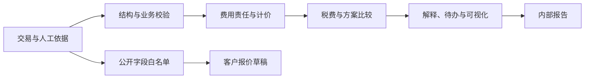

# COCUDTT · 国际贸易成本与贸易术语方案分析

面向外贸业务人员的本地测算工具：录入交易、合同报价与费用，查看费用承担依据、买方落地成本及可评估的卖方利润，比较不同 Incoterms® 2020 方案。项目由国际经济与贸易学习中的报价测算问题出发，近期重点是**中国一般贸易进口、单商品一票**。

**不登录、不上传交易数据。计算、项目文件与报告均在浏览器本机处理。**

> 本工具仅供学习与内部测算参考，不构成法律或专业贸易建议。实际合同请以 Incoterms® 官方文本及当地法规为准。

## 版本与入口

更新于 **2026-11-05**。本版本整合第101至127轮的源码、测试资料、文档与已验收离线工具。正式工具包含输入与移动面板修复；独立业务副本、恢复及组件组合仍为开发原型，尚未接入正式工具入口。完整回归所需的合成测试档案已随源码提供，不含真实交易或客户资料。

本地验收为175文件6,346项单测、45项浏览器断言及54项工程检查通过；本次同步未重跑测试，并跳过本次CI；后续结果以 [GitHub Actions](https://github.com/codeding-101/COCUDTT/actions/workflows/quality.yml) 为准。具体整合范围见[本次同步说明](docs/releases/phase127-publication.md)。

| 入口 | 内容与状态 |
|---|---|
| [在线演示](https://codeding-101.github.io/COCUDTT/) | 新手默认、专业功能保留的本地工作台体验版 |
| [`main` 分支](https://github.com/codeding-101/COCUDTT/tree/main) | 当前验收源码、离线工具、文档与测试 |
| [运输关联集成 PR #29](https://github.com/codeding-101/COCUDTT/pull/29) | 已合并main；贯通0.9、界面、文件与内部审计 |
| [项目说明页源码](https://github.com/codeding-101/COCUDTT/blob/main/project-introduction.html) | 产品工作流、设计取舍与能力边界，可与工具一起离线打开 |

日常试用可从[main下载源码 ZIP](https://github.com/codeding-101/COCUDTT/archive/refs/heads/main.zip)，解压后双击根目录的 `trade-cost-engine.html`。运行离线工具无需安装 Node.js；开发与构建时才需要。

首次进入新手工作台可先看四步引导；已有草稿或不自动显示时，从快速开始下方的“使用引导”重新打开。首次使用建议：载入“中国进口 · 合成示例”观察公式，再用“中国进口 · 开始录入”填写自己的数据。先录入交易与商品、报价与方案；通过“快捷修改主要运费与保险费”明确选定既有记录并修改原币金额，复杂费用仍在完整明细，汇率和税务在“高级设置”，摘要下可展开“读懂本次计算”，或查看完整计算过程。手机可通过“高级设置 · 费用、汇率与税务”进入独立全屏面板，完成后返回测算。专业模式展示全部原有功能；切换不改变业务数据。输入失焦或回车后重算，参考测算与业务确认状态分别提示。请定期另存项目JSON，浏览器草稿不是备份。

第六十二轮的[独立成分工作区](https://github.com/codeding-101/COCUDTT/blob/main/docs/fee-tax-attachment-workspace-validation.md)继续可用，入口是“高级设置 → 费用与税务成分 · 独立内部假设”。先在配对面板捕获当前完整修订，再创建附件、选择映射并明确取用原币事实；未提交编辑不进入导出，数据未知不补零，假设不写项目费用或税基。

第六十八轮的[精度工作台](https://github.com/codeding-101/COCUDTT/blob/main/docs/fee-precision-selection-workspace-validation.md)已接入，入口是“高级设置 → 精度与换汇政策 · 内部核对”。先提交完整配对及成分附件，再明确新建；原值/候选/差额、双来源失效、草稿恢复/冲突备份和内部审计保持，政策不写费用或税基。

第127轮完成[业务副本组合交接](docs/fee-business-modal-validation.md)：七个真实交易字段沿用原计算，保护未提交输入、File和未保存修改，关闭与保存分别确认。新增28项，完整6346项单测、21个原生状态/45项断言及54项工程检查通过，实际下载和重开资料核对通过。**本轮原型与合成测试资料已随本版本提供；独立业务副本尚未接入正式工具入口。**46套财务沿用同字节历史，本轮未重跑。下一步第128轮先补齐失效输入保全与重新载入，再扩展报价及付款表单；完整切换与正式安装分别验收。

<details>
<summary>历史开发记录与验收边界</summary>

历史（未发布本地候选）第126轮完成[受限组件组合](docs/fee-modal-composition-validation.md)：三个组件的查询、焦点和监听器分别管理，共享滚动锁；取消后等待实际模块/工厂结束，迟到句柄保留，失败只重试剩余资源。新增47项，完整6318单测、23个原生状态/50项断言及53项工程检查通过。**这是本地受限副本；原src和正式工具字节保持，main与公开网站未更新。**46套财务沿用同字节历史，本轮未重跑。下一步第127轮核对业务副本的输入/File交接、延后重绘和关闭保护，完整切换与最后单次安装继续单独验收。

历史（未发布本地候选）第125轮完成[移动面板异常恢复](docs/fee-modal-recovery-validation.md)：修复六项已知故障，保全宿主断开后重绘前的File，失败可明确重试。新增31项，完整6271项单测、真实72项检查、46套财务流程和52项工程检查全部通过。**本轮仍保留本地候选，main与公开网站未更新。**下一步第126轮验证受限会话组合及取消、迟到、项目替换和弹窗叠放；完整切换与最后单次安装仍单独验收。

历史（未发布本地候选）第124轮完成[费用输入与文件选择保全修复](docs/fee-input-preservation-validation.md)：无效费用现在显示可修正的字段错误，原文保留；同项目全局与局部刷新保留未交接File，折叠状态键盘导航恢复。新增79项，完整170文件6240项、原生27状态/38断言及新产物46套浏览器流程通过。**仍有6项模态故障待下一轮修复，完整切换与独立安装尚未完成。本轮为本地候选，main和网站保持原版本。**下一步补齐原生模态异常、占位与body样式冲突恢复。

历史（未发布本地候选）第123轮完成[移动端原表单与恢复契约盘点](docs/fee-mobile-settings-validation.md)：原168个控件、3个文件输入，23个原生状态、29项观测断言、3个布局；其中9项复现现存缺口，**均未修复**。完整169文件6161项按原配置通过，无新增单测。**本轮仅完成原行为验证，原src与正式工具不变，main和网站保持原版本。**下一步优先修无效费用、重绘文件选择与折叠键盘，再处理模态异常恢复。

历史（未发布本地候选）第122轮完成[受限会话启动与关闭验证](docs/fee-component-session-validation.md)：新增60项、完整169文件6161项按原配置通过；9组案例、41个原生状态和8组布局通过。实际加载未结束时继续等待，迟到句柄保留，失败只重试剩余资源，原文和原页面保留。**本轮为本地诊断候选，原src与正式工具字节保持，完整工作台切换仍未实现；main和公开网站保持原版本。**下一步核对移动端高级面板的节点迁移与滚动恢复。

历史（未发布本地候选）第121轮完成[首次引导与组件协作验证](docs/fee-onboarding-validation.md)：新增38项，完整168文件6101项按原配置通过；6组偏好案例、35个浏览器状态、四步原文和四宽度通过。副本不改原页面引导偏好，两个组件独立关闭，失败可明确重试。**这是本地诊断接入，原src与正式工具字节保持，完整工作台切换仍未实现；main和公开网站保持原版本。**下一步验证受限会话的启动、取消与组合清理。

历史（未发布本地候选）第120轮完成[字段说明独立实例验证](docs/fee-field-help-validation.md)：新增36项，完整167文件6063项按原配置通过；5组端口案例、22个浏览器状态、7类说明和四宽度通过。两个新实例独立操作，失败先静默并可明确重试，原页面继续输入计算。**这是本地诊断接入，原src与正式工具字节保持，完整切换仍未实现；main和公开网站保持原版本。**下一阶段验证首次引导组件及受限会话内的组件协作。

历史（未发布本地候选）第119轮稳定性收尾完成：[严格JSON校验与旧超时修复](docs/fee-json-stability-validation.md)。新增19项，完整166文件6027项按原双工作进程与超时全部通过；两项原5秒用例另连续三轮通过。20组Node/浏览器对照、9份原文摘要、16个资源状态及46套完整财务浏览器流程通过，正式离线工具保持原字节。**本轮仅启用Node/Vite SSR快路径，原应用整体解绑与完整切换仍未实现；main和公开网站保持原版本。**下一步接字段说明组件的隔离实例。

历史（未发布的119轮初版）第119轮开发中：[隔离资源所有权与失败保持](docs/fee-resource-owner-validation.md)。新增46项通过，原生16状态/四宽度通过；完整6008项为6005通过、3项旧用例超时、0跳过，**尚未通过全量验收，不具备发布资格**。资源停止后原文和原页面保留，异步清理实际结束前持续等待。先解决稳定性收尾，再推进现有组件接入。

历史（未发布本地候选）第118轮完成[诊断格式计量与原5秒复验（本地候选）](docs/fee-session-timing-validation.md)：合并字符串计量并去掉重复扫描，保留严格Unicode、原线格式和预算。新增16项、完整164文件5962项通过；两份旧测试连续三轮各101项按原双线程/原5秒通过。隔离浏览器26组新边界、39组旧接口、6组资源接口与30份线格式对照通过。**不宣称所有环境的耗时已稳定，完整切换与正式接入仍未实现，继续本地保留。**下一阶段验证真实资源解绑与失败保持。

历史（未发布本地候选）第117轮完成[控件证据预算与重复副本核对（本地候选）](docs/fee-workbench-retention-validation.md)：为控件、原文、选择状态和File引用设置独立逻辑预算，超限停止诊断并保留已有证据；仅明确清理与当前已提交数量完全相同的重复旧控件，未知和变动输入保持。新增69项、完整163文件5946项，25个原生状态及4宽度通过；同时修复来源初次核对重入覆盖风险，原配置完整复验通过。**这些预算不是浏览器总内存上限，完整切换与正式接入仍未实现，继续本地保留。**下一阶段先定位原5秒旧测试的时间敏感性，再验证隔离root的资源所有权与解绑。

历史（未发布本地候选）第116轮完成[交接前核对与分项已提交文本保全（本地候选）](docs/fee-workbench-handoff-validation.md)：逐份明确选择已提交来源，下载与用户检查不改原保存证据、不清除待核对输入；取消后的迟到结果不能复用旧确认。新增52项、完整162文件5877项，26个原生状态、3份实际下载及4宽度通过。**六类分项文件不等于完整工作台备份，完整切换与正式接入仍未实现，继续本地保留。**下一阶段先验证控件证据保留上限与退役，再做隔离安装。

历史（未发布本地候选）第115轮完成[输入与变动边界补强（本地候选）](docs/fee-workbench-boundaries-validation.md)：40个方法入口、43处集合调用补上登记缓存引用和集合变动通知；未提交输入移出页面后仍保留待核对。新增39项、完整161文件5825项，25个原生浏览器状态及4宽度通过，退出诊断后原表单可继续编辑。**初始保存证据、完整新鲜性及切换仍未核实或授权，继续本地保留。**下一阶段明确剩余边界与受限交接/安装契约。

历史（未发布本地候选）第114轮完成[真实工作台状态与资源观测（本地候选）](docs/fee-workbench-observation-validation.md)：五个未绑定控制器的32字段、40方法入口及23处资源调用可在专用页面观测；改动后改回会撤销旧检查，撤销观测保留原应用和资源。新增44项、完整160文件5786项，32个真实浏览器状态及4宽度通过；首次两个原用例超时，原配置完整复验通过。**完整新鲜性与切换仍未授权，继续本地保留。**下一阶段补嵌套/缓存引用、DOM缓冲及资源自动移除等缺口。

历史（未发布本地候选）第113轮完成[独立会话生命周期与关闭保护（本地候选）](docs/fee-session-lifecycle-validation.md)：关闭前检查未提交、未交接及未接收文字，放弃须重新明确确认；取消任务后等待实际结束再关闭。原生离开提醒按需绑定，关闭后移除本面板监听器及下载URL。新增41项、完整159文件5742项，50个真实浏览器状态、2份实际下载和4宽度通过。**尚未接入正式工具，继续本地保留。**下一阶段补真实工作台订阅与资源清单，再验证安全切换。

历史（未发布本地候选）第112轮完成[独立敏感性与客户公开字段（本地候选）](docs/fee-trade-forms-validation.md)：可按原模型分析运费、汇率和待确认责任；十一项公开字段独立录入，新核对后导出完整/简洁版HTML、Excel和PDF。内部银行费、资金与来源资料不自动带入客户文件。完整内部文件0.2保全输入，旧0.1兼容、客户核对不继承。新增60项、完整158文件5701项，72个真实浏览器状态、4完整/2分项/6客户下载和4宽度通过。**尚未接入正式工具，继续本地保留。**下一阶段验证真实生命周期、未提交输入与安全关闭/切换。

历史（未发布本地候选）第111轮完成[独立银行费与固定本金资金假设（本地候选）](docs/fee-bank-funding-validation.md)：银行费可逐笔明确来源、付款方和承担方；固定本金单利由用户独立填写本金、利率、期间及基准，复用原计算。未设置、不建模和零利率分别提示，资金成本不自动扣入利润或税基。输入沿原草稿保护与完整文件交接，重开后保留全部来源、原输入和既有备份。新增58项、完整157文件5641项，54个真实浏览器状态和4宽度通过。**尚未接入正式工具；本轮只编辑1.1，高级版本保全但只读。**下一阶段补敏感性与客户公开字段，再做生命周期及关闭保护。

历史（未发布本地候选）第110轮完成[独立实际报价与付款完整交接（本地候选）](docs/fee-contract-settlement-validation.md)：可在独立副本中录入当前术语合同报价与付款计划，沿原校验和引擎计算；报价改变后须明确核对付款绑定，未完成计划可保留为草稿。完整文件保存来源历史、原输入和既有备份，重开后可继续编辑；计划净收付不等于利润或实际到账。新增44项、完整156文件5583项，41个真实浏览器状态、4份完整下载和4宽度通过。**尚未接入正式工具。**下一阶段先补银行费和资金假设录入，再做敏感性/客户字段及生命周期保护。

历史（未发布本地候选）第109轮完成[完整工作台切换前盘点与只读检查（本地候选）](docs/fee-workbench-switch-validation.md)：新增30项，完整155文件5539项；源码解析盘点15组状态与192个字段（10组已绑定160个字段、5组未绑定32个字段），另列3组全局集合及监听器、定时器与对象URL位置。真实工作台挂载只读检查，按未保存、未提交、进行中和未知状态列出阻断，未知保存证据不当作已备份。5组Node/浏览器案例、17个真实界面状态及4宽度通过；数量、零汇率、客户、付款、敏感性、弹层及原生重新检查均覆盖，检查前后原业务、页面和存储保持。关闭诊断后原表单仍可使用。**只读切换前检查已实现；完整表单迁移、监听器解绑/重绑、关闭保护、完整工作台切换及正式接入尚未实现。**复制或跨检查器的报告无当前观测身份，已绑定根ABA会失效；未绑定状态在两次观测间变化后又变回仍不能识别，明确保留订阅缺口，不把安静状态当切换授权。第108轮841文件候选已冻结，旧快照保持，第101至109轮均未更新main或网站。原财税、依赖、格式与离线运行字节保持，46套完整财务浏览器及1/4/8沿用历史，本轮未重跑，不宣称容量、性能或峰值内存改善。下一阶段先扩展独立实际报价和付款表单，逐项复用原校验并贯通未保存保护及完整交接；生命周期与多次费用备份分别验证。

历史（未发布本地候选）第108轮完成[最小独立编辑与完整继续交接（本地候选）](docs/fee-package-continuation-validation.md)：新增50项，完整154文件5509项；在新的独立业务副本中复用七个最小交易字段、原校验和原引擎，明确同步后追加来源记录，再下载完整继续交接文件并重新打开。原输入全文、继承来源记录和既有应用备份均完整保留，新记录不从零计数。3组轻量Node/浏览器案例、34个真实界面状态、4份实际完整下载、1份分项项目下载及4种宽度通过；连续两次编辑、下载和原生文件选择重开逐字核对，Node独立解压与原协议对照通过。浏览器发起下载不冒充保存完成，须明确检查并确认；有未交接修改时阻止另开资料，部分下载不清除待保存。大资料超限在来源覆盖前拒绝，交易修改仍保留。**最小独立编辑与再次完整交接已实现；新费用批次、完整表单、工作台切换及正式接入继续后置。**新增继续载体0.1完整嵌入上一份输入，旧内部包0.1及旧格式不改；原64 MiB包、64条／64 MiB历史限制保持，新增载体限64 MiB编码体、256 MiB累计展开链和16层。第107轮829文件候选已冻结，旧快照保持，第101至108轮均未更新main或网站。原财税、依赖和离线运行字节保持；46套完整财务浏览器及1/4/8沿用历史，本轮未重跑，不宣称容量、性能或峰值内存改善。下一阶段先盘点完整工作台持有者、未保存输入与安全切换条件，多次费用备份另行设计。

历史（未发布本地候选）第107轮完成[完整包独立已提交资料会话（本地候选）](docs/fee-package-session-validation.md)：本地新增36项，完整153文件5459项；从完整包内最新五类来源与当前封套重建十组全新持有者，原引擎和对比重新计算，当前六份来源逐字核对。原完整包、原始档案、全部来源记录及应用备份另槽完整保全；历史未知、消费与退休编号保持。6组Node/浏览器案例、21真实状态、5份完整来源及原协议对照、原生文件选择/声明/明确打开和4宽度通过。坏文件、取消、迟到、ABA及安装失败保留旧会话，成功后的显示失败不回滚。旧草稿、坏数字、未读文件、付款/敏感性/客户表单和旧确认只存档，不装作当前事实；各子文件保存状态未知。**最新已提交资料的独立重建已实现；继续编辑、再次完整交接、完整工作台切换及正式接入尚未实现。**第106轮818文件候选已冻结，旧快照保持；第101至107轮均未更新main或网站。原财税、格式、依赖、原业务模块和离线运行字节保持；46套完整财务浏览器及1/4/8沿用历史，本轮未重跑，不宣称性能、峰值内存或容量改善。下一阶段把完整历史接到可编辑独立副本，再验证来源追加与再次交接，不将历史从零开始或仅留最后一次备份。

历史（未发布本地候选）第106轮完成[完整内部项目包与独立只读打开（本地候选）](docs/fee-recovery-package-validation.md)：本地新增70项，完整152文件5423项；完整内部JSON包0.1包含当前项目/封套、原恢复档案、全部来源同步记录和本副本的新应用备份。原四/五文件原文不改；逐项重算来源指纹、待办与连续历史，旧候选及补丁不执行。6组Node/浏览器案例、25个真实状态、4份实际下载并经原生文件选择只读打开、4种宽度通过；文件损坏、取消、写入失败、迟到及交付后显示失败保留当前项目与旧只读视图。包限64 MiB、最多64条来源更新及本副本0或1次新应用，超限拒绝不截历史；SHA仅表明完整性，浏览器发起下载不冒充操作系统保存完成。**完整来源记录交接与独立只读打开已实现；继续编辑、完整工作台重开和正式接入尚未实现。**第105轮807文件候选已冻结，旧快照保持；第101至106轮均未更新main或网站。原规则、格式、依赖、运行字节和4/8限制保持；46套财务浏览器及1/4/8沿用历史，本轮未重跑，不宣称性能或峰值内存改善。下一阶段先设计完整包中新建独立业务会话，保留连续历史，再补齐完整表单与切换保护。

历史（未发布本地候选）第105轮完成[重录来源核对与明确同步（本地候选）](docs/fee-recovery-reconcile-validation.md)：本地新增41项，完整151文件5353项；五类来源差异须明确选择，原封套接口完整验证后展示前后指纹、回执及退休编号和仍未解决的待办。勾选声明、明确确认时重新准备，原捕获预算预检后一次替换封套控制器/工作区/workflow三个参与者；项目、费用、回执、原文及应用备份保持。8组Node/浏览器案例、24个真实状态、3份原协议对照及4宽度通过；准备/确认期间取消、ABA、迟到、部分失败和更新后显示失败保持。全部来源更新记录保留，独立限制64条/64 MiB；不重绑配对或清除历史未知，不批准客户报价。另修正只读实际报价标签，原取值与计算不变。**来源同步已实现，完整更新记录交接、真实新下载、完整重开及原工作台接入尚未实现。**第104轮796文件候选已冻结，旧快照保持；第101至105轮均未更新main或网站。原规则、格式、依赖、运行字节及4/8限制保持；46套财务浏览器及1/4/8沿用历史，本轮未重跑，不宣称性能或峰值内存改善。下一阶段先交接全部来源更新记录与当前文件、原档案及应用备份，再验证下载、取消及重新打开的边界。

历史（未发布本地候选）第104轮完成[独立业务最小表单与原校验重录（本地候选）](docs/fee-recovery-trade-validation.md)：本地新增42项，完整150文件5312项；第二组真实业务持有者内的七个交易/报价字段可重新录入，原项目校验与原单场景/对比引擎重算，一次替换两个参与者。固定报价金额可编辑，实际独立报价及目标基准保持只读；数量变化不自动缩放整笔报价或费用。失焦、回车、明确提交及逐项错误定位均操作真实表单；无效输入保留、隐藏旧结果并阻断费用准备、交接和客户报价。8组Node/浏览器案例、20状态、3份原协议对照、4宽度和两个同名独立面板通过，320px长金额显示已修正。输入ABA/放弃不复活旧费用或客户确认，失败保持、原来源/未知扩展及应用历史保留。**最小业务表单已实现，完整重录后封套交接、原表单全覆盖、工作台切换及正式接入尚未实现。**第103轮786文件候选已冻结，旧快照保持；第101至104轮均未更新main或网站。原规则、格式、依赖、运行字节和4/8限制保持；46套完整财务浏览器和1/4/8沿用同字节历史，本轮未重跑，不宣称性能或峰值内存改善。首次完整执行有一项原用例超时，保留失败；原限时/两工作线程完整复验通过，未放宽门槛。下一阶段先明确核对重录项目与原封套差异，再交接整套文件。

历史（未发布本地候选）第103轮完成[独立显示与重新录入指引（本地候选）](docs/fee-recovery-preferences-validation.md)：本地新增46项，完整149文件5270项；新手/专业模式、面板收起及证据展开分别明确选择，候选不自动安装，只有新的确认才一次替换独立显示根。未知标识只归档，全未知组保持当前设置，冲突整份拒绝；手动显示编辑和归档切换ABA撤销旧候选。8组Node/浏览器案例及原7组阅读案例一致，16个独立显示状态、3份原协议对照、4宽度与2个实际说明焦点通过。草稿只生成重新录入说明，坏数字/未读文件和客户核对仍未解决；不回填金额、不拼接归档选择器。**这是独立显示结构和说明，不含原业务表单；实际工作台导航、完整重开和正式接入尚未实现。**原财税、格式、依赖、运行字节和4/8限制保持。第102轮776文件候选已完整冻结保存，第101轮旧快照保持，两轮之后继续不上传档案、不更新main或网站。46套完整财务浏览器及1/4/8容量沿用同字节历史，本轮未重跑，不宣称性能、峰值内存或专业验收。下一阶段先验证独立业务副本的最小交易/报价视图及按原校验重新录入，再扩展完整视图和实际切换。

历史（未发布本地候选）第102轮完成[恢复资料逐项核对（本地候选）](docs/fee-recovery-review-validation.md)：本地新增45项，完整148文件5224项；独立清单逐项区分已提交资料、草稿重新录入、坏数字/未读文件、显示偏好、历史、旧执行资格及未知字段。7组Node/浏览器案例一致，16个独立面板状态、3份原Node协议对照与4种宽度通过。双原文摘要与私有选择绑定来源，取消/失败保留旧资料，明确切换清空旧阅读，上下文ABA撤销。全部条目已阅读也不能清除重新输入要求、应用费用或批准客户报价。**这是独立只读核对原型，不安装界面偏好、不接管原工作台；完整工作台重开尚未实现。**原HTML只显示转义文字，完整归档保持，界面预览有单独限额。第101轮候选已完整冻结保留；两轮均未更新main或公开网站。原财税、格式、依赖、运行字节及4/8限制保持；46套完整财务浏览器和1/4/8容量沿用同版本历史，本轮未重跑，不宣称性能、峰值内存或专业验收。下一阶段先做显示偏好的独立明确安装与重新输入定位，再验证完整切换。

历史（未发布本地候选）第101轮完成[恢复后独立业务与交接验证](https://github.com/codeding-101/COCUDTT/blob/main/docs/fee-recovery-business-validation.md)：新增31项，完整147文件5179项；明确打开原恢复档案后，第二组独立业务持有者重新生成真实预览与十组候选，以新的核对声明和确认通过原准备器一次提交。5组Node/浏览器检查一致，12个页面状态、六份真实下载、两组独立文件核对与4种宽度通过；新副本3→4费用、0→1回执，原工作台与原只读会话保持，重复提交拒绝。原档案source_wire/supplement_json逐字保留，正式项目/封套、新应用备份和完整性清单分别交接；五文件不是可自动重开的完整新工作台格式。客户从空白字段和新核对开始，应用后必须再次确认，内部标记与原客户资料不进入客户HTML。**这是独立业务延续原型，尚未接入正式工具，完整工作台重开尚未实现。**取消或应用后保存取消不重复计费；原财税、格式、运行字节及4/8限制保持。46套完整业务沿用同版本历史，本轮未重跑，也未重测1/4/8容量、性能或峰值内存。下一轮先核对未提交资料和界面状态，验证安全切换与失败保留后，再决定正式接入。

历史第100轮完成[恢复清单与独立会话验证](https://github.com/codeding-101/COCUDTT/blob/main/docs/fee-recovery-reopen-validation.md)：新增32项，完整146文件5148项；恢复清单与独立已提交资料会话原型使用五类现有控制器、十组新所有者，六来源、原汇率及文件证据逐项重建，并以原引擎重新计算。4组Node/浏览器检查一致，15个实际页面状态、3份原Node协议对照、4种屏幕宽度通过。取消、坏文件、迟到、旧身份、ABA、部分准备失败和重复恢复保持当前会话；已应用4费用/1回执不重复，恢复零费用写入。未提交输入阻断，无效数字/未读取文件须重新输入或选取。**这是独立核对原型，尚未接入正式工具，完整工作台重开尚未实现。**旧候选/补丁/客户确认只归档，原财税、文件、运行字节与4/8限制保持；46套完整业务沿用同版本历史，本轮未重跑，也未重测1/4/8容量、性能或峰值内存。下一轮先验证恢复后的完整业务链路、正式交接与客户隔离，再决定接入。

历史第九十九轮完成[补充原文共享验证与不接入结论](https://github.com/codeding-101/COCUDTT/blob/main/docs/fee-recovery-sharing-validation.md)：新增44项，完整145文件5116项；19项Node/浏览器检查一致，两份隔离表示逐字一致，5份实际补充表示经独立Node解码完整对应，原来源编码另经未改动Node协议逐字核对。4个页面状态及原1/4/8资料实测：候选补充中间表示减少5,411,554字节，gzip文本体减少329,472字节；基础、正式采用及已应用资料的未压缩表示反而更大。完整候选仍为143,014,394字节，超过128 MiB，原恢复方式继续拒绝，4/8也保持原限制。**不将此方案作为容量修复接入；完整工作台重开仍未实现。**原文、未知历史、费用/回执和客户确认保持，测量零费用写入；原UI仅建立一个合成历史批次。原128/256/64 MiB预算分别保持，原财税、文件与运行字节保持；46套完整业务沿用同版本历史，本轮未重跑，不宣称生产性能或峰值内存改善。下一阶段优先为已能完整保全的小规模资料接恢复入口与安静安装，完整业务链路通过后再考虑运行接入。

历史第九十八轮完成[恢复数据格式与独立还原器](https://github.com/codeding-101/COCUDTT/blob/main/docs/fee-recovery-format-validation.md)：新增54项，完整144文件5072项；16项隔离浏览器检查与Node一致，两份隔离及四份实际页面编码经原Node协议逐字核对。15个页面状态中14个完整恢复至独立数据容器，待确认候选含全部备份达143,014,394字节，超过128 MiB明确拒绝且原工作台保持；未删历史或放宽预算。已应用历史完整恢复和重复恢复保持4笔费用/1回执，恢复零费用写入，未知利润仍为null。原1/4/8资料重跑，4/8仍按原预算拒绝。**尚未接入正式工具，完整工作台重开尚未实现。**浏览器无效数字缓冲与未读取文件内容要求重新输入。原财税、文件与运行字节保持，46套完整业务沿用同版本历史，本轮未重跑，不宣称容量、耗时或峰值内存改善。下一阶段先处理完整候选超限，再验证运行适配、安静安装、完整业务链路和实际收益。

历史第九十七轮完成[独立浏览器原生编解码器](https://github.com/codeding-101/COCUDTT/blob/main/docs/fee-browser-native-validation.md)：新增65项，完整142文件5018项；不依赖源码文本变换，10份隔离编码和3份实际工作台编码与未改动Node原协议逐字一致。原69个复杂/运行场景重跑，52份完整捕获相同；39项接口契约和6组有界资源检查通过，每组40次重叠请求均拒绝，底层任务结束后才释放同实例工作槽。原1/4/8资料重跑：1笔还原并准备十组候选，4笔完整捕获、8笔保留根继续按原预算拒绝，未应用费用。**原生模块尚未接入正式工具，完整工作台重开尚未实现。**原财税、文件和运行字节保持；46套完整业务流程沿用同版本历史，本轮未重跑，不宣称容量、耗时或峰值内存改善。下一阶段实现完整恢复格式与独立还原器，先验证原文/历史、防重复和失败保留，再依据完整链路与实际收益决定接入。

历史第九十六轮完成[浏览器异步接口契约与恢复策略](https://github.com/codeding-101/COCUDTT/blob/main/docs/fee-browser-recovery-validation.md)：新增81项，完整140文件4953项；三个异步阶段的及时取消、ABA、迟到异常、重入和私有观察分别验证。隔离浏览器39场景与Node逐项一致，10份编码经原Node解码再编码逐字核对。六类源文件只作分项保全，生成/下载/写入确认均不能当作完整重开；128/256/48/64/5 MiB五个不同上限分别列明。**独立浏览器原生编解码器及完整工作台重开均未实现，尚未接入正式工具。**原计算、文件格式和离线工具字节保持；原69场景、46套完整业务和1/4/8观察沿用固定历史证据，本轮未重跑，也不宣称容量或性能改善。下一阶段先实现独立原生编解码器并按本契约验证，再决定接入。

历史第九十五轮完成[真实页面只读分层映射](https://github.com/codeding-101/COCUDTT/blob/main/docs/fee-layered-source-mapping-validation.md)：69个原复杂/运行场景重新对照，52份完整捕获逐字一致；新增67项，完整138文件4872项。实际浏览器与Node原协议的三份编码逐字一致，私有身份、A→B→A和取消后迟到读取分别验证。原1/4/8资料同条件复测：1笔还原后完成十组候选准备，4笔完整捕获、8笔保留根仍超原预算，均未继续编码或准备。首次8笔诊断通信超时独立保留，成功重验不证明其唯一原因。**尚未接入正式工具，不宣称容量、耗时或峰值内存改善。**原生产源码、财税规则与离线工具字节保持；46套完整业务流程沿用第九十三轮同版本证据，本轮未重跑。下一阶段先设计浏览器原生接口、异步失效与大资料备份/恢复策略，再依据完整证据决定接入。

另完成[fast-uri开发依赖最小安全补丁](docs/fast-uri-patch-validation.md)：只将Ajv的传递包3.1.8更新至3.1.9，在线审计恢复0项；完整测试和本轮69场景、1/4/8观察在补丁环境重新运行，原应用依赖与离线工具字节保持。

历史第九十四轮完成[分层捕获独立协议0.1](https://github.com/codeding-101/COCUDTT/blob/main/docs/fee-layered-capture-validation.md)：序列化前区分规范保留根与完整捕获外壳，共享完整原文，持有者、未提交状态与私有身份保持。新增85项，完整135文件4805项；22个独立诊断场景核对实际128 MiB、300000节点、坏引用、ABA、迟到读取与真实十组候选准备。**尚未接入正式工具，不宣称容量或性能提升。**原运行字节保持，46套浏览器及69捕获沿用第九十三轮同版本证据，本轮未重跑。下一阶段先验证真实页面只读映射与69场景，再复测1/4/8资料。

历史第九十三轮完成[完整检查失败后的源文件指引](https://github.com/codeding-101/COCUDTT/blob/main/docs/fee-save-guidance-validation.md)：区分检查未完成、备份未生成、另存取消与保存未确认；六个按钮只定位原另存入口。六类JSON不等于完整工作台备份，未提交输入仍须自行保留；迟到保存不覆盖新状态，原费用/回执与客户确认保持。新增27项，完整132文件4720项；15项原生检查、8组布局与24次正式另存通过，原46套完整流程和69个捕获场景在新产物重跑。**原大资料容量限制保持，不宣称提速。**下一轮先设计分层捕获、原文引用及语义预算，独立验证可逆性、ABA与恢复等价后再考虑接入。

历史第九十二轮完成[1/4/8笔分阶段容量复测](https://github.com/codeding-101/COCUDTT/blob/main/docs/fee-capacity-stages-validation.md)：1笔原预览、十组候选及完整备份通过；4笔完整捕获225.7 MB超限，8笔保留语义根284.3 MB超限。原工作台备份同样受限，六类正式源文件共18次另存逐字节核对通过，费用、回执和客户确认保持。新增34项，完整131文件4693项；原运行产物保持，46套完整浏览器证据沿用第九十一轮同字节结果，本轮未重跑。**容量限制尚未解决，不宣称提速。**下一轮先改善超限后的明确另存指引，再验证分层捕获和原文引用的等价性与预算。

历史第九十一轮完成[只读语义捕获接入与完整流程复验](https://github.com/codeding-101/COCUDTT/blob/main/docs/fee-semantic-integration-validation.md)：正式工作台显式读取十组生产者，原文件、未提交状态、业务资格、历史和完整128 MiB预算保持。新增45项，完整130文件4659项；69个捕获场景中52份完整捕获与独立历史实现一致，四个旧反例保持关闭。全部46套原生浏览器流程在新产物重跑，覆盖预览、最新代次重准备、一次根替换、重复提交防护、提交后恢复、正式文件交接、客户隔离与窄屏。**原4/8笔容量仍受限，本轮不宣称提速或容量提升。**旧0.1/0.2矩阵原样保留，CI分别核对历史资格与当前接入。下一轮用同夹具复测1/4/8笔，分别记录捕获、准备、备份及失败原因。

历史第九十轮完成[来源语义预算0.2与反例关闭](https://github.com/codeding-101/COCUDTT/blob/main/docs/fee-semantic-budget-validation.md)：新增45项，完整128文件4614项；69个真实浏览器场景中52份完整捕获逐字一致，四个旧普通JSON反例全部关闭，14种不支持JS对象及原超深/超节点仍拒绝。复合快照的多层转义、中文/emoji实际128 MiB边界通过。**新原型仍独立，正式工具继续原捕获；原4/8笔容量限制保持。**旧0.1矩阵与反例原样保留，CI核对新旧证据及生产隔离。下一阶段接只读捕获并复验完整预览、候选、确认提交及恢复，再做同条件1/4/8测量。 另完成[Vitest5.0.3最小安全补丁](https://github.com/codeding-101/COCUDTT/blob/main/docs/vitest-patch-validation.md)：实际审计0项，旧42/新69场景在补丁环境重跑；CI审计门槛覆盖中风险告警。

历史第八十九轮完成[来源适配兼容矩阵与CI门槛](https://github.com/codeding-101/COCUDTT/blob/main/docs/fee-source-compatibility-validation.md)：新增37项，完整126文件4569项通过；42个真实浏览器场景分开核对原捕获、原保留解析、新帧和重建，21个完整捕获相同，确认4个普通JSON边界反例。实际128 MiB的ASCII/中文UTF8、300000节点和32深度均验证。**正式工具继续原捕获，新适配不接入；原4/8笔容量限制保持。**CI检查反例、源指纹和生产隔离，诊断不提供交易就绪、来源采用或确认资格。下一步先对齐语义预算并关闭四例，再分步只读接入。

历史第八十八轮完成[真实页面来源字段与独立适配模块](https://github.com/codeding-101/COCUDTT/blob/main/docs/fee-source-adapter-validation.md)：明确九个根字段和二十项保留数据；显式投影DOM未提交控件、十键存储可用性、FX行/保留books与文件证据，不展开真实workflow中的DOM引用。新增47项，完整124文件4532项通过；27个真实浏览器场景中新适配与原app完整捕获逐字一致，含原界面采用完整合成资料后的比较。**新模块未接入运行工具，不宣称全输入等价、提速或容量改善，原4/8笔场景仍受限。**下一步补复杂扩展/节点深度的兼容矩阵，再分步接入只读捕获。

历史第八十七轮完成[生产者只读来源视图设计与独立验证](https://github.com/codeding-101/COCUDTT/blob/main/docs/fee-source-view-validation.md)：开发夹具按十组明确投影返回原文、文件证据、未提交状态与读代次，不解析不透明retained_json来猜结构；冻结诊断视图的私有有效性留在会话，JSON副本、A→B→A及取消后迟到读取均验证。新增40项，完整122文件4485项通过。新诊断协议1/4笔可完整还原，8笔超原128 MiB预算；**尚未证明与旧总捕获等价，正式工具4/8笔仍受限，原型未接入运行工具。**下一阶段逐项核对真实页面字段、DOM未提交输入和存储失败，再实现独立适配。

历史第八十六轮完成[原文共享独立设计与原型](https://github.com/codeding-101/COCUDTT/blob/main/docs/fee-text-sharing-validation.md)：明确原文、文件证据、未提交输入、读取代次及私有签发身份分别保留；开发侧扁平节点仅共享相同整串文本，逐字还原、坏引用/循环/别名、展开预算和取消后迟到读取均验证。新增63项，完整120文件4445项通过。单笔合成捕获编码约32.5→29.4 MB，减少约9.5%，仅是原型编码字节；**128 MiB还原预算保持，4/8笔仍受限，原型未接入运行工具。**下一阶段先设计生产者的显式只读来源视图及预算，不把相同摘要或解码结果当成来源、确认或恢复权限。

第八十六轮完成[Vite开发依赖最小安全补丁](https://github.com/codeding-101/COCUDTT/blob/main/docs/dependency-patch-validation.md)：锁定7.3.7，仅升级一项包；审计恢复0项漏洞，重建离线工具逐字节保持，补丁环境重新回归。

历史第八十五轮完成[大资料性能基线](https://github.com/codeding-101/COCUDTT/blob/main/docs/fee-performance-baseline-validation.md)：新增可复现的1/4/8笔合成测量工具，分别记录原文字节、首次计时与三次重复样本。独立控制器中1笔可完成预览和十组准备，4/8笔的完整状态预计约199.6/637.7 MB，超过既有128 MiB保护；真实离线页面同样拒绝4/8笔完整检查，费用、回执保持。**这是已确认的容量限制，尚未优化解决。**新增27项工具正确性检查，完整118文件4382项通过；原工具产物字节保持，本轮浏览器测量与上一轮46套同版本回归分别列明。下一阶段先设计可逆的内部原文共享与失效边界，再验证接入，不放宽大小或财务门槛。

历史第八十四轮完成[应用后新记录与再次报价](https://github.com/codeding-101/COCUDTT/blob/main/docs/post-application-requote-validation.md)：应用后五步交接说明与完整连续验收：显式删除悬空成分和政策、新增不同编号记录、分别重新确认；再确认已有费用引用时只新增引用回执，不重复增加费用，原回执、退休编号及未知利润保留。六类正式JSON和客户HTML、Excel、PDF的实际下载、原输入重新打开及客户重新确认见本轮记录。新增5项，完整117文件4355项测试、46套浏览器回归通过；下一阶段先测量大资料的捕获、校验、重绘与备份成本，再按证据整理状态，不扩大财税规则。

历史第八十三轮完成[合成练习资料与应用后连续核对](https://github.com/codeding-101/COCUDTT/blob/main/docs/fee-workflow-exercises-validation.md)：八步导航可下载三组独立合成ZIP，包含18份正式JSON、说明题与指纹清单。来源EXAMPLE、成分UNKNOWN、政策UNRESOLVED，封套历史未知且无回执，下载及打开不提供费用批准。实际应用后的已有引用、退休映射及两份附件重绑已补验：旧确认撤销，旧目标保持悬空，费用、原回执和恢复备份保持。新增12项，完整116文件4350项通过；浏览器及发布证据见本轮记录。下一阶段补显式新记录与再次报价闭环，继续保持原财务门槛。

历史第八十二轮完成[费用工作流导航与应用后交接说明](https://github.com/codeding-101/COCUDTT/blob/main/docs/fee-workflow-guide-validation.md)：八步定位账单、配对、成分、精度、封套、整批确认、文件保存和客户重新报价，复用原完整预览显示具体待办；已有原文不当作核对通过，资料变化立即清除旧检查状态。六类文件逐字原文证据、最近应用历史提醒和113 USD合成手算分别说明，不自动重绑或提供来源/客户确认。新增17项，完整114文件4338项通过；原生浏览器及发布证据见本轮记录。下一阶段补可下载练习资料与应用后显式修订/引用/重绑连续验证，继续保持财务门槛。

历史第八十一轮完成[明确整批应用与提交后恢复](https://github.com/codeding-101/COCUDTT/blob/main/docs/runtime-fee-application-validation.md)：预览、勾选核对声明与最终确认分别执行；确认时重验来源、重算结果并按最新代次准备十组状态，一次写入费用与一份回执。纯引用不增费，原配对/成分/精度保留历史，客户旧确认撤销；缓存冲突、显示失败或另存取消不回滚已应用事实。正常面板与错误恢复页均可另存完整应用备份，项目/封套仍须分别保存。新增41项，完整113文件4321项通过；原生浏览器与发布验收见本轮记录。下一阶段完善从账单到客户重新报价的完整合成引导和应用后交接，不扩大未知历史、抵扣、海关或精度边界。

历史第八十轮完成[完整运行候选与文件保存证据](https://github.com/codeding-101/COCUDTT/blob/main/docs/runtime-fee-candidate-validation.md)：真实十组状态的字段、取消代次、费用与回执及派生结果一并准备，实际引擎重算并显示当前/候选利润与买方总支付；当前工作台保持。六类文件保留可核实的原文和保存信息，未知文件名保持null；下载发起保留dirty，保存等待阻断候选，迟到保存不能覆盖新文件事实。完整备份采用逐字原文与明确共享引用，超过64MiB整份拒绝、不截断资料。新增25项，完整111文件4280项授权回归通过；完整42套原生浏览器回归通过，候选流程34项/四种宽度与三份实际下载通过，上一公开版两种版式六份客户文件逐字节一致。实际费用入口继续关闭，下一步明确整批确认、最新代次重准备、一次根替换和提交后恢复。

</details>

## 解决什么问题

外贸报价测算常把费用承担、货损风险、付款安排和海关计税混在一起，也容易漏掉未知费用、失效汇率或不同方案的运价差异。本项目把这些问题分别记录，给出可追溯的计算过程和待核对事项。

- 比较同一笔交易的不同术语、实际合同报价与运输费用。
- 查看逐笔费用由谁承担、命中什么规则、为何计入或排除。
- 核对中国进口计税输入、海关汇率有效期及支持范围内的税费计算。
- 将内部成本资料与客户报价说明分开导出。
- 在独立副本上做假设分析，保留原交易和原确认记录。

**稳优先的原则：**未知不补零，付款不推定风险转移，运费终点不代替交货点，软件检查通过不等于专业或真实业务认证。

## main开发版已实现的能力

| 能力 | 当前支持范围 |
|---|---|
| 最近项目 | 手动加入的完整内部项目快照、最多3份，打开/删除/清空分别确认，原文备份；同浏览器同来源，非自动历史或文件备份 |
| 固定合成演示 | 可离线打开的双汇率教学、固定项目下载、四组独立金额与待办核对；不是实际税率或业务认证 |
| 新手／专业工作台 | 四步首次使用引导、核心字段、逐笔运保费快捷录入、七类字段帮助、原币/汇率/汇总教学展示、手机全屏高级设置、只读精度/单位提醒、当前结果摘要、输入待更新及错误定位；切换不改业务数据 |
| 术语与方案比较 | 11 种术语、六种计价方式、逐术语实际报价及原有模拟基准 |
| 费用与运输 | 适用术语、互斥运价组、合同承担约定；运输分段、交货点与运费终点分别记录 |
| 保险与集装箱提醒 | CIF/CIP 保障资料、保额及范围核对；THC、demurrage、detention、查验等费用预设和提醒 |
| 集装箱账单 | 独立面板录入箱组/日历日/免费期/阶梯、来源核对及已有费用只读引用；逐日/逐阶审计，联合/分开候选保留 |
| 配对交接与提案编辑 | 项目/账单完整打开/另存、实时失配、独立快照恢复；明确编辑新建提案、来源确认与失效，不写成本 |
| 新业务副本 | 明确接受复制范围，生成并另存独立配对；重建资料/提案/映射身份、撤销已知确认，旧输入待复核，原业务保留 |
| 费用边界核对 | 页面展示原币金额、跨标签箱日覆盖和税务/精度待办；原提案与费用保持 |
| 核对记录与交接 | 明确启用配对1.1、五类受限假设、来源确认/失效、编辑草稿/恢复、内部导出及合成体验入口；不清除原待办 |
| 集装箱账单文件层 | 独立草稿JSON 1.0打开/另存、Schema/两模板下载、独立自动草稿和恢复备份；内部HTML/Excel记录快照，不自动纳入费用 |
| 中国进口 | 独立申报日期、人民币计税、海关汇率适用期、支持范围内的税基和税款舍入；资格及来源待核对 |
| 解释与可视化 | 费用推理链、真实替值公式、去重依据、运输风险流程及费用/税基图 |
| 假设分析 | 运费、商业/海关汇率及未决费用承担，显示相对基准变化 |
| 客户交付 | 公开字段预览，HTML、原生 Excel、可检索 PDF 报价草稿及固定中英文条款摘要 |
| 内部存档 | HTML/Excel 计算假设摘要、成本、方案、公式、来源及输入快照；付款和资金假设单独保存 |
| 付款与资金假设 | TT/L/C/OA 原币分期对账、银行费关联；恒定/显式变动本金、日期、固定/显式变动利率及计息基准的单利假设；金额舍入及明确计息归集期独立输入与审计 |
| 文件与恢复 | 标准 JSON、离线 Schema、六种项目模板及逐项预设说明；输入修正及关联面板定位、启动/渲染/操作异常恢复、本地恢复备份只读检查 |

资金假设区分融资利息与机会成本，结果独立于经营利润和合同/银行费用收付。付款主方式不证明已付款、单证相符或保证收款。

账单草稿与项目、付款文件分别处理。工具“集装箱账单”面板可独立新建、打开/另存和下载[空草稿](https://github.com/codeding-101/COCUDTT/blob/main/templates/container-bill-empty.json)、[合成例题](https://github.com/codeding-101/COCUDTT/blob/main/templates/container-bill-synthetic-example.json)及[独立Schema](https://github.com/codeding-101/COCUDTT/blob/main/schemas/container-bill-1.0.schema.json)，不能通过“打开项目”混用。缺条件/未支持规则保留但不计算；来源用明确按钮核对，EXAMPLE不自动确认。已有费用引用只读，不新增费用或修改成本；来源与绑定快照不能证明真实业务身份或专业认证。计费模式切换不删除旧字段，须明确清理后重新核对；不同币种及联合/分开费用不自动合计。


第三十六轮新增只读费用提案 API：人工选择已有或新建费用，核对来源、原币与明确承担/海关处理；超过核心6位小数精度的金额阻断，保留原18位账单文本。包含关系、联合/分开候选及失效提案不能忽略；该轮提案无写入入口且未接入界面，不提升推荐。工具新建账单/行使用随机UUID，删除再添加不复用编号。完整58文件1810项、24套浏览器流程及账单32项检查通过，详见[提案设计](https://github.com/codeding-101/COCUDTT/blob/main/docs/container-cost-proposal-design.md)和[验收记录](https://github.com/codeding-101/COCUDTT/blob/main/docs/container-cost-proposal-validation.md)。


第三十七轮独立配对文件层已完成：一份内部JSON保存项目0.8/0.9、账单1.0和提案选择，映射0.1保留稳定编号/修订/删除记录；旧快照更新、不同资料拼接和已删除新建目标编号复用均拒绝。新增66项、完整59文件1875项通过，见[配对设计](https://github.com/codeding-101/COCUDTT/blob/main/docs/container-cost-pair-design.md)、[验收](https://github.com/codeding-101/COCUDTT/blob/main/docs/container-cost-pair-validation.md)及[独立Schema](https://github.com/codeding-101/COCUDTT/blob/main/schemas/container-cost-pair-1.0.schema.json)。该轮仅独立API，入口及费用状态见下方第三十八轮；当时离线工具字节保持。


第三十八轮已接入配对交接面板：打开完整项目/账单、捕获当前修订、明确加入/移除已有引用、实时失配和另存JSON；取消/失败/迟到读取保留资料，独立快照恢复及原始异常备份贯通。配对打开在未修改汇率行时保持原簿名/编号/扩展；不完整/重复编辑行阻断交接，避免遗漏或覆盖。新增33项、完整60文件1908项、25套浏览器回归及新31项检查通过，见[界面设计](https://github.com/codeding-101/COCUDTT/blob/main/docs/container-cost-pair-ui-design.md)和[验收](https://github.com/codeding-101/COCUDTT/blob/main/docs/container-cost-pair-ui-validation.md)。该轮未编辑新建提案，实际费用仍未应用。

第三十九轮已接入新建提案编辑：明确取用账单原币事实，手工选择节点、原因、合同承担/支付/经济承担、含税、海关处理和汇率类型。未完成编辑独立保存浏览器草稿，绑定完整修订；提交或放弃后才可另存配对。来源单独确认，修改撤销旧确认，导入的其他原字段和包含/精度待办保留。新增86项、完整61文件1994项、26套浏览器回归及新35项检查通过，见[编辑设计](https://github.com/codeding-101/COCUDTT/blob/main/docs/container-cost-editor-design.md)与[验收](https://github.com/codeding-101/COCUDTT/blob/main/docs/container-cost-editor-validation.md)。提案编辑不会新增项目费用。

**第四十轮已接入新业务副本：**另存原配对保持同一身份；明确接受复制范围后生成独立候选，再另存并自行打开。新配对/账单/行/新建目标/映射重建，已知确认撤销、账单须重新绑定；项目内局部引用保持一致，旧金额、日期、箱号和合同文字仅作待复核输入。候选冻结后取消/失败可重试同一身份，原业务和保存状态保留。新增72项、完整62文件2066项、27套浏览器回归及新33项检查通过，见[复制设计](https://github.com/codeding-101/COCUDTT/blob/main/docs/container-business-copy-design.md)与[验收](https://github.com/codeding-101/COCUDTT/blob/main/docs/container-business-copy-validation.md)。**候选仅在本页内存，刷新前须另存；新ID不识别真实订单，未知扩展和自由文字仍须核对。包含/候选、含税/精度边界及实际费用应用继续分阶段验收。**

本金、舍入及明确期间三套案例分别提供项目、付款、独立手算记录及离线说明；先保存自己的输入再打开配对文件。舍入例题保留0.018原值，合计后0.02 USD、逐区间0.03 USD；期间例题包含本金和利率变化，原始单利0.03 USD，两期归集0.03 USD、四个人为期间0.04 USD。各层级须独立复核确认，不推定银行结息。[本金手算记录](https://github.com/codeding-101/COCUDTT/blob/main/templates/synthetic-funding-example.check.json)和[期间手算记录](https://github.com/codeding-101/COCUDTT/blob/main/templates/synthetic-period-example.check.json)使用固定合成预期，不代表真实业务验收。

资金事件限一个明确主体、单币种及固定计息基准：本金增减按日期及同日列表顺序处理；利率事件填写新的绝对年利率、生效日及依据，同日重复利率阻断。起始日生效，截止日只审计不多计一天；每段本金、实际利率、天数、余额及公式可复查。金额步长、方式和层级需明确填写；原始单利与舍入金额分开，逐区间应用必须确认边界，不能自动当作银行结息日。

**第四十一轮完成实现前核验：**盘点报价包含、海关加计、含税与精度路径；新增13项现状回归，完整63文件2079项通过。独立检验器另有32个固定手算和26个拒绝输入，已加入Windows/Linux CI。相关官方条文按2026-10-15限定范围核对，见[设计](https://github.com/codeding-101/COCUDTT/blob/main/docs/container-cost-review-design.md)与[验收](https://github.com/codeding-101/COCUDTT/blob/main/docs/container-cost-review-validation.md)。**现有费用含税标记仅记录，不自动拆税/抵扣；买方可抵扣VAT汇总限已归买方的衍生进口VAT。不同范围标签无候选不证明没有重复。**本轮未启用新字段、舍入或费用应用，离线工具字节保持；下一轮先实现只读核对模块。

**第四十二轮已完成独立只读核对模块：**完整配对/术语/映射绑定并重算验证结果；保留原提案和原候选，补充跨标签/币种箱日覆盖、免费期交集、已有费用范围不足、父项及含税/精度待办。新增84项，完整64文件2163项、27套浏览器流程通过，详见[模块验收与API](https://github.com/codeding-101/COCUDTT/blob/main/docs/container-cost-review-module-validation.md)。**尚未接入运行工具、保存人工核对记录或应用费用；经济成本与海关加计额未知为null，不默认零或自动拆税。**下一阶段贯通新核对记录、版本和界面。

**第四十三轮已完成独立核对记录层：**报价包含、父项全额包含、不同收费内容、覆盖范围不交及保持录入金额五类假设可通过API严格读写JSON。编辑只撤销本条确认；业务快照变更使整份待复核，显式重绑保留原文和失效目标，新业务不能沿用旧确认。新增90项，完整65文件2253项通过，见[格式/API与验收](https://github.com/codeding-101/COCUDTT/blob/main/docs/container-cost-review-plan-validation.md)和[第六份离线Schema](https://github.com/codeding-101/COCUDTT/blob/main/schemas/container-cost-review-plan-0.1.schema.json)。**记录仍是用户假设，不清除原待办、不写费用；本轮未接入页面、草稿、恢复或配对1.1。**

**第四十四轮已接入核对记录并发布体验版：**在“项目＋账单配对交接”中明确启用1.1，选择核对类型/目标、填写依据、保存后单独确认来源；修改业务后旧确认失效，原待办和费用保持。独立编辑草稿、恢复、完整配对另存/打开、业务复制清空、内部HTML/Excel及客户隔离已贯通。新增66项，完整66文件2319项、28套浏览器流程通过，见[接入与发布验收](https://github.com/codeding-101/COCUDTT/blob/main/docs/container-review-integration-validation.md)。**体验方式：先保存自己的资料，再展开配对交接，点击“打开合成核对示例（替换项目和账单，先另存）”。核对记录仍不会新增实际费用、拆税或舍入。**

## 使用流程

1. 用“中国进口示例”了解录入口径，再用“新建中国进口”填写自己的交易。
2. 录入货物净价、费用、各术语报价、商业与海关汇率、申报日期，核对税率来源和业务条件。
3. 查看参考结果、费用依据、公式与待办；满足当前软件检查条件的方案才进入确定排名。
4. 修改假设时查看变化；先检查公开预览，再生成客户文件。内部文件包含成本及来源，请按内部资料管理。
5. 用“保存项目”保存项目 JSON；付款计划另存 JSON。自动草稿不能代替文件备份。

明确计息归集期已接入候选工具，可从1.4单独启用1.5：每期明确录入、独立确认，先汇总原值再舍入一次。归集期末不证明实际银行结息或付款。

新建项目默认 **0.8**；显式启用运输费用关联后为 **0.9**，关联范围、候选核对及来源随项目保存。支持读取0.1–0.8旧容器，同名旧扩展不激活、不覆盖。新建内部付款计划仍为 **1.1**，显式启用变动本金才升级 **1.2** 并重新确认假设；显式启用利率事件才升级 **1.3**，同样重新确认；显式启用金额舍入才升级 **1.4**，原值保留且须重新确认；显式启用明确期间再升级**1.5**，空期表待确认、不自动补日期；旧1.0/1.1/1.2/1.3/1.4读取与另存保持原格式，重名扩展升级时拒绝覆盖。客户公开字段和临时假设不随项目 JSON 自动保存。跨设备需自行传递文件，没有云同步。

异常恢复界面隐藏旧结果，可下载内部恢复备份并保留输入重试。恢复备份包含原始项目、汇率行、本页参数及独立账单/账单草稿原文，用于人工复原，不能作为项目 JSON 直接打开。正常页面可检查5 MiB以内恢复文件，原六部分及新增可选账单两部分分别标出；旧文件六部分检查保持，不替换交易、转换汇率或自动导入。检查不保证原始数字精度，人工复原仍以原文件为依据。脚本无法加载、浏览器崩溃或内存丢失不在该恢复机制的保障范围。

## 技术栈与设计

原生 **TypeScript + Vite**，不为展示工程化而额外引入界面框架。TypeScript 开启严格检查；金额采用 **decimal.js**，项目输入另有运行时验证。**Vitest** 覆盖业务计算与真实界面事件，GitHub Actions 在 Windows/Linux 检查回归、依赖及构建一致性。

| 模块 | 职责 |
|---|---|
| [`src/domain`](https://github.com/codeding-101/COCUDTT/tree/main/src/domain) | 贸易、费用、规则、来源、付款与资金假设类型 |
| [`src/engine`](https://github.com/codeding-101/COCUDTT/tree/main/src/engine) | 依赖、责任解析、计价、税费及方案比较 |
| [`src/data`](https://github.com/codeding-101/COCUDTT/tree/main/src/data) | 文件校验、兼容格式、模板、客户投影与工作簿快照 |
| [`src/ui`](https://github.com/codeding-101/COCUDTT/tree/main/src/ui) | 输入事件、结果展示、导出及错误恢复 |



单文件构建将脚本、样式和所需字体内联，支持 `file://` 离线运行。Excel 使用离线原生 `.xlsx` 快照；PDF 使用 pdf-lib 与本地字体。客户文件逐字段重建，不复制内部项目对象。计算规则与展示分层，资金假设不改写费用/税务算法。

## 验证证据与限制

第三十五轮完整 **57 个测试文件、1731 项测试**通过，新增41项账单控制器、真实界面事件、内部报告/Excel及恢复检查；24套浏览器流程通过，新账单29项含原生JSON下载、客户HTML/Excel/PDF隔离、来源与绑定失效、保存/读取竞态、原始异常备份及320px操作。[接入设计](https://github.com/codeding-101/COCUDTT/blob/main/docs/container-bill-ui-design.md)及[验收记录](https://github.com/codeding-101/COCUDTT/blob/main/docs/container-bill-ui-validation.md)明确范围；页面逐行最多预览30天、候选前50对，Excel保留全部逐日并按上限分表。

第三十四轮文件/Schema、无损JSON、来源失效和只读费用引用检查继续通过。[格式边界](https://github.com/codeding-101/COCUDTT/blob/main/docs/container-bill-file-design.md)与[文件层验收](https://github.com/codeding-101/COCUDTT/blob/main/docs/container-bill-file-validation.md)为前阶段记录；精确匹配只接受原币FIXED金额文本，已有包含、重复引用和绑定变化保留待办。

第三十三轮的146项独立计算检查、22个固定合成手算、24组逐箱逐日对照及50行×50箱×3660日上限继续通过。[模型边界](https://github.com/codeding-101/COCUDTT/blob/main/docs/container-bill-design.md)、[固定手算](https://github.com/codeding-101/COCUDTT/blob/main/docs/cases/container-bill-design.json)和[独立计算验收](https://github.com/codeding-101/COCUDTT/blob/main/docs/container-bill-validation.md)可复查；工作日/小时截点等口径暂不计算，结果不自动改变成本或推荐。

本轮包含既有23套浏览器流程的实际重跑，1440/768/390/320模拟宽度通过；原生文件下载与选择器故障替身分别记录，0未处理页面异常，离线工具无外部资源。恢复回归同步检查当前八部分及原始汇率分离，旧恢复文件六部分由原用例保持。旧Schema/模板/资金案例与main基线保持，独立资金14手算/16错误另列；Windows/Linux CI按本轮PR及main实际提交核对。专业、真实业务及真实设备验收不由测试替代。

可复查的记录：[基础概念核验](https://github.com/codeding-101/COCUDTT/blob/main/docs/foundations-validation.md)、[中国进口验收](https://github.com/codeding-101/COCUDTT/blob/main/docs/china-import-validation.md)、[客户与内部隔离](https://github.com/codeding-101/COCUDTT/blob/main/docs/customer-quotes-validation.md)、[资金占用与 Excel](https://github.com/codeding-101/COCUDTT/blob/main/docs/funding-validation.md)、[错误恢复验收](https://github.com/codeding-101/COCUDTT/blob/main/docs/recovery-validation.md)、[恢复文件与输入定位](https://github.com/codeding-101/COCUDTT/blob/main/docs/recovery-review-validation.md)、[本金事件与分段计息](https://github.com/codeding-101/COCUDTT/blob/main/docs/funding-ledger-validation.md)、[配套合成案例与导出指引](https://github.com/codeding-101/COCUDTT/blob/main/docs/funding-example-validation.md)、[显式利率与区间审计](https://github.com/codeding-101/COCUDTT/blob/main/docs/funding-rates-validation.md)、[金额舍入假设与层级差异](https://github.com/codeding-101/COCUDTT/blob/main/docs/funding-rounding-validation.md)、[舍入配套案例与操作指引](https://github.com/codeding-101/COCUDTT/blob/main/docs/rounding-example-validation.md)、[明确期间的实现前设计及验收门槛](https://github.com/codeding-101/COCUDTT/blob/main/docs/funding-period-design.md)、[独立期间归集函数验收](https://github.com/codeding-101/COCUDTT/blob/main/docs/funding-periods-validation.md)、[明确期间完整接入验收](https://github.com/codeding-101/COCUDTT/blob/main/docs/funding-period-integration-validation.md)、[期间配套案例与离线操作指引](https://github.com/codeding-101/COCUDTT/blob/main/docs/period-example-validation.md)、[运输费用关联独立模块](https://github.com/codeding-101/COCUDTT/blob/main/docs/transport-cost-links-validation.md)、[关联完整接入与main集成](https://github.com/codeding-101/COCUDTT/blob/main/docs/transport-links-integration-validation.md)。

已有自动化和合成对照不能证明全部国家税制、贸易例外或银行实务已经适配。税率、归类、原产地待遇及抵扣资格仍需核对，示例不代表真实报关。真实交易对照资料尚未取得；真实手机和人工专业复核按当前安排暂缓。PDF 字体覆盖有限，无法表示的字符会停止生成并提示使用其他格式。

## 本地开发

以下命令面向main源码，建议使用 CI 同款 **Node.js 24**：

```bash
git clone --branch main https://github.com/codeding-101/COCUDTT.git cocudtt
cd cocudtt
npm ci
npm run dev
npm test
npm run check:funding-period-design
npm run check:container-review-design
npm run typecheck
npm run audit
npm audit --audit-level=high
npm run build:single
npm run build:catalog
```

`npm run audit` 检查界面字段/动作和引擎编码的连接；`npm audit` 检查依赖漏洞。CI 还会重建并比较已提交的单文件 HTML、Schema 和模板，防止交付文件与源码漂移。浏览器脚本位于 [`tools`](https://github.com/codeding-101/COCUDTT/tree/main/tools)，需要单独准备浏览器调试环境。

## 后续方向

已交付的付款/资金假设、明确归集期及三套配套案例继续保留。运输费用关联已通过显式0.9接入，核对范围及候选依据独立保存；[详细阶段目标与验收条件](https://github.com/codeding-101/COCUDTT/blob/main/docs/development-stages.md)明确以下顺序：

| 阶段 | 目标与完成条件 |
|---|---|
| 已完成：独立规则与模块 | 明确关联/来源/重叠候选，证明原金额、责任、风险和税费不变 |
| 已完成：完整接入 | 显式0.9、失效引用、候选核对、保存恢复与内部审计已贯通 |
| 已完成：集装箱独立账单 | 日历日/明确边界/边际阶梯、逐日审计、候选及固定手算；不默认承运人规则 |
| 已完成：账单文件与只读引用 | 独立1.0草稿、Schema/模板、来源快照及变更失效、已有费用核对；不写成本 |
| 已完成：账单录入界面 | 打开/另存、箱组/阶梯控件、独立草稿/恢复、内部审计及客户隔离，320px模拟操作通过 |
| 已完成：配对文件及交接界面 | 版本1.0、稳定映射/修订/删除保留；打开/另存、实时失配、独立恢复及原汇率资料保护；不写费用 |
| 已完成：新建提案编辑 | 明确事实/业务条件、独立草稿与完整修订绑定、来源确认失效、删除编号保护；不写费用 |
| 已完成：独立业务复制 | 新资料命名空间/引用一致、已知确认隔离、冻结候选及独立另存；原业务保留，不自动打开 |
| 已完成：包含/候选与含税/精度设计 | 现状核验、32手算/26反例、13现状回归和版本门槛；不启用费用语义 |
| 已完成：独立只读核对模块 | 完整快照/映射、跨标签覆盖及父项/税务/精度待办；不改变原提案 |
| 已完成：独立核对记录层 | 五类假设、来源/目标绑定、记录/业务修订隔离、严格JSON及离线Schema；不清除待办 |
| 已完成：配对1.1与完整接入 | 显式启用、核对控件/来源失效、草稿/恢复/复制/内部审计及客户隔离 |
| 已完成：工作台第一阶段 | 新手默认、专业完整、核心字段/结果置前、具体修错、输入待更新及整体视觉 |
| 已完成：工作台第二阶段 | 逐笔运保费、字段帮助、真实操作数教学、手机全屏设置、精度/单位提示及原依据跳转 |
| 已完成：引导、交付与模板 | 首次引导、内部假设摘要、客户双版式及六模板预设/真实输入说明 |
| 已完成：最近项目独立模块 | 容量/隐私设计、严格原文目录、手动增删、存储租约/读回及失败测试，现已接入手动界面 |
| 已完成：最近项目界面 | 手动加入、原文备份、明确打开/删除/清空、编辑状态及跨标签事件保护 |
| 已完成：能力与验证矩阵 | 14组受限能力的源码/测试/边界，区分专业、真实业务和设备未验收；可复现中国进口合成演示 |
| 已完成：税务成分实现前设计 | 三通道、null传播、精确分数、31手算/45拒绝/200构造对照；不激活旧含税旗或确认抵扣 |
| 已完成：独立只读成分模块 | 严格输入、精确分数、原文/审计、逐列未知汇总及旧扩展保护；开发API，未接运行工具 |
| 已完成：成分附件接入设计 | 独立1.0契约、原文指纹/回执失效、复制恢复与客户隔离；68状态/26拒绝/28变更设计核对 |
| 已完成：独立附件文件模块 | JSON 1.0与Schema、完整原文/指纹、精确原币核对、回执失效、租约/复制及坏结构验证；开发API |
| 已完成：附件控制器与交接模块 | 独立草稿/恢复、冻结保存/迟到读取、原文备份和内部快照/客户隔离；未注册工作台 |
| 只读附件工作区：已接入 | 高级设置中的独立成分记录、来源确认/失效、候选采用、草稿恢复与JSON/内部HTML/Excel交接 |
| 精度文件及交接：已完成 | 独立1.0、完整双来源、政策失效/重绑、两份草稿/恢复/原文备份与内部审计 |
| 精度工作台：已接入 | 明确原成分/通道、ROUND/FX政策，原值/候选/差额及来源/政策/业务待办分开展示；不应用费用 |
| 应用前事务设计：已完成 | 单金额模型限制、稳定消费键、包含/重叠、提交前整批保持与提交后故障分界；独立106/36场景及真实路径测试 |
| 独立只读应用提案：已完成 | 五类真实来源重算、六槽完整原文指纹、逐行差异/阻断；历史未建立时明确阻断，不写费用 |
| 业务身份/封套/账本设计：已完成 | 旧历史未知、稳定消费键、完整归档闭包、另存与新业务分离、分叉/恢复；独立98/31场景 |
| 独立只读封套文件：已完成 | 严格来源/历史闭包、前后项目差异、实际归属、未知历史/恢复与离线Schema；不安装或应用费用 |
| 独立封套交接与内部审计：已完成 | 原文/双指纹/完整历史、静态HTML和实际XLSX，独立限额与客户隔离；尚无运行入口 |
| 独立封套保存与恢复控制器：已完成 | 原文/候选、冻结另存、冲突和原子缓存接口；无工作台或浏览器存储适配器 |
| 已完成：明确整批提交与恢复 | 确认时重验全部来源和最新代次，一次替换费用/回执；提交后故障保留事实，再通过浏览器与客户隔离验收 |
| 第八十六轮：共享设计与原型 | 整串文本共享、逐字还原、预算和真实代次验证；开发侧原型，4/8仍受限 |
| 第八十五轮：性能基线 | 1/4/8合成测量、字节与首次/重复样本；4/8容量限制明确记录，尚未优化解决 |
| 第八十七轮：生产者来源视图 | 十组明确诊断投影、私有有效性与原文/证据验证；新诊断协议1/4笔还原，8笔超预算，正式容量保持受限 |
| 第八十八轮：真实页面字段与独立适配 | 九个根字段/二十项保留数据、47项独立测试及27个真实浏览器完整JSON对照；模块未接入运行工具 |
| 第九十轮：语义预算0.2与反例关闭 | 45项新增、69浏览器场景/52完整相同；四个旧反例关闭，原预算和业务门槛保持，原型尚未接入 |
| 第八十九轮：兼容矩阵与接入保护 | 37项新增、42浏览器场景；四个普通JSON反例保留原入口，原预算保持，CI验证生产隔离 |
| 第100轮：独立恢复清单与已提交会话 | 十组新所有者、原来源重建、安静安装与失败保持；未提交输入阻断，原型尚未接入 |
| 第101轮：恢复后独立业务与文件交接 | 新候选/确认、一次费用/回执、五份内部交接与客户重新核对；原型尚未接入 |
| 第102轮：恢复资料逐项核对 · 本地候选 | 来源绑定、草稿与旧资格分类、阅读不采用、取消/失败保持；未安装到正式工具 |
| 第119轮稳定性收尾 · 本地候选 | 原超时保持，6027项完整回归及46套财务浏览器通过；客户端字节保持、完整切换仍关闭 |
| 第120轮字段说明独立实例 · 本地候选 | 6063项完整回归；双实例焦点、失败静默及重试通过，原src和工具字节保持 |
| 第121轮首次引导与组件协作 · 本地候选 | 6101项完整回归；独立会话偏好、四步说明、双组件关闭及失败重试通过 |
| 第122轮受限会话启动与关闭 · 本地候选 | 6161项完整回归；实际等待、迟到保持、组合关闭及描述符恢复通过 |
| 下一步：第123轮移动高级面板契约 | 盘点真实节点迁移、占位、焦点和body滚动恢复，再决定独立复用 |
| 第八十四轮：新记录与再次报价 | 明确替换记录、撤销旧确认、纯引用回执及九份实际文件连续验收；下一步先测量大资料性能 |
| 第八十三轮：合成练习与继续核对 | 三组独立ZIP资料、原界面打开及应用后引用/重绑验证；下一步补齐新记录与再次报价 |
| 报价与移动端操作质量 | 完善既有双视图、双语/长表/PDF及窄屏操作，客户隔离和真实下载验收 |
| 发布前工程收敛 | 统一候选与证据、CI/离线回归及规则矩阵；按已授权范围完成验证后发布 |

真实手机、专业及实际单据验收继续暂缓；多国家税制、实时运价、保证金/代付净额等不作为近期完成承诺。

详见[开发计划](https://github.com/codeding-101/COCUDTT/blob/main/docs/product-development-plan.md)、[项目展望](https://github.com/codeding-101/COCUDTT/blob/main/docs/project-outlook.md)和[设计文档](https://github.com/codeding-101/COCUDTT/blob/main/docs/design.md)。

## 许可证

[Apache-2.0](https://github.com/codeding-101/COCUDTT/blob/main/LICENSE)。离线中文字体另附[OFL 许可与来源](https://github.com/codeding-101/COCUDTT/tree/main/src/assets/fonts)，分发时请保留。

