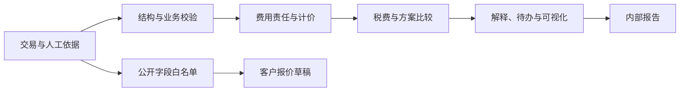

# COCUDTT · 国际贸易成本与贸易术语方案分析

面向外贸业务人员的本地测算工具：录入交易、合同报价与费用，查看费用承担依据、买方落地成本及可评估的卖方利润，比较不同 Incoterms® 2020 方案。项目由国际经济与贸易学习中的报价测算问题出发，近期重点是**中国一般贸易进口、单商品一票**。

**不登录、不上传交易数据。计算、项目文件与报告均在浏览器本机处理。**

> 本工具仅供学习与内部测算参考，不构成法律或专业贸易建议。实际合同请以 Incoterms® 官方文本及当地法规为准。

## 版本与入口

更新于 **2026-10-14**。本 README 介绍当前开发进展；功能代码仍在开发候选分支，尚未合并到 `main` 或发布到公开网站。下载时请确认所选分支。

| 入口 | 内容与状态 |
|---|---|
| [在线演示](https://codeding-101.github.io/COCUDTT/) | 当前已发布版本，尚未包含下方全部新增能力 |
| [`main` 分支](https://github.com/codeding-101/COCUDTT/tree/main) | 历史源码；此前单独更新 README，功能尚未合并 |
| [最新开发候选](https://github.com/codeding-101/COCUDTT/tree/codex/transport-cost-links) | 当前功能源码、单文件工具、文档、测试及已接入工具的明确期间假设 |
| [前轮草稿 PR #27](https://github.com/codeding-101/COCUDTT/pull/27) | 期间配套案例基础；本轮新增独立运输费用关联核对，尚未进入运行工具 |
| [项目说明页源码](https://github.com/codeding-101/COCUDTT/blob/codex/transport-cost-links/project-introduction.html) | 产品工作流、设计取舍与能力边界，可与工具一起离线打开 |

日常试用可从[候选分支下载源码 ZIP](https://github.com/codeding-101/COCUDTT/archive/refs/heads/codex/transport-cost-links.zip)，解压后双击根目录的 `trade-cost-engine.html`。运行离线工具无需安装 Node.js；开发与构建时才需要。

## 解决什么问题

外贸报价测算常把费用承担、货损风险、付款安排和海关计税混在一起，也容易漏掉未知费用、失效汇率或不同方案的运价差异。本项目把这些问题分别记录，给出可追溯的计算过程和待核对事项。

- 比较同一笔交易的不同术语、实际合同报价与运输费用。
- 查看逐笔费用由谁承担、命中什么规则、为何计入或排除。
- 核对中国进口计税输入、海关汇率有效期及支持范围内的税费计算。
- 将内部成本资料与客户报价说明分开导出。
- 在独立副本上做假设分析，保留原交易和原确认记录。

**稳优先的原则：**未知不补零，付款不推定风险转移，运费终点不代替交货点，软件检查通过不等于专业或真实业务认证。

## 开发候选已实现的能力

| 能力 | 当前支持范围 |
|---|---|
| 术语与方案比较 | 11 种术语、六种计价方式、逐术语实际报价及原有模拟基准 |
| 费用与运输 | 适用术语、互斥运价组、合同承担约定；运输分段、交货点与运费终点分别记录 |
| 保险与集装箱提醒 | CIF/CIP 保障资料、保额及范围核对；THC、demurrage、detention、查验等费用预设和提醒 |
| 中国进口 | 独立申报日期、人民币计税、海关汇率适用期、支持范围内的税基和税款舍入；资格及来源待核对 |
| 解释与可视化 | 费用推理链、真实替值公式、去重依据、运输风险流程及费用/税基图 |
| 假设分析 | 运费、商业/海关汇率及未决费用承担，显示相对基准变化 |
| 客户交付 | 公开字段预览，HTML、原生 Excel、可检索 PDF 报价草稿及固定中英文条款摘要 |
| 内部存档 | HTML/Excel 成本、方案、公式、来源及输入快照；付款和资金假设单独保存 |
| 付款与资金假设 | TT/L/C/OA 原币分期对账、银行费关联；恒定/显式变动本金、日期、固定/显式变动利率及计息基准的单利假设；金额舍入及明确计息归集期独立输入与审计 |
| 文件与恢复 | 标准 JSON、离线 Schema、四种模板；输入修正及关联面板定位、启动/渲染/操作异常恢复、本地恢复备份只读检查 |

资金假设区分融资利息与机会成本，结果独立于经营利润和合同/银行费用收付。付款主方式不证明已付款、单证相符或保证收款。

本金、舍入及明确期间三套案例分别提供项目、付款、独立手算记录及离线说明；先保存自己的输入再打开配对文件。舍入例题保留0.018原值，合计后0.02 USD、逐区间0.03 USD；期间例题包含本金和利率变化，原始单利0.03 USD，两期归集0.03 USD、四个人为期间0.04 USD。各层级须独立复核确认，不推定银行结息。[本金手算记录](https://github.com/codeding-101/COCUDTT/blob/codex/transport-cost-links/templates/synthetic-funding-example.check.json)和[期间手算记录](https://github.com/codeding-101/COCUDTT/blob/codex/transport-cost-links/templates/synthetic-period-example.check.json)使用固定合成预期，不代表真实业务验收。

资金事件限一个明确主体、单币种及固定计息基准：本金增减按日期及同日列表顺序处理；利率事件填写新的绝对年利率、生效日及依据，同日重复利率阻断。起始日生效，截止日只审计不多计一天；每段本金、实际利率、天数、余额及公式可复查。金额步长、方式和层级需明确填写；原始单利与舍入金额分开，逐区间应用必须确认边界，不能自动当作银行结息日。

## 使用流程

1. 用“中国进口示例”了解录入口径，再用“新建中国进口”填写自己的交易。
2. 录入货物净价、费用、各术语报价、商业与海关汇率、申报日期，核对税率来源和业务条件。
3. 查看参考结果、费用依据、公式与待办；满足当前软件检查条件的方案才进入确定排名。
4. 修改假设时查看变化；先检查公开预览，再生成客户文件。内部文件包含成本及来源，请按内部资料管理。
5. 用“保存项目”保存项目 JSON；付款计划另存 JSON。自动草稿不能代替文件备份。

明确计息归集期已接入候选工具，可从1.4单独启用1.5：每期明确录入、独立确认，先汇总原值再舍入一次。归集期末不证明实际银行结息或付款。

项目格式为 **0.8**，支持读取 0.1–0.7 旧容器。新建内部付款计划仍为 **1.1**，显式启用变动本金才升级 **1.2** 并重新确认假设；显式启用利率事件才升级 **1.3**，同样重新确认；显式启用金额舍入才升级 **1.4**，原值保留且须重新确认；显式启用明确期间再升级**1.5**，空期表待确认、不自动补日期；旧1.0/1.1/1.2/1.3/1.4读取与另存保持原格式，重名扩展升级时拒绝覆盖。客户公开字段和临时假设不随项目 JSON 自动保存。跨设备需自行传递文件，没有云同步。

异常恢复界面隐藏旧结果，可下载内部恢复备份并保留输入重试。恢复备份包含原始项目、汇率行和本页参数，用于人工复原，不能作为项目 JSON 直接打开。正常页面可检查5 MiB以内恢复文件，分别标出六部分的结构状态；不替换当前交易、转换汇率或自动导入。检查不保证原始数字精度，人工复原仍以原文件为依据。脚本无法加载、浏览器崩溃或内存丢失不在该恢复机制的保障范围。

## 技术栈与设计

原生 **TypeScript + Vite**，不为展示工程化而额外引入界面框架。TypeScript 开启严格检查；金额采用 **decimal.js**，项目输入另有运行时验证。**Vitest** 覆盖业务计算与真实界面事件，GitHub Actions 在 Windows/Linux 检查回归、依赖及构建一致性。

| 模块 | 职责 |
|---|---|
| [`src/domain`](https://github.com/codeding-101/COCUDTT/tree/codex/transport-cost-links/src/domain) | 贸易、费用、规则、来源、付款与资金假设类型 |
| [`src/engine`](https://github.com/codeding-101/COCUDTT/tree/codex/transport-cost-links/src/engine) | 依赖、责任解析、计价、税费及方案比较 |
| [`src/data`](https://github.com/codeding-101/COCUDTT/tree/codex/transport-cost-links/src/data) | 文件校验、兼容格式、模板、客户投影与工作簿快照 |
| [`src/ui`](https://github.com/codeding-101/COCUDTT/tree/codex/transport-cost-links/src/ui) | 输入事件、结果展示、导出及错误恢复 |



单文件构建将脚本、样式和所需字体内联，支持 `file://` 离线运行。Excel 使用离线原生 `.xlsx` 快照；PDF 使用 pdf-lib 与本地字体。客户文件逐字段重建，不复制内部项目对象。计算规则与展示分层，资金假设不改写费用/税务算法。

## 验证证据与限制

第三十一轮完整 **53 个测试文件、1388 项测试**通过，新增67项独立关联/来源/范围及旧结果不变验证；包括36组集合交集对照和100费用×100段上限。新模块尚未进入运行工具；工具重建与前轮一致，原22套浏览器流程是第三十轮历史证据，本轮不计为重跑。独立设计14手算/16错误另列，远程Windows/Linux CI以本轮实际提交为准。

可复查的记录：[基础概念核验](https://github.com/codeding-101/COCUDTT/blob/codex/transport-cost-links/docs/foundations-validation.md)、[中国进口验收](https://github.com/codeding-101/COCUDTT/blob/codex/transport-cost-links/docs/china-import-validation.md)、[客户与内部隔离](https://github.com/codeding-101/COCUDTT/blob/codex/transport-cost-links/docs/customer-quotes-validation.md)、[资金占用与 Excel](https://github.com/codeding-101/COCUDTT/blob/codex/transport-cost-links/docs/funding-validation.md)、[错误恢复验收](https://github.com/codeding-101/COCUDTT/blob/codex/transport-cost-links/docs/recovery-validation.md)、[恢复文件与输入定位](https://github.com/codeding-101/COCUDTT/blob/codex/transport-cost-links/docs/recovery-review-validation.md)、[本金事件与分段计息](https://github.com/codeding-101/COCUDTT/blob/codex/transport-cost-links/docs/funding-ledger-validation.md)、[配套合成案例与导出指引](https://github.com/codeding-101/COCUDTT/blob/codex/transport-cost-links/docs/funding-example-validation.md)、[显式利率与区间审计](https://github.com/codeding-101/COCUDTT/blob/codex/transport-cost-links/docs/funding-rates-validation.md)、[金额舍入假设与层级差异](https://github.com/codeding-101/COCUDTT/blob/codex/transport-cost-links/docs/funding-rounding-validation.md)、[舍入配套案例与操作指引](https://github.com/codeding-101/COCUDTT/blob/codex/transport-cost-links/docs/rounding-example-validation.md)、[明确期间的实现前设计及验收门槛](https://github.com/codeding-101/COCUDTT/blob/codex/transport-cost-links/docs/funding-period-design.md)、[独立期间归集函数验收](https://github.com/codeding-101/COCUDTT/blob/codex/transport-cost-links/docs/funding-periods-validation.md)、[明确期间完整接入验收](https://github.com/codeding-101/COCUDTT/blob/codex/transport-cost-links/docs/funding-period-integration-validation.md)、[期间配套案例与离线操作指引](https://github.com/codeding-101/COCUDTT/blob/codex/transport-cost-links/docs/period-example-validation.md)、[运输费用关联独立模块](https://github.com/codeding-101/COCUDTT/blob/codex/transport-cost-links/docs/transport-cost-links-validation.md)。

已有自动化和合成对照不能证明全部国家税制、贸易例外或银行实务已经适配。税率、归类、原产地待遇及抵扣资格仍需核对，示例不代表真实报关。真实交易对照资料尚未取得；真实手机和人工专业复核按当前安排暂缓。PDF 字体覆盖有限，无法表示的字符会停止生成并提示使用其他格式。

## 本地开发

以下命令面向开发候选，建议使用 CI 同款 **Node.js 24**：

```bash
git clone --branch codex/transport-cost-links https://github.com/codeding-101/COCUDTT.git cocudtt
cd cocudtt
npm ci
npm run dev
npm test
npm run check:funding-period-design
npm run typecheck
npm run audit
npm audit --audit-level=high
npm run build:single
npm run build:catalog
```

`npm run audit` 检查界面字段/动作和引擎编码的连接；`npm audit` 检查依赖漏洞。CI 还会重建并比较已提交的单文件 HTML、Schema 和模板，防止交付文件与源码漂移。浏览器脚本位于 [`tools`](https://github.com/codeding-101/COCUDTT/tree/codex/transport-cost-links/tools)，需要单独准备浏览器调试环境。

## 后续方向

已交付的付款/资金假设、明确归集期及三套配套案例继续保留。本轮完成独立运输费用关联核对，暂未在工具启用；[详细阶段目标与验收条件](https://github.com/codeding-101/COCUDTT/blob/codex/transport-cost-links/docs/development-stages.md)明确以下顺序：

| 阶段 | 目标与完成条件 |
|---|---|
| 当前：独立规则与模块 | 明确关联/来源/重叠候选，证明原金额、责任、风险和税费不变 |
| 下一步：完整接入 | 界面、确认失效、0.9提案/兼容、保存恢复及内部导出同轮通过，再启用 |
| 集装箱账单 | 先设计箱数/免费期/计费日与阶梯，再以固定手算验证；不默认承运人规则 |
| 报价与移动端操作质量 | 完善既有双视图、双语/长表/PDF及窄屏操作，客户隔离和真实下载验收 |
| 发布前工程收敛 | 统一候选与证据、CI/离线回归及规则矩阵；准备可审查结果后由用户决定发布 |

真实手机、专业及实际单据验收继续暂缓；多国家税制、实时运价、保证金/代付净额等不作为近期完成承诺。

详见[开发计划](https://github.com/codeding-101/COCUDTT/blob/codex/transport-cost-links/docs/product-development-plan.md)、[项目展望](https://github.com/codeding-101/COCUDTT/blob/codex/transport-cost-links/docs/project-outlook.md)和[设计文档](https://github.com/codeding-101/COCUDTT/blob/codex/transport-cost-links/docs/design.md)。

## 许可证

[Apache-2.0](https://github.com/codeding-101/COCUDTT/blob/main/LICENSE)。离线中文字体另附[OFL 许可与来源](https://github.com/codeding-101/COCUDTT/tree/codex/transport-cost-links/src/assets/fonts)，分发时请保留。

