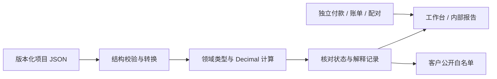

# 能力与验证证据矩阵

2026-10-18，第六十三轮。面向中国一般贸易进口、单商品一票的本地内部测算工具。本文说明程序做了什么、用什么验证，以及没有证明什么；不以测试数量代替法规、真实业务或专业认证。

## 五条验收轴

“开发完成”仅指列出的受限路径可用；“自动化通过”指固定或合成输入的程序/浏览器检查。“人工专业复核”“真实单据对照”“真实设备验收”是另外三项，当前均未完成，按用户安排暂缓。示例中的EXAMPLE、用户自行确认和程序可计算不能提升为后三项。历史文档的测试数、未合并等状态仅对应其阶段。

基线为第五十五轮：79文件2660项测试、37套离线浏览器回归、166项线上检查，Windows/Linux CI和公开产物哈希核对；见[最近项目验收](recent-projects-ui-validation.md)及[PR #52](https://github.com/codeding-101/COCUDTT/pull/52)。第五十六轮新增合成案例与静态说明，见[当轮验收](capability-walkthrough-validation.md)。第五十八轮新增独立成分模块，完整82文件3139项及本轮静态介绍检查见[模块验收](fee-tax-components-module-validation.md)。第五十九轮新增[附件状态设计核对](fee-tax-attachment-design-validation.md)；第六十轮独立文件模块新增90项，完整85文件3229项，见[文件验收](fee-tax-attachment-file-validation.md)。文件API及[独立交接模块](fee-tax-attachment-controller-validation.md)已实现；第六十二轮[工作区验收](fee-tax-attachment-workspace-validation.md)接入页面，新增22项、完整88文件3302项。第六十三轮新增[精度设计验收](fee-precision-design-validation.md)，53/75/4860/124为独立设计证据，运行模块未启用；应用仍88文件3302项。不把旧证据记成重跑结果。

## 受限能力、证据与边界

下表每一行的专业复核、真实单据、真实设备状态均为未完成；“有自动化证据”不承诺覆盖所有边缘场景。

| 能力与实现状态 | 源码及自动化证据 | 已覆盖与仍有边界 |
|---|---|---|
| 术语、费用承担及风险：已启用 | [责任解析](../src/engine/responsibility/resolver.ts)、[基础概念测试](../tests/foundations.test.ts)、[风险测试](../tests/risk.test.ts)、[基础核验](foundations-validation.md) | 11术语、FCA两类地点、C类运费与风险分开；缺合同/地点保留待确认。FOB变形不能凭名称改变风险，补充合同仍须核对 |
| 合同报价与方案：已启用 | [比较](../src/engine/compare.ts)、[实际报价测试](../tests/actual-quotes.test.ts)、[报价验收](actual-quotes-validation.md) | 实际报价/有效期/地点及模拟基准分别记录；缺实际报价不自动推成有效合同方案 |
| 中国进口税基/税款：受限启用 | [完税价格](../src/engine/tax/dutiable-value.ts)、[进口税](../src/engine/tax/import-tax.ts)、[中国进口测试](../tests/china-import.test.ts)、[案例对照](../tests/import-case-acceptance.test.ts) | 净价/运保费、人工调整、支持的关税/消费税/VAT及舍入；不是税则库，不自动确认原产地、特许权费或特殊估价；其他国家专用税制未完成 |
| 商业/海关汇率与来源：已启用 | [汇率](../src/engine/fx.ts)、[来源核对](../src/engine/decision-readiness.ts)、[来源测试](../tests/source-readiness.test.ts)、[进口复现](china-import-walkthrough.md) | 类型、申报日期、适用期及变更后确认失效；真实发布值/特殊日期调整须人工核对，无实时自动查询 |
| 中国出口退税：既有假设模型 | [退税测试](../tests/rebate.test.ts)、[历史规则核验](professional-rules-review.md) | 不是完整2026出口退税合规模型；不按近似日期自动认定逾期。中国进口案例不适用出口退税；本轮未重查法规 |
| 多段运输、保险及箱费提醒：受限启用 | [物流测试](../tests/logistics.test.ts)、[运输关联测试](../tests/transport-links-integration.test.ts)、[物流验收](logistics-validation.md) | 唯一交货点与费用支付终点分开、资料与漏项核对；关联不是按段自动分摊，不认证保单/险别/保额或实际交货 |
| 独立箱费账单与提案：已启用但不写成本 | [账单测试](../tests/container-bill.test.ts)、[提案测试](../tests/container-cost-proposal.test.ts)、[账单界面](container-bill-ui-validation.md) | 日历日、免费期、阶梯、原币审计和候选；未支持规则拒绝。含税标记不自动拆税；提案不等于已计入利润/税基 |
| 配对、业务复制与核对：已启用 | [配对测试](../tests/container-cost-pair.test.ts)、[复制测试](../tests/container-business-copy.test.ts)、[核对接入](container-review-integration-validation.md) | 明确完整交接、稳定映射、旧确认失效；核对记录不清原待办、不构成实际费用应用事务 |
| 费用税务成分：独立内部工作区已接入 | [模块](../src/engine/fee-tax-components.ts)、[计算测试](../tests/fee-tax-components.test.ts)、[边界测试](../tests/fee-tax-components-boundaries.test.ts)、[模块验收](fee-tax-components-module-validation.md) | 原文、精确分数、审计及逐列未知合计；不确认资格、不激活旧扩展、不改变既有费用/利润/税基；[独立文件API](../src/data/fee-tax-attachment.ts)与[JSON测试](../tests/fee-tax-attachment-json.test.ts)已完成，完整来源/回执与Schema见[验收](fee-tax-attachment-file-validation.md)；[独立控制器](../src/ui/fee-tax-attachment-controller.ts)与[内部快照](../src/data/fee-tax-attachment-snapshot.ts)已验证；[表单/工作区](../src/ui/fee-tax-attachment-workspace.ts)、[测试](../tests/fee-tax-attachment-workspace.test.ts)和[浏览器流程](../tools/fee-tax-attachment-browser-check.mjs)验证结构化编辑、明确采用、恢复、交接及窄屏；精度选择/费用应用尚未启用 |
| 付款与资金假设：独立启用 | [付款测试](../tests/settlement.test.ts)、[期间测试](../tests/funding-periods.test.ts)、[期间接入](funding-period-integration-validation.md) | TT/L/C/OA分期、显式本金/利率/舍入/归集期；不是银行实际扣款，不据方式推定风险，不处理保证金/复杂代付净额或复利 |
| 解释、图表与假设：已启用 | [解释测试](../tests/explanation.test.ts)、[假设测试](../tests/sensitivity.test.ts)、[内部口径](calculation-assumptions-validation.md) | 复用真实引擎记录，不在视图重新计算税款；独立假设不写回交易或刷新来源确认 |
| 内部/客户导出：已启用 | [客户测试](../tests/customer-quote.test.ts)、[Excel测试](../tests/workbook-export.test.ts)、[PDF测试](../tests/customer-pdf.test.ts)、[双版式验收](customer-views-validation.md) | 客户公开白名单与内部资料隔离，HTML/XLSX/PDF/固定双语；自由条款不自动认证翻译，文件下载受浏览器限制，打印分页非真实设备验收 |
| 项目文件、恢复与快照：已启用 | [文件测试](../tests/project-file.test.ts)、[真实事件](../tests/project-io.test.ts)、[快照测试](../tests/recent-projects-ui.test.ts)、[快照接入](recent-projects-ui-validation.md) | 版本/扩展保护、异常原文、独立资料、手动3份快照；本机缓存非备份，不承诺跨标签原子事务 |
| 新手、专业与移动界面：已启用 | [工作台测试](../tests/workspace.test.ts)、[移动设置测试](../tests/mobile-settings.test.ts)、[引导验收](onboarding-validation.md) | 核心输入/具体修错/待更新、键盘和模拟窄屏；真实手机、系统文件分享、辅助技术全面验收未完成 |
| 成分假设已实现；精度设计完成，运行选择和费用应用未启用 | [只读核对测试](../tests/container-cost-review.test.ts)、[设计反例](container-cost-review-design.md)、[阶段目标](development-stages.md) | 已有只读待办不等于经济成本、海关金额或税额已确定；[成分设计](fee-tax-components-design.md)已通过31手算/45拒绝/200对照，独立成分模块和内部工作区已实现；[精度设计](fee-precision-design.md)、[固定合成向量](cases/fee-precision-design.json)与[独立检查器](../tools/check-fee-precision-design.mjs)核对原值/差额/守恒/换算边界，尚无精度生产模块或费用应用事务 |

## 工程边界与可复现入口

实际分层为`src/domain`、`src/engine`、`src/data`、`src/ui`，严格TypeScript。文件结构可保存未完成输入，业务校验再决定能否计算；结构有效不表示可交易。UI有统一恢复边界，但`app.ts`仍承担较多事件与状态编排，不能声称已完成全面状态管理重构。静态审查能发现已知字段/动作遗漏，不能证明所有交互无缺陷。

固定案例从[操作说明](china-import-walkthrough.md)开始，或离线打开[演示页面](../china-import-walkthrough.html)。开发环境执行 `node node_modules/vitest/vitest.mjs run tests/china-import-walkthrough.test.ts` 对照固定答案，再执行 `node tools/build-import-walkthrough.mjs --check` 检查HTML和内嵌项目字节。全套测试、类型、绑定、独立设计基准、离线构建和版本化资源比对由[双平台CI](../.github/workflows/quality.yml)执行。

简历可以说明：本地优先、明确领域边界、独立手算与回归、版本化文件、客户/内部隔离和可追溯核对。不能写“支持全球税制”“生产级合规认证”“真实报关准确率100%”或把测试数量当作业务正确率。第五十八轮已完成独立只读成分模块，见[验收](fee-tax-components-module-validation.md)。下一阶段先实现独立纯数值精度模块，逐项对照固定手算与反例、精确余数、未知传播、层级差额、成分守恒和汇率方向；再设计版本化选择/来源失效及界面交接，最后验收费用原子应用与失败回滚。
