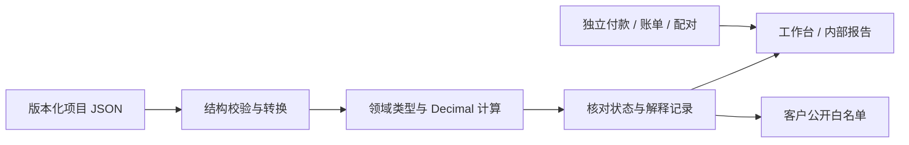

# 能力与验证证据矩阵

2026-10-26，第九十八轮。面向中国一般贸易进口、单商品一票的本地内部测算工具。本文说明程序做了什么、用什么验证，以及没有证明什么；不以测试数量代替法规、真实业务或专业认证。

第九十八轮完成[恢复数据格式与独立还原器](fee-recovery-format-validation.md)：新增54项，完整144文件5072项；16项隔离浏览器检查与Node一致，两份隔离及四份实际页面编码经原Node协议逐字核对。15个页面状态中14个完整恢复至独立数据容器，待确认候选含全部备份达143,014,394字节，超过128 MiB明确拒绝且原工作台保持；未删历史或放宽预算。已应用历史完整恢复和重复恢复保持4笔费用/1回执，恢复零费用写入，未知利润仍为null。原1/4/8资料重跑，4/8仍按原预算拒绝。**尚未接入正式工具，完整工作台重开尚未实现。**浏览器无效数字缓冲与未读取文件内容要求重新输入。原财税、文件与运行字节保持，46套完整业务沿用同版本历史，本轮未重跑，不宣称容量、耗时或峰值内存改善。下一阶段先处理完整候选超限，再验证运行适配、安静安装、完整业务链路和实际收益。

历史第九十七轮完成[独立浏览器原生编解码器](fee-browser-native-validation.md)：新增65项，完整142文件5018项；不依赖源码文本变换，10份隔离编码和3份实际工作台编码与未改动Node原协议逐字一致。原69个复杂/运行场景重跑，52份完整捕获相同；39项接口契约和6组有界资源检查通过，每组40次重叠请求均拒绝，底层任务结束后才释放同实例工作槽。原1/4/8资料重跑：1笔还原并准备十组候选，4笔完整捕获、8笔保留根继续按原预算拒绝，未应用费用。**原生模块尚未接入正式工具，完整工作台重开尚未实现。**原财税、文件和运行字节保持；46套完整业务流程沿用同版本历史，本轮未重跑，不宣称容量、耗时或峰值内存改善。下一阶段实现完整恢复格式与独立还原器，先验证原文/历史、防重复和失败保留，再依据完整链路与实际收益决定接入。

历史第九十六轮完成[浏览器异步接口契约与恢复策略](fee-browser-recovery-validation.md)：新增81项，完整140文件4953项；三个异步阶段的及时取消、ABA、迟到异常、重入和私有观察分别验证。隔离浏览器39场景与Node逐项一致，10份编码经原Node解码再编码逐字核对。六类源文件只作分项保全，生成/下载/写入确认均不能当作完整重开；128/256/48/64/5 MiB五个不同上限分别列明。**独立浏览器原生编解码器及完整工作台重开均未实现，尚未接入正式工具。**原计算、文件格式和离线工具字节保持；原69场景、46套完整业务和1/4/8观察沿用固定历史证据，本轮未重跑，也不宣称容量或性能改善。下一阶段先实现独立原生编解码器并按本契约验证，再决定接入。

历史第九十五轮完成[真实页面只读分层映射](fee-layered-source-mapping-validation.md)：69个原复杂/运行场景重新对照，52份完整捕获逐字一致；新增67项，完整138文件4872项。实际浏览器与Node原协议的三份编码逐字一致，私有身份、A→B→A和取消后迟到读取分别验证。原1/4/8资料同条件复测：1笔还原后完成十组候选准备，4笔完整捕获、8笔保留根仍超原预算，均未继续编码或准备。首次8笔诊断通信超时独立保留，成功重验不证明其唯一原因。**尚未接入正式工具，不宣称容量、耗时或峰值内存改善。**原生产源码、财税规则与离线工具字节保持；46套完整业务流程沿用第九十三轮同版本证据，本轮未重跑。下一阶段先设计浏览器原生接口、异步失效与大资料备份/恢复策略，再依据完整证据决定接入。

另完成[fast-uri开发依赖最小安全补丁](fast-uri-patch-validation.md)：只将Ajv的传递包3.1.8更新至3.1.9，在线审计恢复0项；完整测试和本轮69场景、1/4/8观察在补丁环境重新运行，原应用依赖与离线工具字节保持。

历史第九十四轮完成[分层捕获独立协议0.1](fee-layered-capture-validation.md)：序列化前区分规范保留根与完整捕获外壳，共享完整原文，持有者、未提交状态与私有身份保持。新增85项，完整135文件4805项；22个独立诊断场景核对实际128 MiB、300000节点、坏引用、ABA、迟到读取与真实十组候选准备。**尚未接入正式工具，不宣称容量或性能提升。**原运行字节保持，46套浏览器及69捕获沿用第九十三轮同版本证据，本轮未重跑。下一阶段先验证真实页面只读映射与69场景，再复测1/4/8资料。

历史第九十三轮完成[完整检查失败后的源文件指引](fee-save-guidance-validation.md)：区分检查未完成、备份未生成、另存取消与保存未确认；六个按钮只定位原另存入口。六类JSON不等于完整工作台备份，未提交输入仍须自行保留；迟到保存不覆盖新状态，原费用/回执与客户确认保持。新增27项，完整132文件4720项；15项原生检查、8组布局与24次正式另存通过，原46套完整流程和69个捕获场景在新产物重跑。**原大资料容量限制保持，不宣称提速。**下一轮先设计分层捕获、原文引用及语义预算，独立验证可逆性、ABA与恢复等价后再考虑接入。

历史第九十二轮完成[1/4/8笔分阶段容量复测](fee-capacity-stages-validation.md)：1笔原预览、十组候选及完整备份通过；4笔完整捕获225.7 MB超限，8笔保留语义根284.3 MB超限。原工作台备份同样受限，六类正式源文件共18次另存逐字节核对通过，费用、回执和客户确认保持。新增34项，完整131文件4693项；原运行产物保持，46套完整浏览器证据沿用第九十一轮同字节结果，本轮未重跑。**容量限制尚未解决，不宣称提速。**下一轮先改善超限后的明确另存指引，再验证分层捕获和原文引用的等价性与预算。

历史第九十一轮完成[只读语义捕获接入与完整流程复验](fee-semantic-integration-validation.md)：正式工作台显式读取十组生产者，原文件、未提交状态、业务资格、历史和完整128 MiB预算保持。新增45项，完整130文件4659项；69个捕获场景中52份完整捕获与独立历史实现一致，四个旧反例保持关闭。全部46套原生浏览器流程在新产物重跑，覆盖预览、最新代次重准备、一次根替换、重复提交防护、提交后恢复、正式文件交接、客户隔离与窄屏。**原4/8笔容量仍受限，本轮不宣称提速或容量提升。**旧0.1/0.2矩阵原样保留，CI分别核对历史资格与当前接入。下一轮用同夹具复测1/4/8笔，分别记录捕获、准备、备份及失败原因。

历史第九十轮完成[来源语义预算0.2与反例关闭](fee-semantic-budget-validation.md)：新增45项，完整128文件4614项；69个真实浏览器场景中52份完整捕获逐字一致，四个旧普通JSON反例全部关闭，14种不支持JS对象及原超深/超节点仍拒绝。复合快照的多层转义、中文/emoji实际128 MiB边界通过。**新原型仍独立，正式工具继续原捕获；原4/8笔容量限制保持。**旧0.1矩阵与反例原样保留，CI核对新旧证据及生产隔离。下一阶段接只读捕获并复验完整预览、候选、确认提交及恢复，再做同条件1/4/8测量。 另完成[Vitest5.0.3最小安全补丁](vitest-patch-validation.md)：实际审计0项，旧42/新69场景在补丁环境重跑；CI审计门槛覆盖中风险告警。

历史第八十九轮完成[来源适配兼容矩阵与CI门槛](fee-source-compatibility-validation.md)：新增37项，完整126文件4569项通过；42个真实浏览器场景分开核对原捕获、原保留解析、新帧和重建，21个完整捕获相同，确认4个普通JSON边界反例。实际128 MiB的ASCII/中文UTF8、300000节点和32深度均验证。**正式工具继续原捕获，新适配不接入；原4/8笔容量限制保持。**CI检查反例、源指纹和生产隔离，诊断不提供交易就绪、来源采用或确认资格。下一步先对齐语义预算并关闭四例，再分步只读接入。

## 五条验收轴

“开发完成”仅指列出的受限路径可用；“自动化通过”指固定或合成输入的程序/浏览器检查。“人工专业复核”“真实单据对照”“真实设备验收”是另外三项，当前均未完成，按用户安排暂缓。示例中的EXAMPLE、用户自行确认和程序可计算不能提升为后三项。历史文档的测试数、未合并等状态仅对应其阶段。

基线为第五十五轮：79文件2660项测试、37套离线浏览器回归、166项线上检查，Windows/Linux CI和公开产物哈希核对；见[最近项目验收](recent-projects-ui-validation.md)及[PR #52](https://github.com/codeding-101/COCUDTT/pull/52)。第五十六轮新增合成案例与静态说明，见[当轮验收](capability-walkthrough-validation.md)。第五十八轮新增独立成分模块，完整82文件3139项及本轮静态介绍检查见[模块验收](fee-tax-components-module-validation.md)。第五十九轮新增[附件状态设计核对](fee-tax-attachment-design-validation.md)；第六十轮独立文件模块新增90项，完整85文件3229项，见[文件验收](fee-tax-attachment-file-validation.md)。文件API及[独立交接模块](fee-tax-attachment-controller-validation.md)已实现；第六十二轮[工作区验收](fee-tax-attachment-workspace-validation.md)接入页面，新增22项、完整88文件3302项。第六十三轮新增[精度设计验收](fee-precision-design-validation.md)，53/75/4860/124为独立设计证据，第六十四轮[独立精度模块](fee-precision-module-validation.md)实现五类API，新增193项、完整90文件3495项；尚无运行精度选择。第六十五轮新增[精度选择记录设计验收](fee-precision-selection-design-validation.md)，独立81/60状态案例及50/51单叶变更；不是生产文件或UI证据。第六十六轮[独立精度文件](fee-precision-selection-file-validation.md)新增168项、完整93文件3663项；已实现严格文件API、Schema/合成模板，尚无运行入口或草稿恢复。第六十七轮[独立精度交接/内部审计](fee-precision-selection-controller-validation.md)新增89项、完整97文件3752项，实际客户两版式HTML/XLSX/PDF差分隔离；尚无工作台精度入口或自动草稿。不把旧证据记成重跑结果。

## 受限能力、证据与边界

下表每一行的专业复核、真实单据、真实设备状态均为未完成；“有自动化证据”不承诺覆盖所有边缘场景。

| 能力与实现状态 | 源码及自动化证据 | 已覆盖与仍有边界 |
|---|---|---|
| 分层捕获与原文引用：独立原型、未接入 | [设计](fee-layered-capture-design.md)、[验收](fee-layered-capture-validation.md)、[机器证据](cases/fee-layered-capture.json)、[门禁](../tools/check-fee-layered-capture.mjs) | 85项新增、135文件4805项、22个独立场景；实际预算、原文和持有者、私有失效与真实候选准备核对；正式工具保持，实际浏览器映射与容量提升未证明 |
| 完整检查失败后的源文件指引：已接入 | [设计](fee-save-guidance-design.md)、[验收](fee-save-guidance-validation.md)、[完整当前证据](cases/fee-save-guidance-native.json)、[测试](../tests/fee-workbench-save-guidance.test.ts)、[CI门禁](../tools/check-fee-save-guidance.mjs) | 新增27项，132文件4720项；原46套与69场景在新产物重跑，15项原生/8布局/24次正式另存；导航不保存，原容量与财税门槛保持 |
| 分阶段容量复测：开发诊断 | [设计](fee-capacity-stages-design.md)、[验收](fee-capacity-stages-validation.md)、[原始样本](cases/fee-capacity-stages.json)、[测试](../tests/fee-capacity-trace.test.ts)、[CI门禁](../tools/check-fee-capacity-stages.mjs) | 新增34项，131文件4693项；4笔外层、8笔保留根超限，完整备份同样受限；18次正式源文件另存通过，未解决容量、不宣称提速 |
| 只读语义捕获：正式接入 | [设计](fee-semantic-integration-design.md)、[验收](fee-semantic-integration-validation.md)、[69场景](cases/fee-semantic-integration.json)、[46套流程](cases/fee-semantic-integration-native.json) | 新增45项，130文件4659项；原子应用/恢复/客户隔离重新验证，历史矩阵保持；原预算与4/8笔容量限制保留 |
| 来源语义预算0.2：历史独立原型 | [设计](fee-semantic-budget-design.md)、[验收](fee-semantic-budget-validation.md)、[69场景](cases/fee-source-semantic-budget.json)、[复合字节测试](../tests/fee-source-semantic-size.test.ts) | 新增45项，128文件4614项；四个旧普通JSON反例关闭、52份完整捕获一致；原预算保持，未接入正式入口，不证明交易就绪或容量提升 |
| 来源兼容矩阵与CI门槛：开发诊断 | [设计](fee-source-compatibility-design.md)、[验收](fee-source-compatibility-validation.md)、[42场景](cases/fee-source-compatibility.json)、[边界测试](../tests/fee-source-compatibility-boundary.test.ts) | 新增37项，126文件4569项；21相同捕获、四个普通JSON反例，保留原正式入口；不证明交易就绪或容量提升 |
| 真实页面来源适配：独立模块 | [覆盖设计](fee-source-adapter-design.md)、[27场景验收](fee-source-adapter-validation.md)、[模块](../src/ui/fee-workbench-source-adapter.ts)、[测试](../tests/fee-source-adapter.test.ts) | 九个根字段/二十项保留数据；47新增、124文件4532项，27个原app完整JSON对照。未接入运行入口，未证明全输入等价、提速或4/8容量提升 |
| 生产者只读来源视图：开发独立原型 | [设计](fee-source-view-design.md)、[验收与字节](fee-source-view-validation.md)、[协议测试](../tests/fee-source-view.test.ts)、[控制器测试](../tests/fee-source-view-state.test.ts) | 十组夹具投影、私有有效性/ABA/取消及原文证据；新增40项，122文件4485项。新诊断1/4笔还原、8笔超预算；不证明旧捕获等价或正式4笔可用，未接入运行工具 |
| 术语、费用承担及风险：已启用 | [责任解析](../src/engine/responsibility/resolver.ts)、[基础概念测试](../tests/foundations.test.ts)、[风险测试](../tests/risk.test.ts)、[基础核验](foundations-validation.md) | 11术语、FCA两类地点、C类运费与风险分开；缺合同/地点保留待确认。FOB变形不能凭名称改变风险，补充合同仍须核对 |
| 合同报价与方案：已启用 | [比较](../src/engine/compare.ts)、[实际报价测试](../tests/actual-quotes.test.ts)、[报价验收](actual-quotes-validation.md) | 实际报价/有效期/地点及模拟基准分别记录；缺实际报价不自动推成有效合同方案 |
| 中国进口税基/税款：受限启用 | [完税价格](../src/engine/tax/dutiable-value.ts)、[进口税](../src/engine/tax/import-tax.ts)、[中国进口测试](../tests/china-import.test.ts)、[案例对照](../tests/import-case-acceptance.test.ts) | 净价/运保费、人工调整、支持的关税/消费税/VAT及舍入；不是税则库，不自动确认原产地、特许权费或特殊估价；其他国家专用税制未完成 |
| 商业/海关汇率与来源：已启用 | [汇率](../src/engine/fx.ts)、[来源核对](../src/engine/decision-readiness.ts)、[来源测试](../tests/source-readiness.test.ts)、[进口复现](china-import-walkthrough.md) | 类型、申报日期、适用期及变更后确认失效；真实发布值/特殊日期调整须人工核对，无实时自动查询 |
| 中国出口退税：既有假设模型 | [退税测试](../tests/rebate.test.ts)、[历史规则核验](professional-rules-review.md) | 不是完整2026出口退税合规模型；不按近似日期自动认定逾期。中国进口案例不适用出口退税；本轮未重查法规 |
| 多段运输、保险及箱费提醒：受限启用 | [物流测试](../tests/logistics.test.ts)、[运输关联测试](../tests/transport-links-integration.test.ts)、[物流验收](logistics-validation.md) | 唯一交货点与费用支付终点分开、资料与漏项核对；关联不是按段自动分摊，不认证保单/险别/保额或实际交货 |
| 独立箱费账单与提案：已启用但不写成本 | [账单测试](../tests/container-bill.test.ts)、[提案测试](../tests/container-cost-proposal.test.ts)、[账单界面](container-bill-ui-validation.md) | 日历日、免费期、阶梯、原币审计和候选；未支持规则拒绝。含税标记不自动拆税；提案不等于已计入利润/税基 |
| 配对、业务复制与核对：已启用 | [配对测试](../tests/container-cost-pair.test.ts)、[复制测试](../tests/container-business-copy.test.ts)、[核对接入](container-review-integration-validation.md) | 明确完整交接、稳定映射、旧确认失效；核对记录不清原待办、不构成实际费用应用事务 |
| 费用税务成分：独立内部工作区已接入 | [模块](../src/engine/fee-tax-components.ts)、[计算测试](../tests/fee-tax-components.test.ts)、[边界测试](../tests/fee-tax-components-boundaries.test.ts)、[模块验收](fee-tax-components-module-validation.md) | 原文、精确分数、审计及逐列未知合计；不确认资格、不激活旧扩展、不改变既有费用/利润/税基；[独立文件API](../src/data/fee-tax-attachment.ts)与[JSON测试](../tests/fee-tax-attachment-json.test.ts)已完成，完整来源/回执与Schema见[验收](fee-tax-attachment-file-validation.md)；[独立控制器](../src/ui/fee-tax-attachment-controller.ts)与[内部快照](../src/data/fee-tax-attachment-snapshot.ts)已验证；[表单/工作区](../src/ui/fee-tax-attachment-workspace.ts)、[测试](../tests/fee-tax-attachment-workspace.test.ts)和[浏览器流程](../tools/fee-tax-attachment-browser-check.mjs)验证结构化编辑、明确采用、恢复、交接及窄屏；附件本身不应用费用；精度工作台及受限整批应用有单独入口和门槛 |
| 付款与资金假设：独立启用 | [付款测试](../tests/settlement.test.ts)、[期间测试](../tests/funding-periods.test.ts)、[期间接入](funding-period-integration-validation.md) | TT/L/C/OA分期、显式本金/利率/舍入/归集期；不是银行实际扣款，不据方式推定风险，不处理保证金/复杂代付净额或复利 |
| 解释、图表与假设：已启用 | [解释测试](../tests/explanation.test.ts)、[假设测试](../tests/sensitivity.test.ts)、[内部口径](calculation-assumptions-validation.md) | 复用真实引擎记录，不在视图重新计算税款；独立假设不写回交易或刷新来源确认 |
| 内部/客户导出：已启用 | [客户测试](../tests/customer-quote.test.ts)、[Excel测试](../tests/workbook-export.test.ts)、[PDF测试](../tests/customer-pdf.test.ts)、[双版式验收](customer-views-validation.md) | 客户公开白名单与内部资料隔离，HTML/XLSX/PDF/固定双语；自由条款不自动认证翻译，文件下载受浏览器限制，打印分页非真实设备验收 |
| 项目文件、恢复与快照：已启用 | [文件测试](../tests/project-file.test.ts)、[真实事件](../tests/project-io.test.ts)、[快照测试](../tests/recent-projects-ui.test.ts)、[快照接入](recent-projects-ui-validation.md) | 版本/扩展保护、异常原文、独立资料、手动3份快照；本机缓存非备份，不承诺跨标签原子事务 |
| 新手、专业与移动界面：已启用 | [工作台测试](../tests/workspace.test.ts)、[移动设置测试](../tests/mobile-settings.test.ts)、[引导验收](onboarding-validation.md) | 核心输入/具体修错/待更新、键盘和模拟窄屏；真实手机、系统文件分享、辅助技术全面验收未完成 |
| 成分、精度及受限整批费用应用已接入 | [只读核对测试](../tests/container-cost-review.test.ts)、[设计反例](container-cost-review-design.md)、[阶段目标](development-stages.md) | 已有只读待办不等于经济成本、海关金额或税额已确定；[成分设计](fee-tax-components-design.md)已通过31手算/45拒绝/200对照，独立成分模块和内部工作区已实现；[精度设计](fee-precision-design.md)、[固定合成向量](cases/fee-precision-design.json)与[独立检查器](../tools/check-fee-precision-design.mjs)核对原值/差额/守恒/换算边界，[纯数值模块](../src/engine/fee-precision.ts)、[计算测试](../tests/fee-precision.test.ts)和[边界测试](../tests/fee-precision-boundaries.test.ts)已完成，[精度工作台](fee-precision-selection-workspace-validation.md)已接入，完整双来源、原值/候选/差额及原待办分别核对，实际应用仍须完整来源、历史与资格检查及单独整批确认 |
| 费用应用事务：受限明确应用已接入 | [设计](fee-application-design.md)、[固定向量](cases/fee-application-design.json)、[独立检查器](../tools/check-fee-application-design.mjs)、[现状测试](../tests/fee-application-foundations.test.ts) | 数值投影兼容不等于可应用；G/E/部分C无法由旧单金额同时表达，提交后的持久化/渲染故障不等于财务未发生；成功提交后保存或显示失败不回滚费用与回执；本机存储与文件分别交接，不承诺跨资源原子事务 |

## 工程边界与可复现入口

实际分层为`src/domain`、`src/engine`、`src/data`、`src/ui`，严格TypeScript。文件结构可保存未完成输入，业务校验再决定能否计算；结构有效不表示可交易。UI有统一恢复边界，但`app.ts`仍承担较多事件与状态编排，不能声称已完成全面状态管理重构。静态审查能发现已知字段/动作遗漏，不能证明所有交互无缺陷。

固定案例从[操作说明](china-import-walkthrough.md)开始，或离线打开[演示页面](../china-import-walkthrough.html)。开发环境执行 `node node_modules/vitest/vitest.mjs run tests/china-import-walkthrough.test.ts` 对照固定答案，再执行 `node tools/build-import-walkthrough.mjs --check` 检查HTML和内嵌项目字节。全套测试、类型、绑定、独立设计基准、离线构建和版本化资源比对由[双平台CI](../.github/workflows/quality.yml)执行。

简历可以说明：本地优先、明确领域边界、独立手算与回归、版本化文件、客户/内部隔离和可追溯核对。不能写“支持全球税制”“生产级合规认证”“真实报关准确率100%”或把测试数量当作业务正确率。第五十八轮已完成独立只读成分模块，见[验收](fee-tax-components-module-validation.md)。第六十七轮[交接模块](fee-precision-selection-controller-validation.md)已完成。下一阶段接入工作台精度面板，贯通完整双来源捕获、政策编辑、明确采用/另存、草稿恢复与冲突备份、内部审计及客户隔离；通过离线真实下载、故障竞态和320px流程后再公开启用，费用原子应用与失败回滚最后验收。

第六十八轮完成[工作台精度政策与交接](fee-precision-selection-workspace-validation.md)：高级设置中的原成分/通道选择、ROUND/FX明确政策、原值/候选/带符号差额，完整双来源失配与原业务待办分别呈现；明确采用/恢复、两份草稿、冲突备份和内部HTML/Excel贯通。新增41项、完整98文件3793项；39套浏览器流程及精度40项检查，离线原生下载、故障恢复与320px指针输入验证。政策不应用费用或清除CORE精度/税务待办，原计算、文件1.0、Schema和模板保持。 下一阶段先设计费用应用事务：明确成分/通道到费用字段的映射、包含及重叠、防重复、稳定ID、来源失效、旧格式与整批失败回滚；固定合成反例和独立检查器通过后，再实现独立应用提案，最后接明确预览及原子写入。

第六十九轮完成[费用应用前的模型边界与事务设计](fee-application-design-validation.md)：真实旧路径新增11项、完整99文件3804项；独立106个有效设计场景/36个拒绝输入、303组构造/6份来源变更/2个指纹向量纳入双平台CI。明确G/N/T/X/E/C不混写、部分海关/抵扣/舍入变化与FX的受限边界，稳定来源消费键和提交前整批保持、提交后缓存/渲染/保存失败状态。没有生产应用模块、新格式或费用按钮，原工具及旧计算字节保持。下一阶段实现独立只读应用提案模块：真实完整来源解析/重算、目标与原金额映射、消费历史/完整上下文核对及可解释阻断。之后设计正式新封套、账本与保存/恢复/内外交接，最后接聚合提交协调器；不能把政策回执或数值投影兼容当成应用资格。

第七十轮完成[独立只读费用应用提案](fee-application-proposal-validation.md)：真实项目、账单、配对、成分与精度文件严格解析并重算，保留完整原文/指纹、逐行字段对照及全部来源待办。新增57项、完整100文件3861项；数值可映射仍不是应用资格。部分海关金额、非零抵扣、舍入变化、FX及付款/承担错位继续阻断。现有格式没有正式业务身份或应用账本，缺失历史明确待核，传入历史只作不受信任原文，不宣称完成已消费核验。本轮没有运行入口、正式新格式或费用写入，原工具与旧计算保持。下一阶段先设计正式封套、业务身份/消费历史及恢复协议，再实现解析和内部审计，最后接聚合提交协调器。

第七十一轮完成[业务身份、封套与消费历史设计](fee-envelope-design-validation.md)：明确旧资料导入历史未知、另存保留历史、新业务重建身份、稳定消费键、回执/归档闭包、分支冲突和无最新锚点的恢复边界。新增独立98个有效设计场景/31个拒绝输入，另15个回执叶变更/8组身份变体/2份指纹；原100文件3861项回归保持。只有设计及独立检查器，没有生产封套解析器、迁移、Schema、运行入口或费用写入，旧只读提案仍不识别历史格式。下一阶段实现独立只读封套文件模块，验证真实来源与完整历史闭包，再接交接/恢复和内部审计，最后接聚合提交。

第七十二轮完成[独立只读封套文件模块](fee-envelope-file-validation.md)：真实来源、完整历史引用闭包及前后项目差异重算，旧资料历史未知、新业务候选、对象租约与恢复冲突分别核对，新增离线Schema。新增73项、完整101文件3934项；修正独立提案的配对1.1业务快照误判，并核对实际核心费用归属，不以条目字段覆盖规则。没有工作台入口、自动缓存/恢复、内部新导出或费用写入；旧提案history_json仍不直接信任新格式。下一阶段独立交接与内部审计，再接保存/恢复控制器、运行入口和浏览器竞态/客户隔离，最后接聚合费用提交。

第七十三轮完成[独立封套交接与内部审计](fee-envelope-handoff-validation.md)：完整原文/双指纹/租约与审计深冻结，静态HTML及实际XLSX保留完整来源和历史，不把本地结构通过当作最新、付款或全局未重复证明。新增30项、完整102文件3964项；CR/LF、Unicode、公式形文本、超限整份拒绝及两版式实际客户HTML/XLSX/PDF差分隔离均有验证。独立JSON交接沿用128MiB，报告限额单列，完整1.1历史可能只能交接JSON。没有工作台入口、保存/恢复控制器、自动缓存或费用写入。下一阶段独立保存/恢复控制器，再接运行入口和浏览器竞态/客户隔离，最后接聚合费用提交。

第七十四轮完成[独立封套保存与恢复控制器](fee-envelope-controller-validation.md)：严格UTF-8文件读取，原文/候选分开，旧修订/分支/未知历史/部分身份阻断，冻结另存、迟到读取、失败备份及明确缓存/恢复。新增87项、完整103文件4051项；缓存要求注入原子比较写入，不用普通读写冒充跨标签原子；现有原文默认受保护，异常不自动回滚覆盖。合法大文件仍可交接完整JSON，不受报告上限误拦。没有工作台入口、浏览器缓存适配器、自动缓存或费用写入。下一阶段运行入口与可靠缓存适配、真实浏览器竞态/下载/客户隔离和窄屏验收，最后接聚合费用提交。

第七十五轮完成[封套工作台与可靠缓存适配](fee-envelope-workspace-validation.md)：入口“高级设置 → 项目资料封套 · 内部交接”，支持独立JSON打开/另存、历史未知捕获、新业务候选、来源更新和内部HTML/Excel。采用仅替换面板文件，工作台来源不被安装，费用/利润/税基不写入。缓存经Web Locks协调并精确比较原文；不支持锁时关闭写入/移除，保留文件交接与只读恢复/备份，不自动恢复或覆盖。新增34项、完整105文件4085项；40套浏览器回归、新40项检查和4种模拟宽度验收，含实际双标签竞争、下载、取消/迟到读取、配额失败、异常恢复及客户两版六文件字节差分。下一阶段先实现独立聚合提交协调器，验证完整来源/政策/历史、幂等、整批失败及回滚，再决定费用入口；真实手机、真实业务与人工专业复核仍待验收。

第七十六轮完成[独立费用整批提交协调器](fee-application-transaction-validation.md)：冻结完整封套及计划，重验真实来源、政策、消费历史和前后核心计算，私有构建费用/回执并一次替换独立内存状态。同一完整计划重复确认零写入，事务冲突、后来编辑、取消/待处理输入ABA、来源更新与校验失败保留当前完整原文。原配对/成分/精度保留历史，未静默重绑；部分海关、抵扣、舍入、核心精度及覆盖待办继续阻断。新增72项、完整107文件4157项在Windows/Linux CI验证，本地类型与独立门禁通过；本地Vitest因沙箱路径及审批服务容量故障未启动。未接运行工作台、缓存、渲染或保存副作用，离线工具字节保持第七十五轮版本。下一步接完整工作台聚合状态与明确预览/确认，再验收缓存冲突、渲染/另存失败及浏览器客户隔离；上轮发布后线上原生/哈希复核仍待审批服务恢复。

第七十七轮完成[工作台完整快照与提交后副作用边界](fee-workbench-validation.md)：整体捕获来源、原始汇率行/租约、六份文件、未提交输入和界面内部归档，明确预览前后差异并沿用真实整批事务；确认前失败保持旧状态，确认后缓存冲突/回读异常、显示或另存失败不回滚费用与回执。迟到结果绑定原快照，下载不当已保存，其他编辑保留已提交标记；旧计算和客户确认必须重建。新增40项，完整108文件4197项以本轮实际日志验收。该层尚未接运行app及旧控制器，不声明已完成浏览器或实际落盘；公开工具仍为第七十五轮。下一步实际工作台迁入、预览/确认界面及同轮竞态、恢复、客户隔离和窄屏验收；线上原生/字节复核仍须补齐。

第八十轮完成[完整运行候选与文件保存证据](runtime-fee-candidate-validation.md)：真实十组状态的字段、取消代次、费用与回执及派生结果一并准备，实际引擎重算并显示当前/候选利润与买方总支付；当前工作台保持。六类文件保留可核实的原文和保存信息，未知文件名保持null；下载发起保留dirty，保存等待阻断候选，迟到保存不能覆盖新文件事实。完整备份采用逐字原文与明确共享引用，超过64MiB整份拒绝、不截断资料。新增25项，完整111文件4280项授权回归通过；完整42套原生浏览器回归通过，候选流程34项/四种宽度与三份实际下载通过，上一公开版两种版式六份客户文件逐字节一致。实际费用入口继续关闭，下一步明确整批确认、最新代次重准备、一次根替换和提交后恢复。

运行费用预览的接入、来源/编辑/读取反例及无金融写入，由[实际适配](../src/ui/fee-workbench-preview.ts)、[30项边界测试](../tests/runtime-fee-workbench-preview.test.ts)、[原生浏览器](../tools/runtime-fee-preview-browser-check.mjs)与[接入门禁](../tools/check-runtime-fee-preview.mjs)分别支撑。未知保存证据与真实业务/专业未验收不被提升为已确认事实。

第八十轮[实际候选准备](../src/ui/fee-workbench-candidate.ts)、[文件事实](../src/ui/file-evidence.ts)及[25项边界测试](../tests/runtime-fee-candidate.test.ts)覆盖计算差异、当前根零替换、过期/迟到和真实保存证据；诊断引用和SAVED适配器确认不代表导入权限或磁盘/专业认证。

第八十一轮完成[明确整批应用与提交后恢复](runtime-fee-application-validation.md)：预览、勾选核对声明与最终确认分别执行；确认时重验来源、重算结果并按最新代次准备十组状态，一次写入费用与一份回执。纯引用不增费，原配对/成分/精度保留历史，客户旧确认撤销；缓存冲突、显示失败或另存取消不回滚已应用事实。正常面板与错误恢复页均可另存完整应用备份，项目/封套仍须分别保存。新增41项，完整113文件4321项通过；原生浏览器与发布验收见本轮记录。下一阶段完善从账单到客户重新报价的完整合成引导和应用后交接，不扩大未知历史、抵扣、海关或精度边界。

本轮实际入口、一次根替换与失败保留分别由[应用适配](../src/ui/fee-workbench-candidate.ts)、[38项应用测试](../tests/runtime-fee-application.test.ts)、[原生流程](../tools/runtime-fee-application-browser-check.mjs)及[错误恢复入口](../src/ui/recovery.ts)支撑；独立面板采用和只读预览仍不自动应用费用。

第八十二轮完成[费用工作流导航与应用后交接说明](fee-workflow-guide-validation.md)：八步定位账单、配对、成分、精度、封套、整批确认、文件保存和客户重新报价，复用原完整预览显示具体待办；已有原文不当作核对通过，资料变化立即清除旧检查状态。六类文件逐字原文证据、最近应用历史提醒和113 USD合成手算分别说明，不自动重绑或提供来源/客户确认。新增17项，完整114文件4338项通过；原生浏览器及发布证据见本轮记录。下一阶段补可下载练习资料与应用后显式修订/引用/重绑连续验证，继续保持财务门槛。

导航的只读与历史/保存证据边界由[实际导航](../src/ui/fee-workflow-guide.ts)、[真实控制器测试](../tests/fee-workflow-guide.test.ts)和[原生流程](../tools/fee-workflow-guide-browser-check.mjs)分别验证；合成题不提供真实来源确认，显示资料不证明专业资格。

第八十三轮完成[合成练习资料与应用后连续核对](fee-workflow-exercises-validation.md)：八步导航可下载三组独立合成ZIP，包含18份正式JSON、说明题与指纹清单。来源EXAMPLE、成分UNKNOWN、政策UNRESOLVED，封套历史未知且无回执，下载及打开不提供费用批准。实际应用后的已有引用、退休映射及两份附件重绑已补验：旧确认撤销，旧目标保持悬空，费用、原回执和恢复备份保持。新增12项，完整116文件4350项通过；浏览器及发布证据见本轮记录。下一阶段补显式新记录与再次报价闭环，继续保持原财务门槛。

练习包由[独立构建器](../src/data/fee-workflow-exercises.ts)、[正式解析与指纹测试](../tests/fee-workflow-exercises.test.ts)、[应用后交接测试](../tests/post-application-handoff.test.ts)及[实际下载与原面板流程](../tools/fee-workflow-exercises-browser-check.mjs)验证；合成文件不证明历史、真实业务或税务资格。

第八十四轮完成[应用后新记录与再次报价](../docs/post-application-requote-validation.md)：应用后五步交接说明与完整连续验收：显式删除悬空成分和政策、新增不同编号记录、分别重新确认；再确认已有费用引用时只新增引用回执，不重复增加费用，原回执、退休编号及未知利润保留。六类正式JSON和客户HTML、Excel、PDF的实际下载、原输入重新打开及客户重新确认见本轮记录。新增5项，完整117文件4355项测试、46套浏览器回归通过；下一阶段先测量大资料的捕获、校验、重绘与备份成本，再按证据整理状态，不扩大财税规则。

证据：[连续控制器测试](../tests/post-application-requote.test.ts)、[原生界面及九份文件下载](../tools/post-application-requote-browser-check.mjs)。采用既有确认、原子应用和客户白名单，不新增财务算法或文件版本。

第八十五轮完成[大资料性能基线](fee-performance-baseline-validation.md)：新增可复现的1/4/8笔合成测量工具，分别记录原文字节、首次计时与三次重复样本。独立控制器中1笔可完成预览和十组准备，4/8笔的完整状态预计约199.6/637.7 MB，超过既有128 MiB保护；真实离线页面同样拒绝4/8笔完整检查，费用、回执保持。**这是已确认的容量限制，尚未优化解决。**新增27项工具正确性检查，完整118文件4382项通过；原工具产物字节保持，本轮浏览器测量与上一轮46套同版本回归分别列明。下一阶段先设计可逆的内部原文共享与失效边界，再验证接入，不放宽大小或财务门槛。

证据：[合成夹具](../tools/fee-performance-fixture.ts)、[实际十组控制器测量](../tools/fee-performance-metrics.ts)、[原页面测量](../tools/benchmark-fee-browser.mjs)、[机器可读样本](cases/fee-performance-baseline.json)。性能受限状态不是功能通过；专业、真实业务和真实设备三项仍未完成。

第八十六轮完成[原文共享独立设计与原型](fee-text-sharing-validation.md)：明确原文、文件证据、未提交输入、读取代次及私有签发身份分别保留；开发侧扁平节点仅共享相同整串文本，逐字还原、坏引用/循环/别名、展开预算和取消后迟到读取均验证。新增63项，完整120文件4445项通过。单笔合成捕获编码约32.5→29.4 MB，减少约9.5%，仅是原型编码字节；**128 MiB还原预算保持，4/8笔仍受限，原型未接入运行工具。**下一阶段先设计生产者的显式只读来源视图及预算，不把相同摘要或解码结果当成来源、确认或恢复权限。

证据：[开发侧编解码](../tools/fee-text-sharing-prototype.ts)、[格式和构造对照](../tests/fee-text-sharing.test.ts)、[实际状态与读取取消](../tests/fee-text-sharing-state.test.ts)、[原始字节报告](cases/fee-text-sharing.json)。共享仅作用于原文值，不合并持有者、恢复权限或来源确认，未扩大实际容量。

本轮发布前审计发现开发依赖风险，已完成[Vite 7.3.7最小安全补丁](dependency-patch-validation.md)。仅Vite包版本及根锁定声明变化，审计恢复0项漏洞；重新构建的离线工具字节保持。原型报告记录实际Vite版本及package/锁文件指纹，不把历史审计结果当作未来保证。
