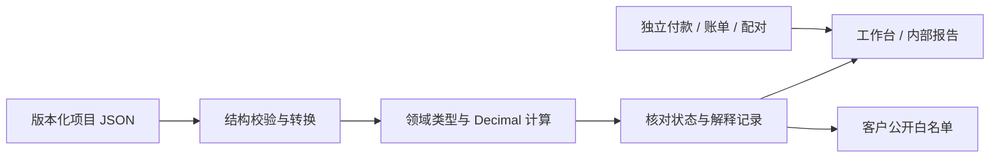

# 能力与验证证据矩阵

> 仓库整合说明：第101至127轮源码、合成测试档案和已验收离线工具纳入本版本。下方历史记录保留各自验收时点的发布状态；本次同步见[发布说明](releases/phase127-publication.md)。独立恢复原型仍未接入正式工具。

2026-11-05，第127轮业务副本组合交接（第101至127轮纳入本版本；历史报告保持原记录）。面向中国一般贸易进口、单商品一票的本地内部测算工具。本文说明程序做了什么、用什么验证，以及没有证明什么；不以测试数量代替法规、真实业务或专业认证。

第127轮完成：[业务副本组合交接](fee-business-modal-validation.md)。第127轮完成业务副本组合交接，本地未发布。真实独立业务副本的七项交易字段接入原生弹窗组合，沿用原校验和计算；项目来源核对及明确确认保持。上层弹窗打开时延后重绘并隐藏旧金额，关闭后明确更新，原文和同一File保留。未提交或未采用输入、未读文件、实际异步任务、待绘及未保存修改阻止关闭；完整下载与保存确认分开。停止后不采用新输入，清理失败保留资料并明确重试。新增28项，完整175文件6346项单测零失败零跳过，原2工作线程与超时保持；21个原生状态、45项断言、3个布局、2组Node/浏览器对照及54项工程检查全部通过。实际下载逐字节核对，重开保持所有业务来源、历史和原文，同时按原契约重置六项旧会话身份。实际725项来源、41份历史报告及27份冻结候选核对。原src、格式、依赖、预算及4088491字节运行文件保持，46套财务沿用第125轮同字节历史，本轮重跑0套。完整工作台切换、原应用整体解绑、当前46方法完整原生观察和正式安装仍未完成，第101至127轮未更新main或公开网站。

历史（未发布本地候选）第126轮完成：[受限组件组合](fee-modal-composition-validation.md)。第126轮完成受限组件组合，本地未发布。高级设置、字段说明与引导在受信同源副本中各自限定查询、唯一ID和监听器，已登记组件的滚动锁按令牌保留至最后退出。上层打开时拒绝底层重绘或替换，先关闭再明确重试；同项目保留原节点/File，明确替换保留最多一组旧输入，新表单不继承旧选择。新增47项，完整173文件6318项单测零失败零跳过，原2工作线程与超时保持；23个原生状态、50项断言、3个布局和4组Node/浏览器对照通过，53项工程检查全部通过。两项成员调用回归修复前失败、修复后通过，初始七份失败和新增样式失败各自保留源码，首版第八份与修正版第十份分别完整回放通过。实际716项来源、40份旧报告及26份冻结候选核对。原src、格式、依赖、预算与4088491字节运行文件保持，46套财务沿用同字节第125轮历史，本轮重跑0套。完整工作台切换、原应用整体解绑、当前46方法完整原生观察和正式安装仍未完成，第101至126轮未更新main或网站。

历史（未发布本地候选）第125轮完成：[移动面板异常恢复](fee-modal-recovery-validation.md)。第125轮完成移动面板六项已知异常修复及刷新前的File保全，本地未发布。关闭失败保持原弹窗和重试入口，打开失败回到原表单；缺少占位、宿主或原父节点仍保留原控件和File，不覆盖已变为其他值或优先级的滚动样式。新增31项，完整171文件6271项单测零失败零跳过，原2工作线程与超时保持。真实原工作台49状态、72项断言、3个布局，以及新运行文件46套完整财务浏览器流程通过，52项工程检查全部通过。当前707项实际代码指纹、39份历史报告与25份冻结候选分别核对，最终完整验收记录使用相同源码和运行字节，首版完整财务恢复失败及其1029文件候选独立保留，关闭期间失焦重绘引发的重入已修复；早期定向与回放保持各自的原记录。完整切换、整体解绑、独立安装及当前46方法的原生观察未完成；相同值的外来样式往返和任意DOM异常原子性仍未证明。税务、术语、有效公式、格式、依赖和原预算保持，第101至125轮未更新main或网站。

历史（未发布本地候选）第124轮完成：[输入与文件保全验证](fee-input-preservation-validation.md)。第124轮完成费用输入与文件选择的三项修复，本地未发布。格式错误或非有限费用使用PRICING_INPUT_INVALID，保留原文并可定位修正，不补零；同项目全局和三处局部刷新保留未交接File节点，明确读取接管后清空，替换项目不继承旧选择；折叠状态反向Tab排除隐藏候选。新增79项、完整170文件6240项按原2工作线程和超时通过。真实表单27个状态、38项断言、3个布局及新产物46套浏览器流程通过，运行文件4085124字节。38份历史报告保持（含本轮三份工程未通过记录）；当前702项源码指纹与独立运行清单核对，财务观察指纹保持原记录，随后仅IO测试桩和九份校验元数据变化，生产源码、浏览器驱动及运行文件相同。保留初次全量中断、6101通过/139失败、首次财务14通过/恢复失败等记录；IO断言未改，17份恢复驱动更新实际故障入口。未改变税务/术语/有效计费公式、格式、依赖或预算。六项模态故障仍未修复，完整工作台切换和独立安装仍未完成，第101至124轮未更新main或网站。下一轮处理节点、原生模态异常、body样式所有权与明确重试。

历史（未发布本地候选）第123轮完成：[移动端原表单与恢复契约盘点](fee-mobile-settings-validation.md)。第123轮完成移动端高级面板的原行为盘点，本地未发布。使用原工作台的168个控件和3个文件输入，验证同一节点开关、焦点/滚动、700/701边界、排队close、项目替换和有效费用Escape提交。23个原生状态、29项观测断言、3个打开布局完成；其中9项确认现存缺口，并非修复通过。无效费用进入整页恢复、重绘文件选择、折叠反向Tab、样式优先级/外来覆盖、占位/宿主缺失及原生打开/关闭异常均已复现，尚未修复。完整169文件6161项按原双工作线程及超时通过，无新增单测。实际697项源码指纹和34份历史报告保持，原src与正式工具字节不变；46套完整财务浏览器沿用同字节历史，本轮未重跑。完整工作台切换与移动组件独立安装仍未完成，第101至123轮未更新main或网站。下一阶段第124轮优先修输入与文件保全及折叠键盘，第125轮处理节点回退、样式所有权与重试。

历史（未发布本地候选）第122轮完成：[受限会话启动与关闭验收](fee-component-session-validation.md)。第122轮受限组件会话启动与关闭验证完成，本地未发布。取消只停止后续准备，已创建组件和输入保留；模块或工厂Promise实际结束前不允许关闭确认。迟到模块不继续创建，迟到工厂交回的句柄保留，部分失败和未知工厂分别处理。新增60项、完整169文件6161项按原双工作线程与超时通过。9组Node/浏览器案例、41个原生状态、9个子文档和8组布局通过，覆盖真实模块响应等待、工厂迟到、私有身份、输入/标识ABA、相反关闭顺序、失败剩余项明确重试、外来描述符冲突和关闭后原文仍可编辑。已知组件关闭后才退役五项引导资源并恢复原存储描述符，原页面偏好和计算保持。实际694项源码指纹、33份历史报告保持；原src和正式工具字节不变，46套财务浏览器沿用同字节历史，本轮未重跑。补查发现工厂句柄方法检查抛错会漏标未知资源，新增回归修正；中断的首次全量及开始指纹保留，修复前受控回放与该指纹完全对应，最终从新目录完整重跑。未知工厂仍不能自动完整清理，不认证原文冻结或整个frame退役；完整工作台切换继续关闭，第101至122轮未更新main或网站。下一阶段第123轮先核对移动端高级面板的真实节点迁移与滚动恢复契约。

历史（未发布本地候选）第121轮完成：[首次引导与组件协作验收](fee-onboarding-validation.md)。第121轮首次引导与组件协作验证完成，本地未发布。复用原引导和字段说明，在受信同源文档内分别管理；副本偏好只留本次会话，不继承或改写原页面的浏览器偏好，关闭不代表已保存。新增38项、完整168文件6101项按原双工作线程与超时通过。6组Node/浏览器偏好案例、35个原生状态、4步原文及四宽度通过：自动/手动打开、前后步骤、Tab/Escape、焦点恢复、读写失败保留旧值、两个组件相反关闭顺序、叠放弹窗、部分准备失败、观察范围内标识ABA和失败静默/明确重试。子文档浏览器存储访问为0，原页面偏好、输入计算和回调身份保持。实际687项源码指纹及32份历史报告核对，原src和正式工具字节保持；46套完整财务浏览器沿用同字节历史记录，本轮未重跑。只覆盖引导八项与帮助五项登记资源，整个frame、启动取消和完整工作台切换仍未完成。同源文档不是恶意脚本沙箱，第101至121轮未更新main或网站。下一阶段第122轮先验证受限会话的启动、取消与组合清理，再单独盘点移动端高级面板的真实表单与滚动状态。

历史（未发布本地候选）第120轮完成：[字段说明独立实例验收](fee-field-help-validation.md)。第120轮字段说明隔离实例验证完成，本地未发布。复用原组件，在受信同源iframe内限定查询范围；只在专用本机Vite响应中替换唯一无障碍ID和两处监听器登记，原src与正式工具保持。新增36项、完整167文件6063项按原双工作线程和超时通过。5组共用端口案例、22个原生浏览器状态、7类原文及四宽度通过：Tab/Shift+Tab/Escape、焦点返回、两个实例独立、部分初始化失败、观察范围内标识ABA、关闭确认撤销、真实移除失败静默及明确重试。DOM与原文保留，原工作台仍可输入计算，原应用监听器不包装。实际679项源码指纹与31份历史报告核对；历史119稳定性6027通过及119初版6005通过/3超时均保持原记录。本轮46套完整财务浏览器沿用上一轮同字节产物的通过记录，未重跑。仅覆盖明确登记的五项组件资源，不管理整个iframe或启动取消，同源文档不是恶意脚本沙箱。完整工作台切换、原应用整体解绑与最终安装仍未实现，第101至120轮未更新main或网站。下一阶段先核对首次引导组件的状态与资源边界，再验证两个既有组件在同一受限会话中的协作；移动端高级面板和完整切换继续后置。

历史（未发布本地候选）第119轮稳定性收尾完成：[严格JSON校验与旧超时修复](fee-json-stability-validation.md)。第119轮稳定性收尾完成，本地未发布。共用JSON校验只在Node/Vite SSR使用严格Unicode原生方法，不可用时保留原循环；浏览器仍走原路径，客户端构建逐字节保持4083172字节。新增19项、完整166文件6027项在原双工作进程与超时下全部通过。原180秒用例107.83秒，两项原5秒用例4.22/2.63秒；另三轮双项原5秒复验均通过，不代表所有环境时间稳定。20组Node/浏览器对照、9份原文及摘要、四宽度通过；客户端原生方法查找为0。当前源码重跑16个真实资源状态与46套完整财务浏览器流程。新门槛核对实际671项源码指纹，30份历史报告保持，原119轮6005通过/3超时的报告不改写。历史投影只供历史检查，当前单测和浏览器使用实际指纹。交易/税务/利润规则、格式、预算、依赖及原测试保持，没有增加业务数据缓存。完整工作台切换、原应用整体解绑与最终安装仍关闭，第101至119轮未更新main或网站。下一步第120轮先接字段说明组件的隔离实例，验证限定查询、唯一无障碍ID、监听器引用、Tab/Escape与焦点恢复。

历史（未发布的119轮初版）第119轮开发中：[隔离资源所有权与失败保持](fee-resource-owner-validation.md)。第119轮资源管理模块已实现，仍为未发布开发候选。新增46项均通过；最终完整165文件6008项中6005通过、3项旧用例超时、0跳过，**全量验收未通过**。8组共用案例、16个真实浏览器状态和4种宽度通过：两个新副本实际释放监听器、计时器、Blob URL、弹窗及FileReader，等待物理任务与异步清理结束，失败保留可重试，DOM与未提交原文保留，原页面继续输入计算。这里只覆盖明确登记的新副本资源，原应用整体解绑、完整切换与正式接入仍关闭。原财税/贸易计算、格式、依赖、预算及离线运行字节保持，第101至119轮未更新main或公开网站。下一步先完成第119轮稳定性收尾，定位并修复旧超时；全部门槛通过后再进入第120轮现有组件隔离实例接入。

历史（未发布本地候选）第118轮完成[诊断格式计量与原5秒复验](fee-session-timing-validation.md)：本轮只优化独立诊断编解码器的字符串计量：UTF-8与两层JSON转义长度合并扫描，去掉未使用的重复计量，复用当前调用中已验证的文本指标。严格Unicode校验、重复/未使用文本表、两种格式及全部预算保持；计量表仍为单次调用内最多4096项，不增加全局缓存。新增16项覆盖1023/1024阈值、控制字符、全部非代理BMP字符、合法代理对及首/中/尾孤立代理字符；与未改Node参考逐字节互读。完整164文件5962项通过，旧两文件连续三轮各101项通过，原双线程、原5秒限制及旧测试源码保持。原生浏览器新26组、原39组接口及6组资源接口通过，30份线格式与Node逐字节相同，4种宽度无横向溢出；这是隔离编解码检查，未加载原工作台。合成剖析与对照仅用于本机定位，耗时仍有波动，不据此宣称所有环境稳定、25分钟远程CI预算、实际堆内存或业务容量改善。原财税/贸易规则、文件格式、依赖与离线产物保持。第117轮943文件候选已冻结，17份历史候选与28份报告保持；第117轮两项旧5秒超时、修复和首次中断开始快照归档缺口继续如实保留，不补造历史。完整工作台切换、原应用资源解绑和正式接入仍关闭；第101至118轮均未更新main或网站。下一阶段第119轮验证隔离root的真实资源所有权、取消、等待、部分失败与旧页面保留，再做最后单次安装。

历史（未发布本地候选）第117轮完成[控件证据预算与重复副本核对](fee-workbench-retention-validation.md)：新增69项，完整163文件5946项通过，原双工作线程及超时保持。诊断账本默认限制4096控件、8 MiB原文、65536个选择状态和128个File引用，先检查整笔更新再复制与替换；这是逻辑证据预算，不是堆/DOM或浏览器总内存上限。超限保留已有证据，永久失效本次观测并移除自己的六个root监听器与MutationObserver，后续输入不再完整记录，原应用仍可使用。仅对初始由可信来源精确匹配、期间未发生变化、已移出页面且当前仍匹配同一字段的重复旧控件提供单独核对、勾选与清理；初始未知、改后改回、坏数字、文件选择及曾无法读取的证据继续保留，不写源文件保存状态。当前原生来源证明仅覆盖商品数量。确认前同步验证全部候选，复制/跨实例/撤回/来源或输入ABA失效；外来原生属性getter不调用。另修复初次来源核对重入可覆盖较新记录的问题，外层发现记录已改变便停止观测并保留新记录。首次全量为此主动中断，修复前失败/修复后通过的回归用例及中断记录保留，最终按原配置从头完整复验通过。8组Node/浏览器案例、25个原工作台状态及四宽度通过；清理1个已核对重复数量控件，真实坏数字/File选择、来源ABA、恰好预算和超限拒绝均覆盖。旧及新的交接身份在超限后拒绝，原保存记录、业务与未核对输入不被清理；超限和停止后原数量仍可编辑。自己的面板click/change归零，72个原描述符恢复，无冲突。**有上限的输入证据与有限范围重复副本清理已实现；完整工作台切换及正式接入尚未实现。**未宣称全部DOM、脚本/反射/外部嵌套往返或自动资源生命周期完整，原应用解绑和最终安装仍后置。补充最后10项回归前，首轮完成的全量为5934通过、2项旧测试在原5秒限制下超时；两文件复验为100通过、1项超时，同一单项随后在当前运行时也有原5秒通过记录，尚未确定原因，不能归因于运行时版本。保留失败、复验及可用的源码绑定记录；首次中断开始快照的归档缺口另行列明。最后完整重跑通过不证明该时间敏感性已消除，原25分钟双平台远程CI仍未验证。另以10项修复前失败/修复后通过的回归补齐最后来源核对回调的重入：回调后重新检查本地代次、清理身份、停止状态和勾选状态，新输入、取消、撤回及停止均拒绝旧清理。归档脚本在第二次中断时覆盖首次中断的两个开始快照，已修复路径并单独记录证据缺口，不补造首次开始源码绑定；首次中断原因、旧原生浏览器、失败及修复结果仍保留，最终版本重新绑定源码完整验收。原财税/贸易规则、格式、依赖、业务/恢复预算和离线运行字节保持。第116轮932文件候选完整冻结，十六份历史候选及27份报告保持，第101至117轮均未更新main或网站。原46套完整财务浏览器、大档案专项及1/4/8本轮未重跑，不宣称专业、实际内存、耗时或容量改善。下一阶段先定位原5秒旧测试的时间敏感性，再在隔离root验证真实资源所有者、解绑/重绑及取消/失败，之后验证最后单次安装。

历史（未发布本地候选）第116轮完成[交接前核对与分项文本保全](fee-workbench-handoff-validation.md)：新增52项，完整162文件5877项通过，原双工作线程及超时保持。独立交接核对面板逐份选择六类已提交来源，确认只复制所选原文；原格式与文本不改。原保存记录分缺失、未知、匹配当前和对应其他文本，接口SAVED、下载发起及用户检查分别记录；副本声明不写原保存证据，不清除未提交或移出的变动输入，不授权完整恢复、客户报价或切换。选择和回执绑定私有观测、所选原文、原保存记录及代次；新准备、取消、已观测ABA或来源变化使旧身份失效。任务实际结束前拒绝重复准备/下载和销毁，撤回核对不冒充取消物理任务，迟到结果无当前确认身份。8组Node/浏览器案例、26个原工作台状态、3份实际下载及四宽度通过；每份逐字节对照来源并由原项目解析器读取。23处原应用资源仅盘点所有者上下文，4处本面板下载资源用独立本机账本验证，URL/计时器结束归零，原应用资源保留。自己的click/change监听器归零，72个原描述符恢复，原表单仍能编辑。**分项已提交文本保全已实现；完整工作台切换及正式接入尚未实现。**新所有者最多保留一份所选原文、单份64 MiB，不提高原业务/恢复容量；原root长期控件保留尚未设置独立上限。初始保存、任意外部嵌套/反射/无事件脚本ABA、全部DOM及自动/外部资源仍有未证明条件。原财税/贸易引擎、文件格式、依赖、既有预算及离线运行字节保持。第115轮921文件候选完整冻结，十五份历史候选与26份报告保持，第101至116轮均未更新main或网站。原46套完整财务浏览器、大资料专项和1/4/8本轮未重跑，不宣称专业、性能、峰值内存或容量改善。下一阶段先设计root控件证据退役和保留上限，超限明确阻断，不能删除未核对输入来清理计数；再在隔离副本验证资源清理、重绑及最终单次安装。

历史（未发布本地候选）第115轮完成[输入与变动边界补强](fee-workbench-boundaries-validation.md)：新增39项，完整161文件5825项通过，原双工作线程及超时保持。14份原源码解析40个方法入口及43处集合调用，共83处、8组持有者；仅在专用本机Vite响应中通知，提前缓存的登记原方法不会绕过入口，不换函数、集合或对象身份。集合先查找原callee再求值参数，接收方、getter次数、返回值、Promise及原错误保持。root六种原生输入事件和结构观察推进代次，变动控件移出页面仍保留待核对，读失败不抹去旧证据；值和文件身份仅留诊断内存，不写业务或报告。8组Node/浏览器共用案例、25个原工作台状态和四宽度通过；两份缓存原方法、指定适配器的集合往返、原数量输入移除/重接、7类原生监听器行为均验证。自动once/AbortSignal移除仍为未知，stopImmediatePropagation等不靠包装回调猜测。六个诊断root监听器归零，72个原描述符恢复且无冲突，保留的输入/持有者引用清除，原工作台仍能编辑。**登记源码与原生输入边界补强已实现；完整新鲜性、原资源解绑和工作台切换尚未实现。**初始保存证据未知，观测基线差异不代表提交或保存状态；重绘后移除的变动输入继续待核对。任意外部嵌套/反射、无事件脚本ABA、关闭的Shadow DOM和未登记资源仍未覆盖。原财税/贸易引擎、格式、依赖、容量预算及离线运行字节不改。第114轮909文件候选完整冻结，十四份历史候选及25份报告保持，第101至115轮均未更新main或网站。原46套完整财务浏览器、大资料专项和1/4/8本轮未重跑，不宣称专业、容量、性能或峰值内存改善。下一阶段先明确剩余未验证边界与受限交接/安装契约，再验证单次安装、失败保持和资源归属；高级资金、多次费用备份分别推进。

历史（未发布本地候选）第114轮完成[真实工作台状态与资源观测](fee-workbench-observation-validation.md)：新增44项，完整160文件5786项通过，原双工作线程及超时保持。首次全量有2个原大档案用例超时，保留失败记录后按原配置完整复验通过，未改原测试或放宽门槛。原15组192字段盘点中，五个未绑定控制器的32字段与40方法入口可在专用本机页面按实例观测；普通字段赋值、登记方法入口及返回推进单调代次，改动后又改回仍使旧检查失效。订阅仅包含持有者、代次和类型，不带业务值。安装前完整校验，撤销恢复当前值、对象身份与原描述符，不回滚用户操作、不覆盖外来描述符。23处资源调用从14份原源码解析，在本机Vite响应中局部适配，不写原源码、不全局改写EventTarget/URL原型；保留原回调及options、接收方、返回值、Promise身份和原错误。5组Node/浏览器案例、32个真实界面状态、四宽度、1份合成下载和两次撤销再挂载通过；旧检查确实遗漏的快捷选择/最近状态往返已复现，新检查会失效。原弹窗焦点也可能先触发旧检查，不把所有变化都宣称为漏检。原URL/计时器创建与完成分别观测，停止诊断不移除应用资源，诊断自己的点击监听器归零，原工作台仍能继续编辑。**真实工作台选定范围观测已实现；完整工作台切换及正式接入尚未实现。**外部直接修改嵌套对象、提前缓存的原方法引用、反射往返、未登记资源、once/AbortSignal自动移除及全部DOM缓冲仍未完整覆盖，完整新鲜性和切换权限保持关闭。原财税/贸易引擎、文件格式、依赖、默认容量和离线运行字节不改。第113轮897文件候选已冻结，十三份历史候选及24份报告保持，第101至114轮均未更新main或网站。原46套完整财务浏览器、1/4/8及大资料专项验收本轮未重跑，不宣称专业、容量、性能或峰值内存改善。下一阶段先补完整观测缺口，再验证原子安装；高级资金、多次费用备份和正式发布分别推进。

历史（未发布本地候选）第113轮完成[独立会话生命周期与关闭保护](fee-session-lifecycle-validation.md)：新增41项，完整159文件5742项通过，原双工作线程与超时保持。独立会话关闭核对绑定业务、付款、表单、来源及任务代次，复制/跨会话/取消/ABA撤销旧身份；未提交、未完整交接和未被表单接收的文字分别保护，未知状态拒绝关闭，未保存必须明确确认放弃。取消任务不丢资料，等待客户/内部写入、分项下载、付款文件读取和打开工作实际结束后重新准备。下载URL的一秒回收计时也属于物理任务；下载已发起不当作完整保存。3组Node/浏览器往返案例、50个真实界面状态、2份实际下载、1次原生beforeunload提醒及4种宽度通过；五次挂载覆盖干净关闭、明确放弃、取消和重复打开，关闭后的本面板监听器、原生提醒和对象URL均归零。七类聚焦草稿与4001字拒收文字保留，明确放弃后的迟到change不复活旧文字；取消结束后原表单解除旧忙碌显示。**独立会话关闭保护已实现；完整工作台订阅、切换与正式接入尚未实现。**原生提醒仅覆盖本面板原生事件及明确刷新，外部程序化修改须刷新；浏览器/系统/强制关闭不保证提醒或等待，不能替代备份。不改原财税/贸易引擎、文件格式、依赖、容量预算或离线运行字节。第112轮886文件候选冻结，十二份历史候选及23份报告保持，第101至113轮均未更新main或网站。原46套完整财务浏览器、1/4/8及大资料案例本轮未重跑，不宣称专业、容量、性能或峰值内存改善。下一阶段补真实工作台未绑定订阅和资源清单，再决定原子安装；高级资金、多次费用备份及正式发布分别后置。

历史（未发布本地候选）第112轮完成[独立敏感性与客户公开字段](fee-trade-forms-validation.md)：新增60项、完整158文件5701项。复用原敏感性分析，运费/汇率/待确认责任的假设不改实际报价、费用、利润口径或税基；最多21个变化点，零基准不计算百分比，坏参数保留而不显示旧结果。十一项客户公开字段和完整/简洁版式独立录入，客户文件仅取原白名单投影，内部银行费、资金、来源及恢复历史不自动拼接。每次按当前业务、付款、输入及版式重新核对；更改、取消或重开撤销核对。3组Node/浏览器案例、72个真实界面状态、4份完整与2份分项下载、两版HTML/Excel/PDF共6份实际客户下载及4宽度通过；HTML/PDF逐字节、Excel解包内容逐项对照原导出器，四页PDF只读渲染检查通过。完整内部载体明确使用0.2保全新表单，旧0.1继续读取/按原格式写出，旧读者拒绝0.2；旧客户批准不序列化，客户下载不清除内部待保存。39,201,629字节大输入和12,507,712字节既有备份完整往返，累计展开229,626,564字节；重开后子交接及追加来源触及原256 MiB链预算均明确拒绝，当前资料、原文及分项导出保留。第111轮874文件候选冻结，十一份历史候选与22份报告保持，原财税/贸易规则、依赖、离线运行字节和容量预算不变。第101至112轮均未更新main或网站。独立敏感性与客户字段已实现；完整工作台切换和正式接入仍后置，46套完整财务浏览器及1/4/8本轮未重跑，不宣称容量、性能、峰值内存或专业复核改善。下一阶段先验收真实生命周期、未提交缓冲及安全关闭/切换，高级资金版本和多次费用备份分别推进。

历史（未发布本地候选）第111轮完成[独立银行费与固定本金资金假设](fee-bank-funding-validation.md)：新增58项，完整157文件5641项。独立内部付款草稿可逐笔录入银行费来源、原币金额、实际付款方、经济承担方、日期与依据；已有费用沿原引擎核对责任、覆盖和是否计入，重复引用拒算，新增仅列计划不自动写成本，代付未建模仍退出。资金假设明确录入固定本金、年利率、性质、期间和基准，复用原单利引擎；未设置、不建模和零利率分别处理，各币种收付、资金成本、贸易利润与税基保持分开。3组Node/浏览器案例、54个真实界面状态、4份完整下载、1份分项付款下载及4宽度通过；连续重开保留银行费、资金原文、来源历史、完整父输入和既有备份。39,201,629字节合成输入、12,507,712字节非空既有应用备份完成往返，累计展开229,625,488字节；随后报价/来源追加触及原链预算明确拒绝，当前资料与分项文件保持。**独立银行费与固定本金资金假设录入已实现；仅明确启用本轮编辑的标准1.1可改，1.0/1.2至1.5只读保全，不静默升级或激活扩展。**报价变化后仍须明确重绑，不自动缩放价款、费用、本金或日期。原默认编辑器保持只读；完整外层0.1、旧格式和默认预算、原财税/贸易规则、依赖及运行字节不变。第110轮865文件候选冻结，十份历史候选与21份报告保持，第101至111轮均未更新main或网站。原46套完整财务浏览器及1/4/8本轮未重跑，不宣称容量、性能、峰值内存或专业验证改善。下一阶段补独立敏感性与客户公开字段，真实生命周期和高级资金版本分别验收。

历史（未发布本地候选）第110轮完成[独立实际报价与付款完整交接](fee-contract-settlement-validation.md)：新增44项，完整156文件5583项；独立副本可填写当前术语实际报价，沿原项目校验、单场景及对比引擎重算，不用模拟金额补合同事实。付款表单复用原实际报价绑定、标准JSON与原收付引擎；未完成计划保留为草稿，报价改变时提示失配，明确重新绑定后也不自动改金额、日期或触发条件。银行费未知不补零，计划净收付不等于利润或实际到账。3组Node/浏览器案例、41个真实界面状态、4份完整下载、1份分项付款下载及4宽度通过；连续重开保全实际报价、付款原文、全部来源历史、原输入全文及既有应用备份。完整外层下载后仍须明确确认保存，分项文件不清除待交接。39,201,629字节合成输入及12,507,712字节既有应用备份完成付款草稿往返；追加报价/来源后触及累计展开预算会明确拒绝，当前资料与分项导出仍可用。**独立报价与付款交接已实现；银行费/资金假设的可编辑表单、完整工作台切换及正式接入尚未实现。**旧档案付款只归档，标准高级版本明确导入后保全但只读，不复制旧客户确认或开放新费用应用。新独立载体0.1限64 MiB编码体、256 MiB累计展开链和16层，旧格式、默认预算、原财税/贸易规则、依赖和运行字节保持。第109轮852文件候选已冻结，九份历史候选与20份历史报告保持，第101至110轮均未更新main或网站。46套完整财务浏览器及1/4/8沿用历史，本轮未重跑；较大档案往返不证明容量、性能或峰值内存改善。下一阶段沿原标准扩展独立银行费和资金假设，再做敏感性/客户字段与真实生命周期保护。

历史（未发布本地候选）第109轮完成[完整工作台切换前盘点与只读检查](fee-workbench-switch-validation.md)：新增30项，完整155文件5539项；源码解析盘点15组状态与192个字段（10组已绑定160个字段、5组未绑定32个字段），另列3组全局集合及监听器、定时器与对象URL位置。真实工作台挂载只读检查，按未保存、未提交、进行中和未知状态列出阻断，未知保存证据不当作已备份。5组Node/浏览器案例、17个真实界面状态及4宽度通过；数量、零汇率、客户、付款、敏感性、弹层及原生重新检查均覆盖，检查前后原业务、页面和存储保持。关闭诊断后原表单仍可使用。**只读切换前检查已实现；完整表单迁移、监听器解绑/重绑、关闭保护、完整工作台切换及正式接入尚未实现。**复制或跨检查器的报告无当前观测身份，已绑定根ABA会失效；未绑定状态在两次观测间变化后又变回仍不能识别，明确保留订阅缺口，不把安静状态当切换授权。第108轮841文件候选已冻结，旧快照保持，第101至109轮均未更新main或网站。原财税、依赖、格式与离线运行字节保持，46套完整财务浏览器及1/4/8沿用历史，本轮未重跑，不宣称容量、性能或峰值内存改善。下一阶段先扩展独立实际报价和付款表单，逐项复用原校验并贯通未保存保护及完整交接；生命周期与多次费用备份分别验证。

历史（未发布本地候选）第108轮完成[最小独立编辑与完整继续交接](fee-package-continuation-validation.md)：新增50项，完整154文件5509项；在新的独立业务副本中复用七个最小交易字段、原校验和原引擎，明确同步后追加来源记录，再下载完整继续交接文件并重新打开。原输入全文、继承来源记录和既有应用备份均完整保留，新记录不从零计数。3组轻量Node/浏览器案例、34个真实界面状态、4份实际完整下载、1份分项项目下载及4种宽度通过；连续两次编辑、下载和原生文件选择重开逐字核对，Node独立解压与原协议对照通过。浏览器发起下载不冒充保存完成，须明确检查并确认；有未交接修改时阻止另开资料，部分下载不清除待保存。大资料超限在来源覆盖前拒绝，交易修改仍保留。**最小独立编辑与再次完整交接已实现；新费用批次、完整表单、工作台切换及正式接入继续后置。**新增继续载体0.1完整嵌入上一份输入，旧内部包0.1及旧格式不改；原64 MiB包、64条／64 MiB历史限制保持，新增载体限64 MiB编码体、256 MiB累计展开链和16层。第107轮829文件候选已冻结，旧快照保持，第101至108轮均未更新main或网站。原财税、依赖和离线运行字节保持；46套完整财务浏览器及1/4/8沿用历史，本轮未重跑，不宣称容量、性能或峰值内存改善。下一阶段先盘点完整工作台持有者、未保存输入与安全切换条件，多次费用备份另行设计。

历史（未发布本地候选）第107轮完成[完整包独立已提交资料会话](fee-package-session-validation.md)：本地新增36项，完整153文件5459项；从完整包内最新五类来源与当前封套重建十组全新持有者，原引擎和对比重新计算，当前六份来源逐字核对。原完整包、原始档案、全部来源记录及应用备份另槽完整保全；历史未知、消费与退休编号保持。6组Node/浏览器案例、21真实状态、5份完整来源及原协议对照、原生文件选择/声明/明确打开和4宽度通过。坏文件、取消、迟到、ABA及安装失败保留旧会话，成功后的显示失败不回滚。旧草稿、坏数字、未读文件、付款/敏感性/客户表单和旧确认只存档，不装作当前事实；各子文件保存状态未知。**最新已提交资料的独立重建已实现；继续编辑、再次完整交接、完整工作台切换及正式接入尚未实现。**第106轮818文件候选已冻结，旧快照保持；第101至107轮均未更新main或网站。原财税、格式、依赖、原业务模块和离线运行字节保持；46套完整财务浏览器及1/4/8沿用历史，本轮未重跑，不宣称性能、峰值内存或容量改善。下一阶段把完整历史接到可编辑独立副本，再验证来源追加与再次交接，不将历史从零开始或仅留最后一次备份。

历史（未发布本地候选）第106轮完成[完整内部项目包与独立只读打开](fee-recovery-package-validation.md)：本地新增70项，完整152文件5423项；完整内部JSON包0.1包含当前项目/封套、原恢复档案、全部来源同步记录和本副本的新应用备份。原四/五文件原文不改；逐项重算来源指纹、待办与连续历史，旧候选及补丁不执行。6组Node/浏览器案例、25个真实状态、4份实际下载并经原生文件选择只读打开、4种宽度通过；文件损坏、取消、写入失败、迟到及交付后显示失败保留当前项目与旧只读视图。包限64 MiB、最多64条来源更新及本副本0或1次新应用，超限拒绝不截历史；SHA仅表明完整性，浏览器发起下载不冒充操作系统保存完成。**完整来源记录交接与独立只读打开已实现；继续编辑、完整工作台重开和正式接入尚未实现。**第105轮807文件候选已冻结，旧快照保持；第101至106轮均未更新main或网站。原规则、格式、依赖、运行字节和4/8限制保持；46套财务浏览器及1/4/8沿用历史，本轮未重跑，不宣称性能或峰值内存改善。下一阶段先设计完整包中新建独立业务会话，保留连续历史，再补齐完整表单与切换保护。

历史（未发布本地候选）第105轮完成[重录来源核对与明确同步](fee-recovery-reconcile-validation.md)：本地新增41项，完整151文件5353项；五类来源差异须明确选择，原封套接口完整验证后展示前后指纹、回执及退休编号和仍未解决的待办。勾选声明、明确确认时重新准备，原捕获预算预检后一次替换封套控制器/工作区/workflow三个参与者；项目、费用、回执、原文及应用备份保持。8组Node/浏览器案例、24个真实状态、3份原协议对照及4宽度通过；准备/确认期间取消、ABA、迟到、部分失败和更新后显示失败保持。全部来源更新记录保留，独立限制64条/64 MiB；不重绑配对或清除历史未知，不批准客户报价。另修正只读实际报价标签，原取值与计算不变。**来源同步已实现，完整更新记录交接、真实新下载、完整重开及原工作台接入尚未实现。**第104轮796文件候选已冻结，旧快照保持；第101至105轮均未更新main或网站。原规则、格式、依赖、运行字节及4/8限制保持；46套财务浏览器及1/4/8沿用历史，本轮未重跑，不宣称性能或峰值内存改善。下一阶段先交接全部来源更新记录与当前文件、原档案及应用备份，再验证下载、取消及重新打开的边界。

历史（未发布本地候选）第104轮完成[独立业务最小表单与原校验重录](fee-recovery-trade-validation.md)：本地新增42项，完整150文件5312项；第二组真实业务持有者内的七个交易/报价字段可重新录入，原项目校验与原单场景/对比引擎重算，一次替换两个参与者。固定报价金额可编辑，实际独立报价及目标基准保持只读；数量变化不自动缩放整笔报价或费用。失焦、回车、明确提交及逐项错误定位均操作真实表单；无效输入保留、隐藏旧结果并阻断费用准备、交接和客户报价。8组Node/浏览器案例、20状态、3份原协议对照、4宽度和两个同名独立面板通过，320px长金额显示已修正。输入ABA/放弃不复活旧费用或客户确认，失败保持、原来源/未知扩展及应用历史保留。**最小业务表单已实现，完整重录后封套交接、原表单全覆盖、工作台切换及正式接入尚未实现。**第103轮786文件候选已冻结，旧快照保持；第101至104轮均未更新main或网站。原规则、格式、依赖、运行字节和4/8限制保持；46套完整财务浏览器和1/4/8沿用同字节历史，本轮未重跑，不宣称性能或峰值内存改善。首次完整执行有一项原用例超时，保留失败；原限时/两工作线程完整复验通过，未放宽门槛。下一阶段先明确核对重录项目与原封套差异，再交接整套文件。

历史（未发布本地候选）第103轮完成[独立显示与重新录入指引](fee-recovery-preferences-validation.md)：本地新增46项，完整149文件5270项；新手/专业模式、面板收起及证据展开分别明确选择，候选不自动安装，只有新的确认才一次替换独立显示根。未知标识只归档，全未知组保持当前设置，冲突整份拒绝；手动显示编辑和归档切换ABA撤销旧候选。8组Node/浏览器案例及原7组阅读案例一致，16个独立显示状态、3份原协议对照、4宽度与2个实际说明焦点通过。草稿只生成重新录入说明，坏数字/未读文件和客户核对仍未解决；不回填金额、不拼接归档选择器。**这是独立显示结构和说明，不含原业务表单；实际工作台导航、完整重开和正式接入尚未实现。**原财税、格式、依赖、运行字节和4/8限制保持。第102轮776文件候选已完整冻结保存，第101轮旧快照保持，两轮之后继续不上传档案、不更新main或网站。46套完整财务浏览器及1/4/8容量沿用同字节历史，本轮未重跑，不宣称性能、峰值内存或专业验收。下一阶段先验证独立业务副本的最小交易/报价视图及按原校验重新录入，再扩展完整视图和实际切换。

历史（未发布本地候选）第102轮完成[恢复资料逐项核对](fee-recovery-review-validation.md)：本地新增45项，完整148文件5224项；独立清单逐项区分已提交资料、草稿重新录入、坏数字/未读文件、显示偏好、历史、旧执行资格及未知字段。7组Node/浏览器案例一致，16个独立面板状态、3份原Node协议对照与4种宽度通过。双原文摘要与私有选择绑定来源，取消/失败保留旧资料，明确切换清空旧阅读，上下文ABA撤销。全部条目已阅读也不能清除重新输入要求、应用费用或批准客户报价。**这是独立只读核对原型，不安装界面偏好、不接管原工作台；完整工作台重开尚未实现。**原HTML只显示转义文字，完整归档保持，界面预览有单独限额。第101轮候选已完整冻结保留；两轮均未更新main或公开网站。原财税、格式、依赖、运行字节及4/8限制保持；46套完整财务浏览器和1/4/8容量沿用同版本历史，本轮未重跑，不宣称性能、峰值内存或专业验收。下一阶段先做显示偏好的独立明确安装与重新输入定位，再验证完整切换。

历史（未发布本地候选）第101轮完成[恢复后独立业务与交接验证](fee-recovery-business-validation.md)：新增31项，完整147文件5179项；明确打开原恢复档案后，第二组独立业务持有者重新生成真实预览与十组候选，以新的核对声明和确认通过原准备器一次提交。5组Node/浏览器检查一致，12个页面状态、六份真实下载、两组独立文件核对与4种宽度通过；新副本3→4费用、0→1回执，原工作台与原只读会话保持，重复提交拒绝。原档案source_wire/supplement_json逐字保留，正式项目/封套、新应用备份和完整性清单分别交接；五文件不是可自动重开的完整新工作台格式。客户从空白字段和新核对开始，应用后必须再次确认，内部标记与原客户资料不进入客户HTML。**这是独立业务延续原型，尚未接入正式工具，完整工作台重开尚未实现。**取消或应用后保存取消不重复计费；原财税、格式、运行字节及4/8限制保持。46套完整业务沿用同版本历史，本轮未重跑，也未重测1/4/8容量、性能或峰值内存。下一轮先核对未提交资料和界面状态，验证安全切换与失败保留后，再决定正式接入。

历史第100轮完成[恢复清单与独立会话验证](fee-recovery-reopen-validation.md)：新增32项，完整146文件5148项；恢复清单与独立已提交资料会话原型使用五类现有控制器、十组新所有者，六来源、原汇率及文件证据逐项重建，并以原引擎重新计算。4组Node/浏览器检查一致，15个实际页面状态、3份原Node协议对照、4种屏幕宽度通过。取消、坏文件、迟到、旧身份、ABA、部分准备失败和重复恢复保持当前会话；已应用4费用/1回执不重复，恢复零费用写入。未提交输入阻断，无效数字/未读取文件须重新输入或选取。**这是独立核对原型，尚未接入正式工具，完整工作台重开尚未实现。**旧候选/补丁/客户确认只归档，原财税、文件、运行字节与4/8限制保持；46套完整业务沿用同版本历史，本轮未重跑，也未重测1/4/8容量、性能或峰值内存。下一轮先验证恢复后的完整业务链路、正式交接与客户隔离，再决定接入。

历史第九十九轮完成[补充原文共享验证与不接入结论](fee-recovery-sharing-validation.md)：新增44项，完整145文件5116项；19项Node/浏览器检查一致，两份隔离表示逐字一致，5份实际补充表示经独立Node解码完整对应，原来源编码另经未改动Node协议逐字核对。4个页面状态及原1/4/8资料实测：候选补充中间表示减少5,411,554字节，gzip文本体减少329,472字节；基础、正式采用及已应用资料的未压缩表示反而更大。完整候选仍为143,014,394字节，超过128 MiB，原恢复方式继续拒绝，4/8也保持原限制。**不将此方案作为容量修复接入；完整工作台重开仍未实现。**原文、未知历史、费用/回执和客户确认保持，测量零费用写入；原UI仅建立一个合成历史批次。原128/256/64 MiB预算分别保持，原财税、文件与运行字节保持；46套完整业务沿用同版本历史，本轮未重跑，不宣称生产性能或峰值内存改善。下一阶段优先为已能完整保全的小规模资料接恢复入口与安静安装，完整业务链路通过后再考虑运行接入。

历史第九十八轮完成[恢复数据格式与独立还原器](fee-recovery-format-validation.md)：新增54项，完整144文件5072项；16项隔离浏览器检查与Node一致，两份隔离及四份实际页面编码经原Node协议逐字核对。15个页面状态中14个完整恢复至独立数据容器，待确认候选含全部备份达143,014,394字节，超过128 MiB明确拒绝且原工作台保持；未删历史或放宽预算。已应用历史完整恢复和重复恢复保持4笔费用/1回执，恢复零费用写入，未知利润仍为null。原1/4/8资料重跑，4/8仍按原预算拒绝。**尚未接入正式工具，完整工作台重开尚未实现。**浏览器无效数字缓冲与未读取文件内容要求重新输入。原财税、文件与运行字节保持，46套完整业务沿用同版本历史，本轮未重跑，不宣称容量、耗时或峰值内存改善。下一阶段先处理完整候选超限，再验证运行适配、安静安装、完整业务链路和实际收益。

历史第九十七轮完成[独立浏览器原生编解码器](fee-browser-native-validation.md)：新增65项，完整142文件5018项；不依赖源码文本变换，10份隔离编码和3份实际工作台编码与未改动Node原协议逐字一致。原69个复杂/运行场景重跑，52份完整捕获相同；39项接口契约和6组有界资源检查通过，每组40次重叠请求均拒绝，底层任务结束后才释放同实例工作槽。原1/4/8资料重跑：1笔还原并准备十组候选，4笔完整捕获、8笔保留根继续按原预算拒绝，未应用费用。**原生模块尚未接入正式工具，完整工作台重开尚未实现。**原财税、文件和运行字节保持；46套完整业务流程沿用同版本历史，本轮未重跑，不宣称容量、耗时或峰值内存改善。下一阶段实现完整恢复格式与独立还原器，先验证原文/历史、防重复和失败保留，再依据完整链路与实际收益决定接入。

历史第九十六轮完成[浏览器异步接口契约与恢复策略](fee-browser-recovery-validation.md)：新增81项，完整140文件4953项；三个异步阶段的及时取消、ABA、迟到异常、重入和私有观察分别验证。隔离浏览器39场景与Node逐项一致，10份编码经原Node解码再编码逐字核对。六类源文件只作分项保全，生成/下载/写入确认均不能当作完整重开；128/256/48/64/5 MiB五个不同上限分别列明。**独立浏览器原生编解码器及完整工作台重开均未实现，尚未接入正式工具。**原计算、文件格式和离线工具字节保持；原69场景、46套完整业务和1/4/8观察沿用固定历史证据，本轮未重跑，也不宣称容量或性能改善。下一阶段先实现独立原生编解码器并按本契约验证，再决定接入。

历史第九十五轮完成[真实页面只读分层映射](fee-layered-source-mapping-validation.md)：69个原复杂/运行场景重新对照，52份完整捕获逐字一致；新增67项，完整138文件4872项。实际浏览器与Node原协议的三份编码逐字一致，私有身份、A→B→A和取消后迟到读取分别验证。原1/4/8资料同条件复测：1笔还原后完成十组候选准备，4笔完整捕获、8笔保留根仍超原预算，均未继续编码或准备。首次8笔诊断通信超时独立保留，成功重验不证明其唯一原因。**尚未接入正式工具，不宣称容量、耗时或峰值内存改善。**原生产源码、财税规则与离线工具字节保持；46套完整业务流程沿用第九十三轮同版本证据，本轮未重跑。下一阶段先设计浏览器原生接口、异步失效与大资料备份/恢复策略，再依据完整证据决定接入。

另完成[fast-uri开发依赖最小安全补丁](fast-uri-patch-validation.md)：只将Ajv的传递包3.1.8更新至3.1.9，在线审计恢复0项；完整测试和本轮69场景、1/4/8观察在补丁环境重新运行，原应用依赖与离线工具字节保持。

历史第九十四轮完成[分层捕获独立协议0.1](fee-layered-capture-validation.md)：序列化前区分规范保留根与完整捕获外壳，共享完整原文，持有者、未提交状态与私有身份保持。新增85项，完整135文件4805项；22个独立诊断场景核对实际128 MiB、300000节点、坏引用、ABA、迟到读取与真实十组候选准备。**尚未接入正式工具，不宣称容量或性能提升。**原运行字节保持，46套浏览器及69捕获沿用第九十三轮同版本证据，本轮未重跑。下一阶段先验证真实页面只读映射与69场景，再复测1/4/8资料。

历史第九十三轮完成[完整检查失败后的源文件指引](fee-save-guidance-validation.md)：区分检查未完成、备份未生成、另存取消与保存未确认；六个按钮只定位原另存入口。六类JSON不等于完整工作台备份，未提交输入仍须自行保留；迟到保存不覆盖新状态，原费用/回执与客户确认保持。新增27项，完整132文件4720项；15项原生检查、8组布局与24次正式另存通过，原46套完整流程和69个捕获场景在新产物重跑。**原大资料容量限制保持，不宣称提速。**下一轮先设计分层捕获、原文引用及语义预算，独立验证可逆性、ABA与恢复等价后再考虑接入。

历史第九十二轮完成[1/4/8笔分阶段容量复测](fee-capacity-stages-validation.md)：1笔原预览、十组候选及完整备份通过；4笔完整捕获225.7 MB超限，8笔保留语义根284.3 MB超限。原工作台备份同样受限，六类正式源文件共18次另存逐字节核对通过，费用、回执和客户确认保持。新增34项，完整131文件4693项；原运行产物保持，46套完整浏览器证据沿用第九十一轮同字节结果，本轮未重跑。**容量限制尚未解决，不宣称提速。**下一轮先改善超限后的明确另存指引，再验证分层捕获和原文引用的等价性与预算。

历史第九十一轮完成[只读语义捕获接入与完整流程复验](fee-semantic-integration-validation.md)：正式工作台显式读取十组生产者，原文件、未提交状态、业务资格、历史和完整128 MiB预算保持。新增45项，完整130文件4659项；69个捕获场景中52份完整捕获与独立历史实现一致，四个旧反例保持关闭。全部46套原生浏览器流程在新产物重跑，覆盖预览、最新代次重准备、一次根替换、重复提交防护、提交后恢复、正式文件交接、客户隔离与窄屏。**原4/8笔容量仍受限，本轮不宣称提速或容量提升。**旧0.1/0.2矩阵原样保留，CI分别核对历史资格与当前接入。下一轮用同夹具复测1/4/8笔，分别记录捕获、准备、备份及失败原因。

历史第九十轮完成[来源语义预算0.2与反例关闭](fee-semantic-budget-validation.md)：新增45项，完整128文件4614项；69个真实浏览器场景中52份完整捕获逐字一致，四个旧普通JSON反例全部关闭，14种不支持JS对象及原超深/超节点仍拒绝。复合快照的多层转义、中文/emoji实际128 MiB边界通过。**新原型仍独立，正式工具继续原捕获；原4/8笔容量限制保持。**旧0.1矩阵与反例原样保留，CI核对新旧证据及生产隔离。下一阶段接只读捕获并复验完整预览、候选、确认提交及恢复，再做同条件1/4/8测量。 另完成[Vitest5.0.3最小安全补丁](vitest-patch-validation.md)：实际审计0项，旧42/新69场景在补丁环境重跑；CI审计门槛覆盖中风险告警。

历史第八十九轮完成[来源适配兼容矩阵与CI门槛](fee-source-compatibility-validation.md)：新增37项，完整126文件4569项通过；42个真实浏览器场景分开核对原捕获、原保留解析、新帧和重建，21个完整捕获相同，确认4个普通JSON边界反例。实际128 MiB的ASCII/中文UTF8、300000节点和32深度均验证。**正式工具继续原捕获，新适配不接入；原4/8笔容量限制保持。**CI检查反例、源指纹和生产隔离，诊断不提供交易就绪、来源采用或确认资格。下一步先对齐语义预算并关闭四例，再分步只读接入。

## 五条验收轴

“开发完成”仅指列出的受限路径可用；“自动化通过”指固定或合成输入的程序/浏览器检查。“人工专业复核”“真实单据对照”“真实设备验收”是另外三项，当前均未完成，按用户安排暂缓。示例中的EXAMPLE、用户自行确认和程序可计算不能提升为后三项。历史文档的测试数、未合并等状态仅对应其阶段。

基线为第五十五轮：79文件2660项测试、37套离线浏览器回归、166项线上检查，Windows/Linux CI和公开产物哈希核对；见[最近项目验收](recent-projects-ui-validation.md)及[PR #52](https://github.com/codeding-101/COCUDTT/pull/52)。第五十六轮新增合成案例与静态说明，见[当轮验收](capability-walkthrough-validation.md)。第五十八轮新增独立成分模块，完整82文件3139项及本轮静态介绍检查见[模块验收](fee-tax-components-module-validation.md)。第五十九轮新增[附件状态设计核对](fee-tax-attachment-design-validation.md)；第六十轮独立文件模块新增90项，完整85文件3229项，见[文件验收](fee-tax-attachment-file-validation.md)。文件API及[独立交接模块](fee-tax-attachment-controller-validation.md)已实现；第六十二轮[工作区验收](fee-tax-attachment-workspace-validation.md)接入页面，新增22项、完整88文件3302项。第六十三轮新增[精度设计验收](fee-precision-design-validation.md)，53/75/4860/124为独立设计证据，第六十四轮[独立精度模块](fee-precision-module-validation.md)实现五类API，新增193项、完整90文件3495项；尚无运行精度选择。第六十五轮新增[精度选择记录设计验收](fee-precision-selection-design-validation.md)，独立81/60状态案例及50/51单叶变更；不是生产文件或UI证据。第六十六轮[独立精度文件](fee-precision-selection-file-validation.md)新增168项、完整93文件3663项；已实现严格文件API、Schema/合成模板，尚无运行入口或草稿恢复。第六十七轮[独立精度交接/内部审计](fee-precision-selection-controller-validation.md)新增89项、完整97文件3752项，实际客户两版式HTML/XLSX/PDF差分隔离；尚无工作台精度入口或自动草稿。不把旧证据记成重跑结果。

## 受限能力、证据与边界

下表每一行的专业复核、真实单据、真实设备状态均为未完成；“有自动化证据”不承诺覆盖所有边缘场景。

| 能力与实现状态 | 源码及自动化证据 | 已覆盖与仍有边界 |
|---|---|---|
| 第122轮受限组件会话：本地候选 | [设计](fee-component-session-design.md)、[验收](fee-component-session-validation.md)、[机器记录](cases/fee-component-session.json)、[协调器](../tools/fee-component-session.ts)、[引导租约](../tools/fee-component-session-dom.ts)、[测试](../tests/fee-component-session.test.ts) | 60项新增、6161完整回归；9案例/41状态/9子文档/8布局；已知资源退役、未知工厂保留阻断，原文不冻结，完整切换仍关闭 |
| 第121轮首次引导与组件协作：本地候选 | [设计](fee-onboarding-design.md)、[验收](fee-onboarding-validation.md)、[机器记录](cases/fee-onboarding.json)、[偏好](../tools/fee-onboarding-preference.ts)、[实例](../tools/fee-onboarding-scope.ts)、[测试](../tests/fee-onboarding-scope.test.ts) | 38项新增、6101完整回归；6案例/35状态/4步/四宽度；原浏览器偏好保持，副本仅会话内偏好，完整切换仍关闭 |
| 第120轮字段说明独立实例：本地候选 | [设计](fee-field-help-design.md)、[验收](fee-field-help-validation.md)、[机器记录](cases/fee-field-help.json)、[端口](../tools/fee-field-help-port.ts)、[实例](../tools/fee-field-help-scope.ts)、[测试](../tests/fee-field-help-scope.test.ts) | 36项新增、6063完整回归；5案例/22状态/7类说明/四宽度；仅受信组件副本，原src保持，未实现完整切换 |
| 第119轮稳定性收尾：本地候选 | [设计](fee-json-stability-design.md)、[验收](fee-json-stability-validation.md)、[机器记录](cases/fee-json-stability.json)、[生产校验](../src/data/fee-envelope-json.ts)、[冻结对照](../tools/fee-json-stability-oracle.ts)、[回归](../tests/fee-json-stability.test.ts) | 19项新增、6027项完整回归；20组跨环境/9原文摘要/16资源状态/46套财务浏览器；仅SSR快路径，旧失败及客户端字节保持 |
| 第119轮初版资源所有权：历史未通过候选 | [设计](fee-resource-owner-design.md)、[验收](fee-resource-owner-validation.md)、[机器记录](cases/fee-resource-owner.json)、[所有者](../tools/fee-resource-owner.ts)、[原生适配](../tools/fee-resource-owner-dom.ts)、[测试](../tests/fee-resource-owner.test.ts) | 新增46通过；完整6008项6005通过/3旧超时；8案例/16状态/四宽度。仅明确登记资源，未取得发布或原应用整体解绑资格 |
| 诊断编解码格式计量：本地前置修复 | [设计](fee-session-timing-design.md)、[验收](fee-session-timing-validation.md)、[机器记录](cases/fee-session-timing.json)、[编解码器](../tools/fee-browser-native-codec.ts)、[边界案例](../tools/fee-session-timing-cases.ts)、[测试](../tests/fee-session-timing.test.ts) | 新增16、完整164文件5962项；三轮原5秒各101项；隔离26新/39旧/6资源/30线格式/四宽度，不代表所有环境稳定或原应用解绑 |
| 控件证据预算与重复副本核对：本地诊断 | [设计](fee-workbench-retention-design.md)、[验收](fee-workbench-retention-validation.md)、[机器记录](cases/fee-workbench-retention.json)、[账本](../tools/fee-workbench-retention.ts)、[DOM](../tools/fee-workbench-retention-dom.ts)、[测试](../tests/fee-workbench-retention.test.ts) | 新增69、完整163文件5946项；8案例/25状态/四宽度；逻辑预算与明确清理，不代表堆内存上限或完整切换 |
| 交接前核对与分项文本保全：本地独立面板 | [设计](fee-workbench-handoff-design.md)、[验收](fee-workbench-handoff-validation.md)、[机器记录](cases/fee-workbench-handoff.json)、[交接](../tools/fee-workbench-handoff.ts)、[资源清单](../tools/fee-workbench-handoff-inventory.mjs)、[测试](../tests/fee-workbench-handoff.test.ts) | 新增52、完整162文件5877项；8案例/26状态/3下载/四宽度；保存与未提交状态不写，完整恢复和切换未实现 |
| 输入与变动边界：本地只读原型 | [设计](fee-workbench-boundaries-design.md)、[验收](fee-workbench-boundaries-validation.md)、[机器记录](cases/fee-workbench-boundaries.json)、[入口](../tools/fee-workbench-boundaries.ts)、[输入](../tools/fee-workbench-dom-buffers.ts)、[测试](../tests/fee-workbench-boundaries.test.ts) | 新增39、完整161文件5825项；8案例/25状态/四宽度；83源码边界；自动移除和完整切换保持未知/未实现 |
| 真实工作台选定范围观测：本地原型 | [设计](fee-workbench-observation-design.md)、[验收](fee-workbench-observation-validation.md)、[机器记录](cases/fee-workbench-observation.json)、[控制器](../tools/fee-workbench-observation.ts)、[资源](../tools/fee-workbench-resources.ts)、[测试](../tests/fee-workbench-observation.test.ts) | 44新增、160文件5786项；5案例/32状态/四宽度，五控制器32字段40入口与23调用；完整新鲜性、解绑和切换后置 |
| 独立会话生命周期与关闭保护：本地原型 | [设计](fee-session-lifecycle-design.md)、[验收](fee-session-lifecycle-validation.md)、[机器记录](cases/fee-session-lifecycle.json)、[控制器](../tools/fee-session-lifecycle.ts)、[面板](../tools/fee-session-lifecycle-panel.ts)、[测试](../tests/fee-session-lifecycle.test.ts) | 41新增、159文件5742项；3案例/50状态/2下载/1原生提醒/4宽度，五次挂载关闭资源归零；全工作台订阅/切换后置 |
| 独立敏感性与客户公开字段：本地原型 | [设计](fee-trade-forms-design.md)、[验收](fee-trade-forms-validation.md)、[机器记录](cases/fee-trade-forms.json)、[控制器](../tools/fee-trade-forms.ts)、[表单](../tools/fee-trade-forms-panel.ts)、[测试](../tests/fee-trade-forms.test.ts) | 60新增、158文件5701项；3案例/72状态/4完整/2分项/6客户下载/4宽度；原模型、新核对和完整输入保全，正式接入后置 |
| 独立银行费与固定本金资金假设：本地原型 | [设计](fee-bank-funding-design.md)、[验收](fee-bank-funding-validation.md)、[机器记录](cases/fee-bank-funding.json)、[控制器](../tools/fee-recovery-settlement.ts)、[表单](../tools/fee-bank-funding-panel.ts)、[测试](../tests/fee-bank-funding.test.ts) | 58新增、157文件5641项；3案例/54状态/4完整及1分项下载/4宽度，原收付/单利及完整历史保全；仅1.1编辑，正式接入后置 |
| 独立实际报价与付款完整交接：本地原型 | [设计](fee-contract-settlement-design.md)、[验收](fee-contract-settlement-validation.md)、[机器记录](cases/fee-contract-settlement.json)、[模块](../tools/fee-contract-settlement.ts)、[面板](../tools/fee-contract-settlement-panel.ts)、[测试](../tests/fee-contract-settlement.test.ts) | 44新增、156文件5583项；3案例/41状态/4完整及1分项下载/4宽度，既有应用备份保全；银行费/资金编辑及正式切换后置 |
| 完整工作台切换前盘点：本地只读原型 | [设计](fee-workbench-switch-design.md)、[验收](fee-workbench-switch-validation.md)、[机器记录](cases/fee-workbench-switch.json)、[模块](../tools/fee-workbench-switch.ts)、[面板](../tools/fee-workbench-switch-panel.ts)、[测试](../tests/fee-workbench-switch.test.ts) | 30新增、155文件5539项；15组192字段/3全局集合，5案例/17真实状态/4宽度；真实工作台只读隔离，完整切换及关闭保护后置 |
| 最小独立编辑与完整继续交接：本地原型 | [设计](fee-package-continuation-design.md)、[验收](fee-package-continuation-validation.md)、[机器记录](cases/fee-package-continuation.json)、[适配器](../tools/fee-package-continuation.ts)、[面板](../tools/fee-package-continuation-panel.ts)、[测试](../tests/fee-package-continuation.test.ts) | 50新增、154文件5509项；3轻量案例/34状态/4完整及1分项下载/4宽度，连续两轮完整交接；原输入和继承历史保留，完整工作台后置 |
| 完整包独立已提交资料会话：本地最小原型 | [设计](fee-package-session-design.md)、[验收](fee-package-session-validation.md)、[机器记录](cases/fee-package-session.json)、[模块](../tools/fee-package-session.ts)、[面板](../tools/fee-package-session-panel.ts)、[测试](../tests/fee-package-session.test.ts) | 36新增、153文件5459项，6可移植案例/21状态/5份完整来源与协议对照/4宽度；最新六来源重建真实持有者、旧表单只保全；继续编辑与完整切换后置 |
| 完整内部项目包与独立只读打开：本地原型 | [设计](fee-recovery-package-design.md)、[验收](fee-recovery-package-validation.md)、[机器记录](cases/fee-recovery-package.json)、[格式](../tools/fee-recovery-package.ts)、[面板](../tools/fee-recovery-package-panel.ts)、[测试](../tests/fee-recovery-package.test.ts) | 70新增、152文件5423项，6可移植案例/25状态/4真实下载与原生选择/4宽度；来源连续历史完整保全，只读打开零费用写入；完整业务重开与正式接入后置 |
| 重录后的来源核对与明确同步：本地原型 | [设计](fee-recovery-reconcile-design.md)、[验收](fee-recovery-reconcile-validation.md)、[机器记录](cases/fee-recovery-reconcile.json)、[模块](../tools/fee-recovery-reconcile.ts)、[面板](../tools/fee-recovery-reconcile-panel.ts)、[测试](../tests/fee-recovery-reconcile.test.ts) | 41新增、151文件5353项，8可移植案例/24状态/3协议对照/4宽度；新确认后一次同步，历史及业务待办保持；完整更新记录交接与原页面切换后置 |
| 独立业务最小交易/报价重录：本地原型 | [设计](fee-recovery-trade-design.md)、[验收](fee-recovery-trade-validation.md)、[机器记录](cases/fee-recovery-trade.json)、[模块](../tools/fee-recovery-trade.ts)、[面板](../tools/fee-recovery-trade-panel.ts)、[测试](../tests/fee-recovery-trade.test.ts) | 42新增、150文件5312项，8可移植案例、20状态/3协议对照/4宽度/双容器；真实七字段原校验重录，不重放草稿或客户批准，完整封套交接和原工作台切换后置 |
| 独立显示偏好与重新录入说明：本地原型 | [设计](fee-recovery-preferences-design.md)、[验收](fee-recovery-preferences-validation.md)、[机器记录](cases/fee-recovery-preferences.json)、[模块](../tools/fee-recovery-preferences.ts)、[面板](../tools/fee-recovery-preferences-panel.ts)、[测试](../tests/fee-recovery-preferences.test.ts) | 46新增、149文件5270项，8新/7旧可移植案例、16状态/3协议对照/4宽度/2说明焦点；只改独立显示，不采用草稿或客户批准，尚未接原业务表单 |
| 恢复资料逐项核对：本地独立原型 | [设计](fee-recovery-review-design.md)、[验收](fee-recovery-review-validation.md)、[机器记录](cases/fee-recovery-review.json)、[模块](../tools/fee-recovery-review.ts)、[面板](../tools/fee-recovery-review-panel.ts)、[测试](../tests/fee-recovery-review.test.ts) | 45项新增、148文件5224项，7组可移植案例/16面板状态/3协议对照/4宽度；阅读不采用，坏数字/未读文件仍须重新输入；不挂载原工作台或公开发布 |
| 恢复后独立业务与交接：开发原型 | [设计](fee-recovery-business-design.md)、[验证](fee-recovery-business-validation.md)、[机器记录](cases/fee-recovery-business.json)、[业务会话](../tools/fee-recovery-business.ts)、[面板](../tools/fee-recovery-business-panel.ts)、[边界测试](../tests/fee-recovery-business.test.ts) | 31项新增、147文件5179项，5组可移植检查/12状态/6下载/2文件对照/4宽度；新副本一次费用与回执，原页面/只读会话保持；完整重开与正式接入尚未完成 |
| 独立恢复清单与已提交会话：开发原型 | [设计](fee-recovery-reopen-design.md)、[验证](fee-recovery-reopen-validation.md)、[机器记录](cases/fee-recovery-reopen.json)、[还原器](../tools/fee-recovery-reopen.ts)、[面板](../tools/fee-recovery-reopen-panel.ts)、[边界测试](../tests/fee-recovery-reopen.test.ts) | 32项新增、146文件5148项，4组可移植检查/15浏览器状态/3协议对照/4宽度；真实控制器十组新所有者，未提交输入阻断；完整重开与正式接入尚未完成 |
| 分层捕获与原文引用：独立原型、未接入 | [设计](fee-layered-capture-design.md)、[验收](fee-layered-capture-validation.md)、[机器证据](cases/fee-layered-capture.json)、[门禁](../tools/check-fee-layered-capture.mjs) | 85项新增、135文件4805项、22个独立场景；实际预算、原文和持有者、私有失效与真实候选准备核对；正式工具保持，实际浏览器映射与容量提升未证明 |
| 完整检查失败后的源文件指引：已接入 | [设计](fee-save-guidance-design.md)、[验收](fee-save-guidance-validation.md)、[完整当前证据](cases/fee-save-guidance-native.json)、[测试](../tests/fee-workbench-save-guidance.test.ts)、[CI门禁](../tools/check-fee-save-guidance.mjs) | 新增27项，132文件4720项；原46套与69场景在新产物重跑，15项原生/8布局/24次正式另存；导航不保存，原容量与财税门槛保持 |
| 分阶段容量复测：开发诊断 | [设计](fee-capacity-stages-design.md)、[验收](fee-capacity-stages-validation.md)、[原始样本](cases/fee-capacity-stages.json)、[测试](../tests/fee-capacity-trace.test.ts)、[CI门禁](../tools/check-fee-capacity-stages.mjs) | 新增34项，131文件4693项；4笔外层、8笔保留根超限，完整备份同样受限；18次正式源文件另存通过，未解决容量、不宣称提速 |
| 只读语义捕获：正式接入 | [设计](fee-semantic-integration-design.md)、[验收](fee-semantic-integration-validation.md)、[69场景](cases/fee-semantic-integration.json)、[46套流程](cases/fee-semantic-integration-native.json) | 新增45项，130文件4659项；原子应用/恢复/客户隔离重新验证，历史矩阵保持；原预算与4/8笔容量限制保留 |
| 来源语义预算0.2：历史独立原型 | [设计](fee-semantic-budget-design.md)、[验收](fee-semantic-budget-validation.md)、[69场景](cases/fee-source-semantic-budget.json)、[复合字节测试](../tests/fee-source-semantic-size.test.ts) | 新增45项，128文件4614项；四个旧普通JSON反例关闭、52份完整捕获一致；原预算保持，未接入正式入口，不证明交易就绪或容量提升 |
| 来源兼容矩阵与CI门槛：开发诊断 | [设计](fee-source-compatibility-design.md)、[验收](fee-source-compatibility-validation.md)、[42场景](cases/fee-source-compatibility.json)、[边界测试](../tests/fee-source-compatibility-boundary.test.ts) | 新增37项，126文件4569项；21相同捕获、四个普通JSON反例，保留原正式入口；不证明交易就绪或容量提升 |
| 真实页面来源适配：独立模块 | [覆盖设计](fee-source-adapter-design.md)、[27场景验收](fee-source-adapter-validation.md)、[模块](../src/ui/fee-workbench-source-adapter.ts)、[测试](../tests/fee-source-adapter.test.ts) | 九个根字段/二十项保留数据；47新增、124文件4532项，27个原app完整JSON对照。未接入运行入口，未证明全输入等价、提速或4/8容量提升 |
| 生产者只读来源视图：开发独立原型 | [设计](fee-source-view-design.md)、[验收与字节](fee-source-view-validation.md)、[协议测试](../tests/fee-source-view.test.ts)、[控制器测试](../tests/fee-source-view-state.test.ts) | 十组夹具投影、私有有效性/ABA/取消及原文证据；新增40项，122文件4485项。新诊断1/4笔还原、8笔超预算；不证明旧捕获等价或正式4笔可用，未接入运行工具 |
| 术语、费用承担及风险：已启用 | [责任解析](../src/engine/responsibility/resolver.ts)、[基础概念测试](../tests/foundations.test.ts)、[风险测试](../tests/risk.test.ts)、[基础核验](foundations-validation.md) | 11术语、FCA两类地点、C类运费与风险分开；缺合同/地点保留待确认。FOB变形不能凭名称改变风险，补充合同仍须核对 |
| 合同报价与方案：已启用 | [比较](../src/engine/compare.ts)、[实际报价测试](../tests/actual-quotes.test.ts)、[报价验收](actual-quotes-validation.md) | 实际报价/有效期/地点及模拟基准分别记录；缺实际报价不自动推成有效合同方案 |
| 中国进口税基/税款：受限启用 | [完税价格](../src/engine/tax/dutiable-value.ts)、[进口税](../src/engine/tax/import-tax.ts)、[中国进口测试](../tests/china-import.test.ts)、[案例对照](../tests/import-case-acceptance.test.ts) | 净价/运保费、人工调整、支持的关税/消费税/VAT及舍入；不是税则库，不自动确认原产地、特许权费或特殊估价；其他国家专用税制未完成 |
| 商业/海关汇率与来源：已启用 | [汇率](../src/engine/fx.ts)、[来源核对](../src/engine/decision-readiness.ts)、[来源测试](../tests/source-readiness.test.ts)、[进口复现](china-import-walkthrough.md) | 类型、申报日期、适用期及变更后确认失效；真实发布值/特殊日期调整须人工核对，无实时自动查询 |
| 中国出口退税：既有假设模型 | [退税测试](../tests/rebate.test.ts)、[历史规则核验](professional-rules-review.md) | 不是完整2026出口退税合规模型；不按近似日期自动认定逾期。中国进口案例不适用出口退税；本轮未重查法规 |
| 多段运输、保险及箱费提醒：受限启用 | [物流测试](../tests/logistics.test.ts)、[运输关联测试](../tests/transport-links-integration.test.ts)、[物流验收](logistics-validation.md) | 唯一交货点与费用支付终点分开、资料与漏项核对；关联不是按段自动分摊，不认证保单/险别/保额或实际交货 |
| 独立箱费账单与提案：已启用但不写成本 | [账单测试](../tests/container-bill.test.ts)、[提案测试](../tests/container-cost-proposal.test.ts)、[账单界面](container-bill-ui-validation.md) | 日历日、免费期、阶梯、原币审计和候选；未支持规则拒绝。含税标记不自动拆税；提案不等于已计入利润/税基 |
| 配对、业务复制与核对：已启用 | [配对测试](../tests/container-cost-pair.test.ts)、[复制测试](../tests/container-business-copy.test.ts)、[核对接入](container-review-integration-validation.md) | 明确完整交接、稳定映射、旧确认失效；核对记录不清原待办、不构成实际费用应用事务 |
| 费用税务成分：独立内部工作区已接入 | [模块](../src/engine/fee-tax-components.ts)、[计算测试](../tests/fee-tax-components.test.ts)、[边界测试](../tests/fee-tax-components-boundaries.test.ts)、[模块验收](fee-tax-components-module-validation.md) | 原文、精确分数、审计及逐列未知合计；不确认资格、不激活旧扩展、不改变既有费用/利润/税基；[独立文件API](../src/data/fee-tax-attachment.ts)与[JSON测试](../tests/fee-tax-attachment-json.test.ts)已完成，完整来源/回执与Schema见[验收](fee-tax-attachment-file-validation.md)；[独立控制器](../src/ui/fee-tax-attachment-controller.ts)与[内部快照](../src/data/fee-tax-attachment-snapshot.ts)已验证；[表单/工作区](../src/ui/fee-tax-attachment-workspace.ts)、[测试](../tests/fee-tax-attachment-workspace.test.ts)和[浏览器流程](../tools/fee-tax-attachment-browser-check.mjs)验证结构化编辑、明确采用、恢复、交接及窄屏；附件本身不应用费用；精度工作台及受限整批应用有单独入口和门槛 |
| 付款与资金假设：独立启用 | [付款测试](../tests/settlement.test.ts)、[期间测试](../tests/funding-periods.test.ts)、[期间接入](funding-period-integration-validation.md) | TT/L/C/OA分期、显式本金/利率/舍入/归集期；不是银行实际扣款，不据方式推定风险，不处理保证金/复杂代付净额或复利 |
| 解释、图表与假设：已启用 | [解释测试](../tests/explanation.test.ts)、[假设测试](../tests/sensitivity.test.ts)、[内部口径](calculation-assumptions-validation.md) | 复用真实引擎记录，不在视图重新计算税款；独立假设不写回交易或刷新来源确认 |
| 内部/客户导出：已启用 | [客户测试](../tests/customer-quote.test.ts)、[Excel测试](../tests/workbook-export.test.ts)、[PDF测试](../tests/customer-pdf.test.ts)、[双版式验收](customer-views-validation.md) | 客户公开白名单与内部资料隔离，HTML/XLSX/PDF/固定双语；自由条款不自动认证翻译，文件下载受浏览器限制，打印分页非真实设备验收 |
| 项目文件、恢复与快照：已启用 | [文件测试](../tests/project-file.test.ts)、[真实事件](../tests/project-io.test.ts)、[快照测试](../tests/recent-projects-ui.test.ts)、[快照接入](recent-projects-ui-validation.md) | 版本/扩展保护、异常原文、独立资料、手动3份快照；本机缓存非备份，不承诺跨标签原子事务 |
| 新手、专业与移动界面：已启用 | [工作台测试](../tests/workspace.test.ts)、[移动设置测试](../tests/mobile-settings.test.ts)、[引导验收](onboarding-validation.md) | 核心输入/具体修错/待更新、键盘和模拟窄屏；真实手机、系统文件分享、辅助技术全面验收未完成 |
| 成分、精度及受限整批费用应用已接入 | [只读核对测试](../tests/container-cost-review.test.ts)、[设计反例](container-cost-review-design.md)、[阶段目标](development-stages.md) | 已有只读待办不等于经济成本、海关金额或税额已确定；[成分设计](fee-tax-components-design.md)已通过31手算/45拒绝/200对照，独立成分模块和内部工作区已实现；[精度设计](fee-precision-design.md)、[固定合成向量](cases/fee-precision-design.json)与[独立检查器](../tools/check-fee-precision-design.mjs)核对原值/差额/守恒/换算边界，[纯数值模块](../src/engine/fee-precision.ts)、[计算测试](../tests/fee-precision.test.ts)和[边界测试](../tests/fee-precision-boundaries.test.ts)已完成，[精度工作台](fee-precision-selection-workspace-validation.md)已接入，完整双来源、原值/候选/差额及原待办分别核对，实际应用仍须完整来源、历史与资格检查及单独整批确认 |
| 费用应用事务：受限明确应用已接入 | [设计](fee-application-design.md)、[固定向量](cases/fee-application-design.json)、[独立检查器](../tools/check-fee-application-design.mjs)、[现状测试](../tests/fee-application-foundations.test.ts) | 数值投影兼容不等于可应用；G/E/部分C无法由旧单金额同时表达，提交后的持久化/渲染故障不等于财务未发生；成功提交后保存或显示失败不回滚费用与回执；本机存储与文件分别交接，不承诺跨资源原子事务 |

## 工程边界与可复现入口

实际分层为`src/domain`、`src/engine`、`src/data`、`src/ui`，严格TypeScript。文件结构可保存未完成输入，业务校验再决定能否计算；结构有效不表示可交易。UI有统一恢复边界，但`app.ts`仍承担较多事件与状态编排，不能声称已完成全面状态管理重构。静态审查能发现已知字段/动作遗漏，不能证明所有交互无缺陷。

固定案例从[操作说明](china-import-walkthrough.md)开始，或离线打开[演示页面](../china-import-walkthrough.html)。开发环境执行 `node node_modules/vitest/vitest.mjs run tests/china-import-walkthrough.test.ts` 对照固定答案，再执行 `node tools/build-import-walkthrough.mjs --check` 检查HTML和内嵌项目字节。全套测试、类型、绑定、独立设计基准、离线构建和版本化资源比对由[双平台CI](../.github/workflows/quality.yml)执行。

简历可以说明：本地优先、明确领域边界、独立手算与回归、版本化文件、客户/内部隔离和可追溯核对。不能写“支持全球税制”“生产级合规认证”“真实报关准确率100%”或把测试数量当作业务正确率。第五十八轮已完成独立只读成分模块，见[验收](fee-tax-components-module-validation.md)。第六十七轮[交接模块](fee-precision-selection-controller-validation.md)已完成。下一阶段接入工作台精度面板，贯通完整双来源捕获、政策编辑、明确采用/另存、草稿恢复与冲突备份、内部审计及客户隔离；通过离线真实下载、故障竞态和320px流程后再公开启用，费用原子应用与失败回滚最后验收。

第六十八轮完成[工作台精度政策与交接](fee-precision-selection-workspace-validation.md)：高级设置中的原成分/通道选择、ROUND/FX明确政策、原值/候选/带符号差额，完整双来源失配与原业务待办分别呈现；明确采用/恢复、两份草稿、冲突备份和内部HTML/Excel贯通。新增41项、完整98文件3793项；39套浏览器流程及精度40项检查，离线原生下载、故障恢复与320px指针输入验证。政策不应用费用或清除CORE精度/税务待办，原计算、文件1.0、Schema和模板保持。 下一阶段先设计费用应用事务：明确成分/通道到费用字段的映射、包含及重叠、防重复、稳定ID、来源失效、旧格式与整批失败回滚；固定合成反例和独立检查器通过后，再实现独立应用提案，最后接明确预览及原子写入。

第六十九轮完成[费用应用前的模型边界与事务设计](fee-application-design-validation.md)：真实旧路径新增11项、完整99文件3804项；独立106个有效设计场景/36个拒绝输入、303组构造/6份来源变更/2个指纹向量纳入双平台CI。明确G/N/T/X/E/C不混写、部分海关/抵扣/舍入变化与FX的受限边界，稳定来源消费键和提交前整批保持、提交后缓存/渲染/保存失败状态。没有生产应用模块、新格式或费用按钮，原工具及旧计算字节保持。下一阶段实现独立只读应用提案模块：真实完整来源解析/重算、目标与原金额映射、消费历史/完整上下文核对及可解释阻断。之后设计正式新封套、账本与保存/恢复/内外交接，最后接聚合提交协调器；不能把政策回执或数值投影兼容当成应用资格。

第七十轮完成[独立只读费用应用提案](fee-application-proposal-validation.md)：真实项目、账单、配对、成分与精度文件严格解析并重算，保留完整原文/指纹、逐行字段对照及全部来源待办。新增57项、完整100文件3861项；数值可映射仍不是应用资格。部分海关金额、非零抵扣、舍入变化、FX及付款/承担错位继续阻断。现有格式没有正式业务身份或应用账本，缺失历史明确待核，传入历史只作不受信任原文，不宣称完成已消费核验。本轮没有运行入口、正式新格式或费用写入，原工具与旧计算保持。下一阶段先设计正式封套、业务身份/消费历史及恢复协议，再实现解析和内部审计，最后接聚合提交协调器。

第七十一轮完成[业务身份、封套与消费历史设计](fee-envelope-design-validation.md)：明确旧资料导入历史未知、另存保留历史、新业务重建身份、稳定消费键、回执/归档闭包、分支冲突和无最新锚点的恢复边界。新增独立98个有效设计场景/31个拒绝输入，另15个回执叶变更/8组身份变体/2份指纹；原100文件3861项回归保持。只有设计及独立检查器，没有生产封套解析器、迁移、Schema、运行入口或费用写入，旧只读提案仍不识别历史格式。下一阶段实现独立只读封套文件模块，验证真实来源与完整历史闭包，再接交接/恢复和内部审计，最后接聚合提交。

第七十二轮完成[独立只读封套文件模块](fee-envelope-file-validation.md)：真实来源、完整历史引用闭包及前后项目差异重算，旧资料历史未知、新业务候选、对象租约与恢复冲突分别核对，新增离线Schema。新增73项、完整101文件3934项；修正独立提案的配对1.1业务快照误判，并核对实际核心费用归属，不以条目字段覆盖规则。没有工作台入口、自动缓存/恢复、内部新导出或费用写入；旧提案history_json仍不直接信任新格式。下一阶段独立交接与内部审计，再接保存/恢复控制器、运行入口和浏览器竞态/客户隔离，最后接聚合费用提交。

第七十三轮完成[独立封套交接与内部审计](fee-envelope-handoff-validation.md)：完整原文/双指纹/租约与审计深冻结，静态HTML及实际XLSX保留完整来源和历史，不把本地结构通过当作最新、付款或全局未重复证明。新增30项、完整102文件3964项；CR/LF、Unicode、公式形文本、超限整份拒绝及两版式实际客户HTML/XLSX/PDF差分隔离均有验证。独立JSON交接沿用128MiB，报告限额单列，完整1.1历史可能只能交接JSON。没有工作台入口、保存/恢复控制器、自动缓存或费用写入。下一阶段独立保存/恢复控制器，再接运行入口和浏览器竞态/客户隔离，最后接聚合费用提交。

第七十四轮完成[独立封套保存与恢复控制器](fee-envelope-controller-validation.md)：严格UTF-8文件读取，原文/候选分开，旧修订/分支/未知历史/部分身份阻断，冻结另存、迟到读取、失败备份及明确缓存/恢复。新增87项、完整103文件4051项；缓存要求注入原子比较写入，不用普通读写冒充跨标签原子；现有原文默认受保护，异常不自动回滚覆盖。合法大文件仍可交接完整JSON，不受报告上限误拦。没有工作台入口、浏览器缓存适配器、自动缓存或费用写入。下一阶段运行入口与可靠缓存适配、真实浏览器竞态/下载/客户隔离和窄屏验收，最后接聚合费用提交。

第七十五轮完成[封套工作台与可靠缓存适配](fee-envelope-workspace-validation.md)：入口“高级设置 → 项目资料封套 · 内部交接”，支持独立JSON打开/另存、历史未知捕获、新业务候选、来源更新和内部HTML/Excel。采用仅替换面板文件，工作台来源不被安装，费用/利润/税基不写入。缓存经Web Locks协调并精确比较原文；不支持锁时关闭写入/移除，保留文件交接与只读恢复/备份，不自动恢复或覆盖。新增34项、完整105文件4085项；40套浏览器回归、新40项检查和4种模拟宽度验收，含实际双标签竞争、下载、取消/迟到读取、配额失败、异常恢复及客户两版六文件字节差分。下一阶段先实现独立聚合提交协调器，验证完整来源/政策/历史、幂等、整批失败及回滚，再决定费用入口；真实手机、真实业务与人工专业复核仍待验收。

第七十六轮完成[独立费用整批提交协调器](fee-application-transaction-validation.md)：冻结完整封套及计划，重验真实来源、政策、消费历史和前后核心计算，私有构建费用/回执并一次替换独立内存状态。同一完整计划重复确认零写入，事务冲突、后来编辑、取消/待处理输入ABA、来源更新与校验失败保留当前完整原文。原配对/成分/精度保留历史，未静默重绑；部分海关、抵扣、舍入、核心精度及覆盖待办继续阻断。新增72项、完整107文件4157项在Windows/Linux CI验证，本地类型与独立门禁通过；本地Vitest因沙箱路径及审批服务容量故障未启动。未接运行工作台、缓存、渲染或保存副作用，离线工具字节保持第七十五轮版本。下一步接完整工作台聚合状态与明确预览/确认，再验收缓存冲突、渲染/另存失败及浏览器客户隔离；上轮发布后线上原生/哈希复核仍待审批服务恢复。

第七十七轮完成[工作台完整快照与提交后副作用边界](fee-workbench-validation.md)：整体捕获来源、原始汇率行/租约、六份文件、未提交输入和界面内部归档，明确预览前后差异并沿用真实整批事务；确认前失败保持旧状态，确认后缓存冲突/回读异常、显示或另存失败不回滚费用与回执。迟到结果绑定原快照，下载不当已保存，其他编辑保留已提交标记；旧计算和客户确认必须重建。新增40项，完整108文件4197项以本轮实际日志验收。该层尚未接运行app及旧控制器，不声明已完成浏览器或实际落盘；公开工具仍为第七十五轮。下一步实际工作台迁入、预览/确认界面及同轮竞态、恢复、客户隔离和窄屏验收；线上原生/字节复核仍须补齐。

第八十轮完成[完整运行候选与文件保存证据](runtime-fee-candidate-validation.md)：真实十组状态的字段、取消代次、费用与回执及派生结果一并准备，实际引擎重算并显示当前/候选利润与买方总支付；当前工作台保持。六类文件保留可核实的原文和保存信息，未知文件名保持null；下载发起保留dirty，保存等待阻断候选，迟到保存不能覆盖新文件事实。完整备份采用逐字原文与明确共享引用，超过64MiB整份拒绝、不截断资料。新增25项，完整111文件4280项授权回归通过；完整42套原生浏览器回归通过，候选流程34项/四种宽度与三份实际下载通过，上一公开版两种版式六份客户文件逐字节一致。实际费用入口继续关闭，下一步明确整批确认、最新代次重准备、一次根替换和提交后恢复。

运行费用预览的接入、来源/编辑/读取反例及无金融写入，由[实际适配](../src/ui/fee-workbench-preview.ts)、[30项边界测试](../tests/runtime-fee-workbench-preview.test.ts)、[原生浏览器](../tools/runtime-fee-preview-browser-check.mjs)与[接入门禁](../tools/check-runtime-fee-preview.mjs)分别支撑。未知保存证据与真实业务/专业未验收不被提升为已确认事实。

第八十轮[实际候选准备](../src/ui/fee-workbench-candidate.ts)、[文件事实](../src/ui/file-evidence.ts)及[25项边界测试](../tests/runtime-fee-candidate.test.ts)覆盖计算差异、当前根零替换、过期/迟到和真实保存证据；诊断引用和SAVED适配器确认不代表导入权限或磁盘/专业认证。

第八十一轮完成[明确整批应用与提交后恢复](runtime-fee-application-validation.md)：预览、勾选核对声明与最终确认分别执行；确认时重验来源、重算结果并按最新代次准备十组状态，一次写入费用与一份回执。纯引用不增费，原配对/成分/精度保留历史，客户旧确认撤销；缓存冲突、显示失败或另存取消不回滚已应用事实。正常面板与错误恢复页均可另存完整应用备份，项目/封套仍须分别保存。新增41项，完整113文件4321项通过；原生浏览器与发布验收见本轮记录。下一阶段完善从账单到客户重新报价的完整合成引导和应用后交接，不扩大未知历史、抵扣、海关或精度边界。

本轮实际入口、一次根替换与失败保留分别由[应用适配](../src/ui/fee-workbench-candidate.ts)、[38项应用测试](../tests/runtime-fee-application.test.ts)、[原生流程](../tools/runtime-fee-application-browser-check.mjs)及[错误恢复入口](../src/ui/recovery.ts)支撑；独立面板采用和只读预览仍不自动应用费用。

第八十二轮完成[费用工作流导航与应用后交接说明](fee-workflow-guide-validation.md)：八步定位账单、配对、成分、精度、封套、整批确认、文件保存和客户重新报价，复用原完整预览显示具体待办；已有原文不当作核对通过，资料变化立即清除旧检查状态。六类文件逐字原文证据、最近应用历史提醒和113 USD合成手算分别说明，不自动重绑或提供来源/客户确认。新增17项，完整114文件4338项通过；原生浏览器及发布证据见本轮记录。下一阶段补可下载练习资料与应用后显式修订/引用/重绑连续验证，继续保持财务门槛。

导航的只读与历史/保存证据边界由[实际导航](../src/ui/fee-workflow-guide.ts)、[真实控制器测试](../tests/fee-workflow-guide.test.ts)和[原生流程](../tools/fee-workflow-guide-browser-check.mjs)分别验证；合成题不提供真实来源确认，显示资料不证明专业资格。

第八十三轮完成[合成练习资料与应用后连续核对](fee-workflow-exercises-validation.md)：八步导航可下载三组独立合成ZIP，包含18份正式JSON、说明题与指纹清单。来源EXAMPLE、成分UNKNOWN、政策UNRESOLVED，封套历史未知且无回执，下载及打开不提供费用批准。实际应用后的已有引用、退休映射及两份附件重绑已补验：旧确认撤销，旧目标保持悬空，费用、原回执和恢复备份保持。新增12项，完整116文件4350项通过；浏览器及发布证据见本轮记录。下一阶段补显式新记录与再次报价闭环，继续保持原财务门槛。

练习包由[独立构建器](../src/data/fee-workflow-exercises.ts)、[正式解析与指纹测试](../tests/fee-workflow-exercises.test.ts)、[应用后交接测试](../tests/post-application-handoff.test.ts)及[实际下载与原面板流程](../tools/fee-workflow-exercises-browser-check.mjs)验证；合成文件不证明历史、真实业务或税务资格。

第八十四轮完成[应用后新记录与再次报价](../docs/post-application-requote-validation.md)：应用后五步交接说明与完整连续验收：显式删除悬空成分和政策、新增不同编号记录、分别重新确认；再确认已有费用引用时只新增引用回执，不重复增加费用，原回执、退休编号及未知利润保留。六类正式JSON和客户HTML、Excel、PDF的实际下载、原输入重新打开及客户重新确认见本轮记录。新增5项，完整117文件4355项测试、46套浏览器回归通过；下一阶段先测量大资料的捕获、校验、重绘与备份成本，再按证据整理状态，不扩大财税规则。

证据：[连续控制器测试](../tests/post-application-requote.test.ts)、[原生界面及九份文件下载](../tools/post-application-requote-browser-check.mjs)。采用既有确认、原子应用和客户白名单，不新增财务算法或文件版本。

第八十五轮完成[大资料性能基线](fee-performance-baseline-validation.md)：新增可复现的1/4/8笔合成测量工具，分别记录原文字节、首次计时与三次重复样本。独立控制器中1笔可完成预览和十组准备，4/8笔的完整状态预计约199.6/637.7 MB，超过既有128 MiB保护；真实离线页面同样拒绝4/8笔完整检查，费用、回执保持。**这是已确认的容量限制，尚未优化解决。**新增27项工具正确性检查，完整118文件4382项通过；原工具产物字节保持，本轮浏览器测量与上一轮46套同版本回归分别列明。下一阶段先设计可逆的内部原文共享与失效边界，再验证接入，不放宽大小或财务门槛。

证据：[合成夹具](../tools/fee-performance-fixture.ts)、[实际十组控制器测量](../tools/fee-performance-metrics.ts)、[原页面测量](../tools/benchmark-fee-browser.mjs)、[机器可读样本](cases/fee-performance-baseline.json)。性能受限状态不是功能通过；专业、真实业务和真实设备三项仍未完成。

第八十六轮完成[原文共享独立设计与原型](fee-text-sharing-validation.md)：明确原文、文件证据、未提交输入、读取代次及私有签发身份分别保留；开发侧扁平节点仅共享相同整串文本，逐字还原、坏引用/循环/别名、展开预算和取消后迟到读取均验证。新增63项，完整120文件4445项通过。单笔合成捕获编码约32.5→29.4 MB，减少约9.5%，仅是原型编码字节；**128 MiB还原预算保持，4/8笔仍受限，原型未接入运行工具。**下一阶段先设计生产者的显式只读来源视图及预算，不把相同摘要或解码结果当成来源、确认或恢复权限。

证据：[开发侧编解码](../tools/fee-text-sharing-prototype.ts)、[格式和构造对照](../tests/fee-text-sharing.test.ts)、[实际状态与读取取消](../tests/fee-text-sharing-state.test.ts)、[原始字节报告](cases/fee-text-sharing.json)。共享仅作用于原文值，不合并持有者、恢复权限或来源确认，未扩大实际容量。

本轮发布前审计发现开发依赖风险，已完成[Vite 7.3.7最小安全补丁](dependency-patch-validation.md)。仅Vite包版本及根锁定声明变化，审计恢复0项漏洞；重新构建的离线工具字节保持。原型报告记录实际Vite版本及package/锁文件指纹，不把历史审计结果当作未来保证。
