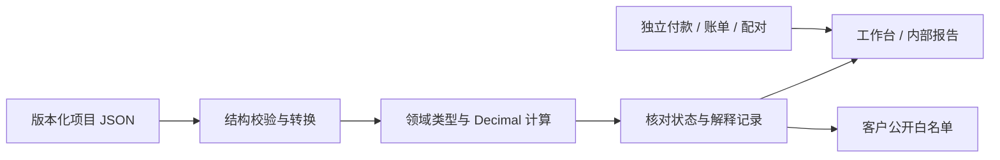

# 能力与验证证据矩阵

2026-10-19，第七十六轮。面向中国一般贸易进口、单商品一票的本地内部测算工具。本文说明程序做了什么、用什么验证，以及没有证明什么；不以测试数量代替法规、真实业务或专业认证。

## 五条验收轴

“开发完成”仅指列出的受限路径可用；“自动化通过”指固定或合成输入的程序/浏览器检查。“人工专业复核”“真实单据对照”“真实设备验收”是另外三项，当前均未完成，按用户安排暂缓。示例中的EXAMPLE、用户自行确认和程序可计算不能提升为后三项。历史文档的测试数、未合并等状态仅对应其阶段。

基线为第五十五轮：79文件2660项测试、37套离线浏览器回归、166项线上检查，Windows/Linux CI和公开产物哈希核对；见[最近项目验收](recent-projects-ui-validation.md)及[PR #52](https://github.com/codeding-101/COCUDTT/pull/52)。第五十六轮新增合成案例与静态说明，见[当轮验收](capability-walkthrough-validation.md)。第五十八轮新增独立成分模块，完整82文件3139项及本轮静态介绍检查见[模块验收](fee-tax-components-module-validation.md)。第五十九轮新增[附件状态设计核对](fee-tax-attachment-design-validation.md)；第六十轮独立文件模块新增90项，完整85文件3229项，见[文件验收](fee-tax-attachment-file-validation.md)。文件API及[独立交接模块](fee-tax-attachment-controller-validation.md)已实现；第六十二轮[工作区验收](fee-tax-attachment-workspace-validation.md)接入页面，新增22项、完整88文件3302项。第六十三轮新增[精度设计验收](fee-precision-design-validation.md)，53/75/4860/124为独立设计证据，第六十四轮[独立精度模块](fee-precision-module-validation.md)实现五类API，新增193项、完整90文件3495项；尚无运行精度选择。第六十五轮新增[精度选择记录设计验收](fee-precision-selection-design-validation.md)，独立81/60状态案例及50/51单叶变更；不是生产文件或UI证据。第六十六轮[独立精度文件](fee-precision-selection-file-validation.md)新增168项、完整93文件3663项；已实现严格文件API、Schema/合成模板，尚无运行入口或草稿恢复。第六十七轮[独立精度交接/内部审计](fee-precision-selection-controller-validation.md)新增89项、完整97文件3752项，实际客户两版式HTML/XLSX/PDF差分隔离；尚无工作台精度入口或自动草稿。不把旧证据记成重跑结果。

## 受限能力、证据与边界

下表每一行的专业复核、真实单据、真实设备状态均为未完成；“有自动化证据”不承诺覆盖所有边缘场景。

| 能力与实现状态 | 源码及自动化证据 | 已覆盖与仍有边界 |
|---|---|---|
| 术语、费用承担及风险：已启用 | [责任解析](../src/engine/responsibility/resolver.ts)、[基础概念测试](../tests/foundations.test.ts)、[风险测试](../tests/risk.test.ts)、[基础核验](foundations-validation.md) | 11术语、FCA两类地点、C类运费与风险分开；缺合同/地点保留待确认。FOB变形不能凭名称改变风险，补充合同仍须核对 |
| 合同报价与方案：已启用 | [比较](../src/engine/compare.ts)、[实际报价测试](../tests/actual-quotes.test.ts)、[报价验收](actual-quotes-validation.md) | 实际报价/有效期/地点及模拟基准分别记录；缺实际报价不自动推成有效合同方案 |
| 中国进口税基/税款：受限启用 | [完税价格](../src/engine/tax/dutiable-value.ts)、[进口税](../src/engine/tax/import-tax.ts)、[中国进口测试](../tests/china-import.test.ts)、[案例对照](../tests/import-case-acceptance.test.ts) | 净价/运保费、人工调整、支持的关税/消费税/VAT及舍入；不是税则库，不自动确认原产地、特许权费或特殊估价；其他国家专用税制未完成 |
| 商业/海关汇率与来源：已启用 | [汇率](../src/engine/fx.ts)、[来源核对](../src/engine/decision-readiness.ts)、[来源测试](../tests/source-readiness.test.ts)、[进口复现](china-import-walkthrough.md) | 类型、申报日期、适用期及变更后确认失效；真实发布值/特殊日期调整须人工核对，无实时自动查询 |
| 中国出口退税：既有假设模型 | [退税测试](../tests/rebate.test.ts)、[历史规则核验](professional-rules-review.md) | 不是完整2026出口退税合规模型；不按近似日期自动认定逾期。中国进口案例不适用出口退税；本轮未重查法规 |
| 多段运输、保险及箱费提醒：受限启用 | [物流测试](../tests/logistics.test.ts)、[运输关联测试](../tests/transport-links-integration.test.ts)、[物流验收](logistics-validation.md) | 唯一交货点与费用支付终点分开、资料与漏项核对；关联不是按段自动分摊，不认证保单/险别/保额或实际交货 |
| 独立箱费账单与提案：已启用但不写成本 | [账单测试](../tests/container-bill.test.ts)、[提案测试](../tests/container-cost-proposal.test.ts)、[账单界面](container-bill-ui-validation.md) | 日历日、免费期、阶梯、原币审计和候选；未支持规则拒绝。含税标记不自动拆税；提案不等于已计入利润/税基 |
| 配对、业务复制与核对：已启用 | [配对测试](../tests/container-cost-pair.test.ts)、[复制测试](../tests/container-business-copy.test.ts)、[核对接入](container-review-integration-validation.md) | 明确完整交接、稳定映射、旧确认失效；核对记录不清原待办、不构成实际费用应用事务 |
| 费用税务成分：独立内部工作区已接入 | [模块](../src/engine/fee-tax-components.ts)、[计算测试](../tests/fee-tax-components.test.ts)、[边界测试](../tests/fee-tax-components-boundaries.test.ts)、[模块验收](fee-tax-components-module-validation.md) | 原文、精确分数、审计及逐列未知合计；不确认资格、不激活旧扩展、不改变既有费用/利润/税基；[独立文件API](../src/data/fee-tax-attachment.ts)与[JSON测试](../tests/fee-tax-attachment-json.test.ts)已完成，完整来源/回执与Schema见[验收](fee-tax-attachment-file-validation.md)；[独立控制器](../src/ui/fee-tax-attachment-controller.ts)与[内部快照](../src/data/fee-tax-attachment-snapshot.ts)已验证；[表单/工作区](../src/ui/fee-tax-attachment-workspace.ts)、[测试](../tests/fee-tax-attachment-workspace.test.ts)和[浏览器流程](../tools/fee-tax-attachment-browser-check.mjs)验证结构化编辑、明确采用、恢复、交接及窄屏；精度选择/费用应用尚未启用 |
| 付款与资金假设：独立启用 | [付款测试](../tests/settlement.test.ts)、[期间测试](../tests/funding-periods.test.ts)、[期间接入](funding-period-integration-validation.md) | TT/L/C/OA分期、显式本金/利率/舍入/归集期；不是银行实际扣款，不据方式推定风险，不处理保证金/复杂代付净额或复利 |
| 解释、图表与假设：已启用 | [解释测试](../tests/explanation.test.ts)、[假设测试](../tests/sensitivity.test.ts)、[内部口径](calculation-assumptions-validation.md) | 复用真实引擎记录，不在视图重新计算税款；独立假设不写回交易或刷新来源确认 |
| 内部/客户导出：已启用 | [客户测试](../tests/customer-quote.test.ts)、[Excel测试](../tests/workbook-export.test.ts)、[PDF测试](../tests/customer-pdf.test.ts)、[双版式验收](customer-views-validation.md) | 客户公开白名单与内部资料隔离，HTML/XLSX/PDF/固定双语；自由条款不自动认证翻译，文件下载受浏览器限制，打印分页非真实设备验收 |
| 项目文件、恢复与快照：已启用 | [文件测试](../tests/project-file.test.ts)、[真实事件](../tests/project-io.test.ts)、[快照测试](../tests/recent-projects-ui.test.ts)、[快照接入](recent-projects-ui-validation.md) | 版本/扩展保护、异常原文、独立资料、手动3份快照；本机缓存非备份，不承诺跨标签原子事务 |
| 新手、专业与移动界面：已启用 | [工作台测试](../tests/workspace.test.ts)、[移动设置测试](../tests/mobile-settings.test.ts)、[引导验收](onboarding-validation.md) | 核心输入/具体修错/待更新、键盘和模拟窄屏；真实手机、系统文件分享、辅助技术全面验收未完成 |
| 成分假设与精度选择工作台已接入；费用应用未启用 | [只读核对测试](../tests/container-cost-review.test.ts)、[设计反例](container-cost-review-design.md)、[阶段目标](development-stages.md) | 已有只读待办不等于经济成本、海关金额或税额已确定；[成分设计](fee-tax-components-design.md)已通过31手算/45拒绝/200对照，独立成分模块和内部工作区已实现；[精度设计](fee-precision-design.md)、[固定合成向量](cases/fee-precision-design.json)与[独立检查器](../tools/check-fee-precision-design.mjs)核对原值/差额/守恒/换算边界，[纯数值模块](../src/engine/fee-precision.ts)、[计算测试](../tests/fee-precision.test.ts)和[边界测试](../tests/fee-precision-boundaries.test.ts)已完成，[精度工作台](fee-precision-selection-workspace-validation.md)已接入，完整双来源、原值/候选/差额及原待办分别核对，尚无费用应用事务 |
| 费用应用事务：实现前设计，未启用生产应用 | [设计](fee-application-design.md)、[固定向量](cases/fee-application-design.json)、[独立检查器](../tools/check-fee-application-design.mjs)、[现状测试](../tests/fee-application-foundations.test.ts) | 数值投影兼容不等于可应用；G/E/部分C无法由旧单金额同时表达，提交后的持久化/渲染故障不等于财务未发生；尚无真实回滚实现 |

## 工程边界与可复现入口

实际分层为`src/domain`、`src/engine`、`src/data`、`src/ui`，严格TypeScript。文件结构可保存未完成输入，业务校验再决定能否计算；结构有效不表示可交易。UI有统一恢复边界，但`app.ts`仍承担较多事件与状态编排，不能声称已完成全面状态管理重构。静态审查能发现已知字段/动作遗漏，不能证明所有交互无缺陷。

固定案例从[操作说明](china-import-walkthrough.md)开始，或离线打开[演示页面](../china-import-walkthrough.html)。开发环境执行 `node node_modules/vitest/vitest.mjs run tests/china-import-walkthrough.test.ts` 对照固定答案，再执行 `node tools/build-import-walkthrough.mjs --check` 检查HTML和内嵌项目字节。全套测试、类型、绑定、独立设计基准、离线构建和版本化资源比对由[双平台CI](../.github/workflows/quality.yml)执行。

简历可以说明：本地优先、明确领域边界、独立手算与回归、版本化文件、客户/内部隔离和可追溯核对。不能写“支持全球税制”“生产级合规认证”“真实报关准确率100%”或把测试数量当作业务正确率。第五十八轮已完成独立只读成分模块，见[验收](fee-tax-components-module-validation.md)。第六十七轮[交接模块](fee-precision-selection-controller-validation.md)已完成。下一阶段接入工作台精度面板，贯通完整双来源捕获、政策编辑、明确采用/另存、草稿恢复与冲突备份、内部审计及客户隔离；通过离线真实下载、故障竞态和320px流程后再公开启用，费用原子应用与失败回滚最后验收。

第六十八轮完成[工作台精度政策与交接](fee-precision-selection-workspace-validation.md)：高级设置中的原成分/通道选择、ROUND/FX明确政策、原值/候选/带符号差额，完整双来源失配与原业务待办分别呈现；明确采用/恢复、两份草稿、冲突备份和内部HTML/Excel贯通。新增41项、完整98文件3793项；39套浏览器流程及精度40项检查，离线原生下载、故障恢复与320px指针输入验证。政策不应用费用或清除CORE精度/税务待办，原计算、文件1.0、Schema和模板保持。 下一阶段先设计费用应用事务：明确成分/通道到费用字段的映射、包含及重叠、防重复、稳定ID、来源失效、旧格式与整批失败回滚；固定合成反例和独立检查器通过后，再实现独立应用提案，最后接明确预览及原子写入。

第六十九轮完成[费用应用前的模型边界与事务设计](fee-application-design-validation.md)：真实旧路径新增11项、完整99文件3804项；独立106个有效设计场景/36个拒绝输入、303组构造/6份来源变更/2个指纹向量纳入双平台CI。明确G/N/T/X/E/C不混写、部分海关/抵扣/舍入变化与FX的受限边界，稳定来源消费键和提交前整批保持、提交后缓存/渲染/保存失败状态。没有生产应用模块、新格式或费用按钮，原工具及旧计算字节保持。下一阶段实现独立只读应用提案模块：真实完整来源解析/重算、目标与原金额映射、消费历史/完整上下文核对及可解释阻断。之后设计正式新封套、账本与保存/恢复/内外交接，最后接聚合提交协调器；不能把政策回执或数值投影兼容当成应用资格。

第七十轮完成[独立只读费用应用提案](fee-application-proposal-validation.md)：真实项目、账单、配对、成分与精度文件严格解析并重算，保留完整原文/指纹、逐行字段对照及全部来源待办。新增57项、完整100文件3861项；数值可映射仍不是应用资格。部分海关金额、非零抵扣、舍入变化、FX及付款/承担错位继续阻断。现有格式没有正式业务身份或应用账本，缺失历史明确待核，传入历史只作不受信任原文，不宣称完成已消费核验。本轮没有运行入口、正式新格式或费用写入，原工具与旧计算保持。下一阶段先设计正式封套、业务身份/消费历史及恢复协议，再实现解析和内部审计，最后接聚合提交协调器。

第七十一轮完成[业务身份、封套与消费历史设计](fee-envelope-design-validation.md)：明确旧资料导入历史未知、另存保留历史、新业务重建身份、稳定消费键、回执/归档闭包、分支冲突和无最新锚点的恢复边界。新增独立98个有效设计场景/31个拒绝输入，另15个回执叶变更/8组身份变体/2份指纹；原100文件3861项回归保持。只有设计及独立检查器，没有生产封套解析器、迁移、Schema、运行入口或费用写入，旧只读提案仍不识别历史格式。下一阶段实现独立只读封套文件模块，验证真实来源与完整历史闭包，再接交接/恢复和内部审计，最后接聚合提交。

第七十二轮完成[独立只读封套文件模块](fee-envelope-file-validation.md)：真实来源、完整历史引用闭包及前后项目差异重算，旧资料历史未知、新业务候选、对象租约与恢复冲突分别核对，新增离线Schema。新增73项、完整101文件3934项；修正独立提案的配对1.1业务快照误判，并核对实际核心费用归属，不以条目字段覆盖规则。没有工作台入口、自动缓存/恢复、内部新导出或费用写入；旧提案history_json仍不直接信任新格式。下一阶段独立交接与内部审计，再接保存/恢复控制器、运行入口和浏览器竞态/客户隔离，最后接聚合费用提交。

第七十三轮完成[独立封套交接与内部审计](fee-envelope-handoff-validation.md)：完整原文/双指纹/租约与审计深冻结，静态HTML及实际XLSX保留完整来源和历史，不把本地结构通过当作最新、付款或全局未重复证明。新增30项、完整102文件3964项；CR/LF、Unicode、公式形文本、超限整份拒绝及两版式实际客户HTML/XLSX/PDF差分隔离均有验证。独立JSON交接沿用128MiB，报告限额单列，完整1.1历史可能只能交接JSON。没有工作台入口、保存/恢复控制器、自动缓存或费用写入。下一阶段独立保存/恢复控制器，再接运行入口和浏览器竞态/客户隔离，最后接聚合费用提交。

第七十四轮完成[独立封套保存与恢复控制器](fee-envelope-controller-validation.md)：严格UTF-8文件读取，原文/候选分开，旧修订/分支/未知历史/部分身份阻断，冻结另存、迟到读取、失败备份及明确缓存/恢复。新增87项、完整103文件4051项；缓存要求注入原子比较写入，不用普通读写冒充跨标签原子；现有原文默认受保护，异常不自动回滚覆盖。合法大文件仍可交接完整JSON，不受报告上限误拦。没有工作台入口、浏览器缓存适配器、自动缓存或费用写入。下一阶段运行入口与可靠缓存适配、真实浏览器竞态/下载/客户隔离和窄屏验收，最后接聚合费用提交。

第七十五轮完成[封套工作台与可靠缓存适配](fee-envelope-workspace-validation.md)：入口“高级设置 → 项目资料封套 · 内部交接”，支持独立JSON打开/另存、历史未知捕获、新业务候选、来源更新和内部HTML/Excel。采用仅替换面板文件，工作台来源不被安装，费用/利润/税基不写入。缓存经Web Locks协调并精确比较原文；不支持锁时关闭写入/移除，保留文件交接与只读恢复/备份，不自动恢复或覆盖。新增34项、完整105文件4085项；40套浏览器回归、新40项检查和4种模拟宽度验收，含实际双标签竞争、下载、取消/迟到读取、配额失败、异常恢复及客户两版六文件字节差分。下一阶段先实现独立聚合提交协调器，验证完整来源/政策/历史、幂等、整批失败及回滚，再决定费用入口；真实手机、真实业务与人工专业复核仍待验收。

第七十六轮完成[独立费用整批提交协调器](fee-application-transaction-validation.md)：冻结完整封套及计划，重验真实来源、政策、消费历史和前后核心计算，私有构建费用/回执并一次替换独立内存状态。同一完整计划重复确认零写入，事务冲突、后来编辑、取消/待处理输入ABA、来源更新与校验失败保留当前完整原文。原配对/成分/精度保留历史，未静默重绑；部分海关、抵扣、舍入、核心精度及覆盖待办继续阻断。新增72项、完整107文件4157项在Windows/Linux CI验证，本地类型与独立门禁通过；本地Vitest因沙箱路径及审批服务容量故障未启动。未接运行工作台、缓存、渲染或保存副作用，离线工具字节保持第七十五轮版本。下一步接完整工作台聚合状态与明确预览/确认，再验收缓存冲突、渲染/另存失败及浏览器客户隔离；上轮发布后线上原生/哈希复核仍待审批服务恢复。

第七十七轮完成[工作台完整快照与提交后副作用边界](fee-workbench-validation.md)：整体捕获来源、原始汇率行/租约、六份文件、未提交输入和界面内部归档，明确预览前后差异并沿用真实整批事务；确认前失败保持旧状态，确认后缓存冲突/回读异常、显示或另存失败不回滚费用与回执。迟到结果绑定原快照，下载不当已保存，其他编辑保留已提交标记；旧计算和客户确认必须重建。新增40项，完整108文件4197项以本轮实际日志验收。该层尚未接运行app及旧控制器，不声明已完成浏览器或实际落盘；公开工具仍为第七十五轮。下一步实际工作台迁入、预览/确认界面及同轮竞态、恢复、客户隔离和窄屏验收；线上原生/字节复核仍须补齐。
