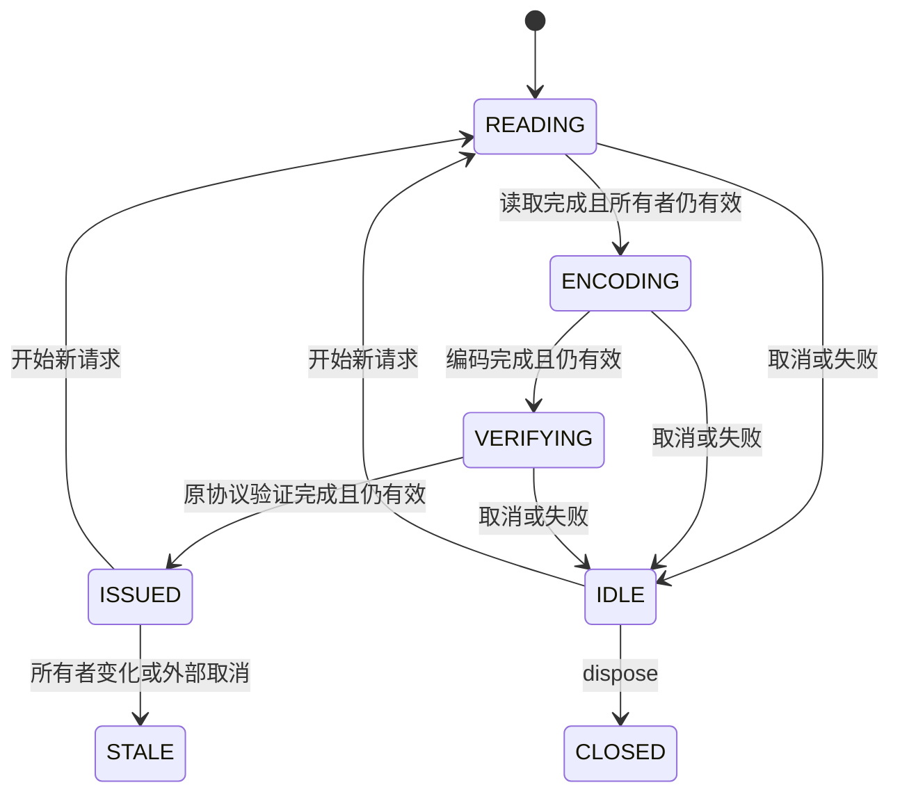

# 浏览器异步捕获接口与恢复策略

2026-10-25，第九十六轮。承接[只读映射](fee-layered-source-mapping-design.md)，交付可执行接口契约与恢复边界。**尚无独立浏览器原生编解码器，也没有完整工作台重开入口。**正式计算、费用提交、文件格式和运行工具保持。

## 接口与所有者

[接口契约](../tools/fee-browser-capture-contract.ts)接受受信任的`encode/decode`适配器。接口使用浏览器的`AbortSignal`，业务数据仍由原`WorkbenchStateOwner`检查点约束；它不识别贸易资格、税额或费用批准。适配器必须在第一次异步等待前完成借用数据的校验与分离，返回已验证、深冻结的还原数据。当前实例使用第九十五轮的诊断适配器验证这些要求，不能称为新原生编解码器。

三个异步阶段后分别重查原所有者；A→B→A不能复用旧结果，旧式嵌套编辑仍须`touch()`。新请求先安装自己的私有操作身份，再通知旧请求取消；旧的受信任取消监听器若重入并创建更新请求，更新请求获得最终身份。元数据描述器检查之后再检查一次所有者，防止Proxy陷阱重入。

取消会及时拒绝当前观察，即使受信任读取或后端Promise尚未结束；后续结果与异常都有处理器，不能重新签发旧观察。请求结束时移除外部事件监听器，之后同一外部信号取消仍使已签发观察失效。关闭会话后禁止再读取。错误按阶段返回常量代码，不读取外部异常或取消原因的消息、堆栈和名称。

观察对象的身份留在`WeakMap`，JSON、复制、另一会话和解码数据都不能当当前观察。有效观察也只是数据，不提供来源采用、业务确认或费用提交权限。取消不回滚受信任回调自身的外部副作用；接口也没有证明物理停止WebCrypto、同步校验或内存释放。后续实现必须验证有界任务队列与重复点击，不能将异步API写成提速或减内存结论。

## 五个上限分别核对

| 层级 | 当前上限/行为 | 不能推定什么 |
|---|---|---|
| 语义捕获 | 每根及完整捕获128 MiB，300000节点、根零深度32 | 较小传输编码不能绕过还原预算 |
| 诊断备份原文编码 | UTF-8原文不超过256 MiB | 压缩前仍要先形成完整捕获和备份原文 |
| 直接备份文本 | 不超过48 MiB时保持原文 | 有JSON文件不等于存在导入入口 |
| 压缩归档/候选备份 | 超过48 MiB使用gzip/base64，输出不超过64 MiB | 不能把64 MiB当语义捕获预算 |
| 异常快照只读检查 | 5 MiB，且只接受`INTERNAL_RECOVERY_SNAPSHOT`1.0 | 不是检查备份、应用备份或分层协议的重开器 |

依据是[捕获协议](../tools/fee-layered-capture-prototype.ts)、[运行备份编码器](../src/data/runtime-fee-backup.ts)、[候选与应用备份](../src/ui/fee-workbench-candidate.ts)和[异常快照检查](../src/data/recovery-review.ts)。已有备份单测独立解压核对大于48 MiB的原始字节；本轮不更改这些实现或门槛。

## 六类源文件只能作为分项保全

[恢复计划](../tools/fee-browser-recovery-plan.ts)只读取明确的捕获外壳及同一次操作的备份事实，输出小型状态摘要，不包含原文或输入值，不执行保存、解压、迁移或导入。它分别记录：当前文本是否可用、已知文件原文是否存在、两者是否逐字相同、历史名称/写入时间是否已知。null、空文本、读入文件和写入确认不合并；历史写入时间也不保证当前磁盘文件可访问。

| 已知事实 | 允许的结论 |
|---|---|
| 六份当前文本均与已知文件原文相同 | 六项文本匹配；不保证业务有效或工作台完整 |
| 已发起下载 | 尚未证明落盘 |
| 另存取消或未确认 | 当前资料仍须保留 |
| 写入器确认 | 有该次写入器确认；不产生完整重开资格 |
| 捕获未检查或被预算拒绝 | 不能同时声称本次完整备份已经生成或另存 |

六类源文件未完整覆盖：未提交控件和编辑、工作区草稿/恢复、原始FX编辑行及租约、存储原文/可用性、读取代次与待处理IO、客户确认和本地假设、文件保存事实及私有会话身份。保持工作台打开、按原入口另存可用源文件并保留未提交输入，是当前分项保全路径；不是完整恢复方案。

## 完整重开的后续门槛

当前检查备份0.1/0.2、应用备份0.1、gzip归档0.1与分层协议0.1均不能进入已有异常快照检查器；本轮用真实检查函数验证拒绝。异常快照格式被识别时也只检查结构，没有安装当前业务。

未来若设计完整重开，须分别完成版本/大小/解压展开保护、逐字原文和未知扩展保留、完整来源与历史核对、安静状态下的新所有者安装、旧业务失败保留、重新计算与用户明确选择。不能恢复原Promise、DOM/File句柄、活跃读取、私有令牌或旧客户确认；序列化的这些事实仅供审计。已应用费用和回执须保留历史，`pending_patches`不得自动重放成第二次费用提交，未知历史不能补造。

第九十五轮1/4/8观察仅作为固定历史事实：1笔完成还原与候选准备，4笔完整捕获225,678,795字节、8笔保留根284,281,150字节仍超限。本轮没有重跑这些大资料，也没有容量改变。完整恢复方案若要求放宽现有预算，须明确作为后续独立取舍，不能在编解码器内偷偷修改。

下一轮先实现无需文本变换的独立浏览器编解码器，按本契约核对原Node编码、异步失效和原69场景；同条件1/4/8继续记录真实拒绝阶段。完整恢复格式与实际接入须另有完整链路和收益证据。见[本轮验收](fee-browser-recovery-validation.md)。
