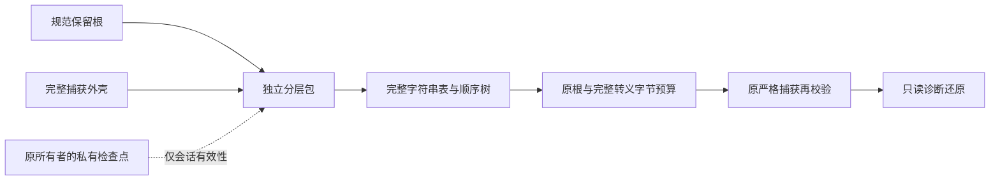

# 分层捕获与完整原文引用：独立协议0.1

2026-10-23，第九十四轮。承接[第九十三轮保存指引](fee-save-guidance-validation.md)。本轮在开发工具中验证序列化前的两个逻辑根，正式工具继续原捕获、预览、候选、费用应用和恢复入口。

## 与既有原型的区别

[第八十六轮](fee-text-sharing-design.md)共享已捕获对象中的完整字符串，`retained_json`仍是不透明的大字符串；[第八十七轮](fee-source-view-design.md)验证生产者视图；[第九十一轮](fee-semantic-integration-design.md)已把规范语义根读取接入正式工具。本轮在这些边界上增加独立的分层协议，不重复注册第二份生产计算逻辑。

调用者显式提供`retained_root`、不含`retained_json`的`capture_shell`，以及`COMPACT`或`PRETTY_LF`格式。前者是已知规范保留根，后者保留完整来源、文件证据、汇率、编辑、活动和阻断信息。只接受固定外层字段和原捕获字段顺序；未知业务扩展仍在所属根内完整保留。协议不会从商品、附件、账单或未知扩展字符串中猜测JSON结构。

本轮只为受控Node夹具映射两个根，没有建立实际页面生产者映射，也没有改变公开工具的运行格式。`retained_json`格式逐字还原，包括生产侧的两空格缩进和末尾LF，或夹具的紧凑格式；不能把二者无声混用。

## 引用、持有者与传输

[独立实现](../tools/fee-layered-capture-prototype.ts)位于`tools/`，使用Node加密模块，没有生产入口。标记`INTERNAL_FEE_LAYERED_CAPTURE_PROTOTYPE`、版本`0.1`，固定财务写入0、导入/确认权限false、运行接入false。

- 只有UTF-8至少1024字节的**完整字符串**进入共享表；按完整字符串相等和首次出现顺序编号，不按摘要、名称、业务编号或Unicode归一化合并。
- 文件证据、来源持有者、确认字段、未提交输入、存储可访问性及读取代次保留各自位置。相同原文不代表相同文件、同一次读取或已经保存；未知null和false保持。
- 结构按先序树展开，容器没有引用ID。数组记录子项数，对象记录有序键列表；输入中共享的对象恢复为不同持有者。容器引用、循环和别名不能通过协议标签表达，未知标签拒绝；真实循环输入同样拒绝。
- 节点以每块最多512个元组编码为JSON字符串。外包、每块和对象键列表分别经过原严格JSON解析器，避免把协议包装开销误算为业务语义深度/节点。重复键、坏Unicode、越界或外部文本引用、重复/未使用文本、未闭合树、剩余节点和错分根均拒绝。
- 用户值中类似`text-ref`、`__proto__`的标记只是普通数据；对象通过`Object.fromEntries`重建自有键，不写原型。访问器、toJSON、稀疏数组、非有限数和不支持的JavaScript类型继续拒绝。

原文只作为数据保存；文本值即使看起来像URL或本地路径，也不会被读取、请求或执行。节点引用位置只接受表内整数。字节数和SHA-256验证内容一致性，不证明来源资格、当前状态或业务确认；JSON文本本身也不区分0与-0，不能用摘要代替私有身份。

## 五个预算分别核对

| 边界 | 固定上限与核对方式 |
|---|---|
| 规范保留根的紧凑JSON | 128 MiB、300000语义节点、根深度0到32 |
| 原`retained_json`文本 | 128 MiB；按指定缩进/换行计算实际UTF-8 |
| 完整捕获的紧凑JSON | 128 MiB、300000节点、32深度；包括保留文本再次转义后的全部字节 |
| 分层传输JSON | 独立128 MiB；各严格JSON层继续原语法保护，最多4096份共享原文、每块512节点 |
| 原文件读取、事务、备份和恢复 | 各原模块的独立保护保持；分层包不替代正式文件或检查备份 |

字节预检独立计算紧凑、缩进以及再次作为字符串转义后的大小，换行、控制字符、引号、反斜杠、中文和emoji均按实际UTF-8核对。重复引用在展开预算中逐次计入；不能因为表里只有一份1 MiB原文，就接受其129份展开。协议头的大小声明不可信，解码须重算。

两个逻辑根和完整转义捕获都通过预检后才构造还原对象，再调用[原规范捕获校验](../src/ui/fee-workbench-semantic-capture.ts)并检查实际字节和摘要。`inspectFeeLayeredCaptureBudget`只返回计数，**不是编码、来源、当前性或事务就绪证明**。实际128 MiB计数边界单列为`BUDGET_ONLY`；传输包装仍可能先达到独立限额。

## 私有状态与恢复边界

会话只接受受信任读取回调，在读取前取得[原所有者](../src/ui/workbench-state.ts)检查点，并在异步读取及协议构造后复查。最新读取、取消和A→B→A使旧结果失效；私有WeakMap只认本会话签发的对象。另一会话、复制对象、JSON重开或诊断还原都不能取得原资格。

读取失败不返回部分结果，也不自动退回旧快照。受信任回调或Proxy陷阱自己的外部副作用不能回滚；旧式嵌套修改仍须在交互边界调用`touch()`，本轮没有自动深层变更侦测。格式相同的只读还原也不会安装来源、恢复读取、签发候选或继承客户确认。

## 接入条件

[测试](../tests/fee-layered-capture.test.ts)、[边界](../tests/fee-layered-capture-budget.test.ts)、[状态与真实夹具](../tests/fee-layered-capture-state.test.ts)及[独立诊断器](../tools/fee-layered-capture-diagnostic.ts)验证协议自身。下一轮先连接真实页面的显式生产者作只读观察，对照全部原捕获字段、69个复杂/运行场景及实际1/4/8笔夹具；检查坏引用、未提交控件、不可用存储、ABA和恢复差异。完整等价、预算与原子流程验收前不接运行入口，不把本轮看作容量或性能提升。结果见[验收记录](fee-layered-capture-validation.md)。
