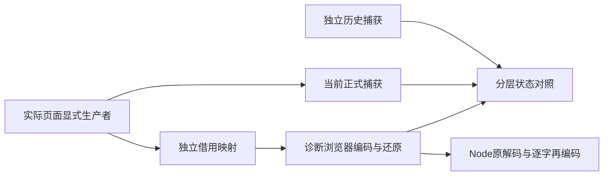

# 真实页面生产者的只读分层映射

2026-10-24，第九十五轮。承接[独立协议0.1](fee-layered-capture-design.md)。本轮把实际页面的显式生产者映射为两个逻辑根，仅供专用测试服务器观察；正式源码、计算、费用应用和离线产物保持原实现。

## 读取与资格分开

[映射器](../tools/fee-layered-source-mapping.ts)按原回调顺序读取账单、配对、成分、精度、封套、三个工作区、工作流、已初始化项目、未提交控件和存储。每次受信任读取及来源复制前后检查原所有者修订，A→B→A也使观察失效。不读取尚未初始化的项目，不把null、空文本、false或不可用存储合并。

返回值是**借用视图**：外壳和新建保留根浅冻结，部分嵌套值仍由原生产者持有，不是持久快照，也不是私有签发对象。应立即交给绑定同一所有者的分层诊断会话；旧式嵌套修改仍须调用`touch()`。受信任回调或Proxy陷阱自己的外部副作用无法回滚。

| 来源 | 规范保留根 | 捕获外壳 |
|---|---|---|
| 项目与文件事实 | 原项目、名称、保存时间、dirty、原文是否已知 | 当前项目序列化原文及独立文件证据 |
| 账单、配对 | 完整控制器投影、未知扩展和代次 | 独立draft/pair原文、费用/核对未提交编辑 |
| 成分、精度、封套 | 当前/预览/恢复/编辑、文件事实、读取与缓存状态 | 原来源字符串、编辑、活动与封套阻断 |
| 工作流 | 读取/结算代次、客户字段和确认、敏感性、恢复状态 | 活动、未提交输入及具体阻断顺序 |
| DOM与存储 | 原控件value/dataset/connected及各存储raw/available | 独立pending输入，不补造文件或保存事实 |

未知扩展在所属位置保留。源文件及编辑对象先经过原独立JSON保护，再调用原序列化器，避免在序列化时调用访问器或toJSON；规范根及完整再次转义预算继续由分层协议检查。未知业务字符串不解析、不拆片、不归一化。同文持有者、读取代次、文件证据和客户确认仍分开。

## 浏览器适配只作用于诊断

上轮协议使用Node的UTF-8与加密接口。[严格作用域适配](../tools/fee-layered-browser-port.ts)只在专用Vite服务器内存中替换两处开发模块：UTF-8计数与等待WebCrypto的SHA-256；同步Node源码不改。哈希成为异步操作后，原私有会话仍在完成后复查所有者和读取代次。

[UTF-8计数器](../tools/fee-layered-browser-utf8.ts)与TextEncoder/Buffer核对全部UTF-16单码元及固定混合字符串。计数器替换规则本身不是内存或性能结果；协议继续拒绝孤立代理项。普通构建不使用这些变换，不导入Node诊断模块。

[诊断器](../tools/fee-layered-source-diagnostic.ts)分别记录独立历史外层、历史保留层解析、当前正式捕获、借用映射、协议编码及还原。映射能返回不代表协议接受；外层能序列化也不代表保留层通过。只有当前正式路径和完整还原都接受，才比较全部捕获JSON；双方拒绝时完整相等保持null。

## 同一场景的三条路径

[浏览器桥](../tools/fee-layered-source-bridge.mjs)复用原42个复杂状态与27个运行状态构造。复杂状态同时观察独立历史实现、当前正式捕获和新映射，读取3×10个存储位置；运行状态比较当前正式捕获与新映射，读取2×10个位置。两者写入必须为0；原20次读取的历史记录原样保留，不重新标记为本轮数据。

[驱动](../tools/check-fee-layered-source-browser.mjs)还使用原File输入、采用与另存按钮加载1/4/8笔合成资料。文件与保存API为明确替身，不证明真实磁盘或手机。先另存项目和封套、明确客户复核，再仅记录原保护的SHAPE阶段；不测计时或峰值内存。1笔通过原预览及十组准备后丢弃候选，4/8笔拒绝后不继续编码、还原或准备，始终不应用费用。

三份诊断编码分段取回，拼接完整UTF-16后才核对UTF-8和SHA-256，避免跨分段代理对损失；Node原解码器及逐字重新编码独立验证浏览器适配。合成输入同样分段、拼接并核对完整原文，不能用分段绕过原文件或业务预算。

## 接入前的边界

真实页面的私有身份、ABA、控制器取消与迟到读取由原所有者和控制器验证。JSON或只读还原不能重入签发表、激活旧读取或成为候选。新映射、调试桥和平台适配均未进入正式入口；完整财务应用流程沿用同源码、同字节的既有证据。

[验收](fee-layered-source-mapping-validation.md)记录当前通过项、首次超时及重验方法。下一阶段先明确浏览器原生接口、异步失效和大资料备份/恢复策略，再以完整验收与实际收益决定接入。原4/8笔容量限制仍存在，不以较小wire或借用视图宣称业务可用。
