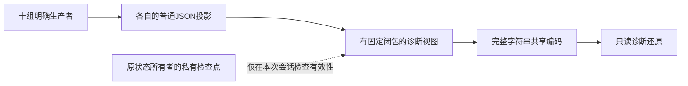

# 生产者只读来源视图：独立设计与原型

2026-10-21，第八十七轮。承接[整串原文共享](fee-text-sharing-design.md)。本轮在开发夹具中建立十组显式投影，验证资料完整性、私有有效性和预算；没有替换浏览器的完整捕获、预览、候选、备份或正式文件。

## 为什么需要生产者提供视图

[浏览器捕获](../src/ui/app.ts)把控制器、工作区、存储和未提交状态再次序列化为`retained_json`。消费者无法仅凭这个不透明字符串可靠判断哪些片段是同一原文，也不能猜测未知扩展的含义。因此由拥有状态的代码明确返回普通JSON，再由开发原型共享完整字符串。原文字符串内部的JSON、换行、BOM和未知内容仍是数据。

十个标签不证明真实控制器身份。回调与所有者的正确连接由受信任夹具负责，不能从外部JSON注册回调、执行路径或取得业务权限。

## 生产者协议与边界

[夹具](../tools/fee-performance-harness.ts)新增`sourceViewReaders()`，原`captureInput()`、初始化、来源和准备路径保持。按以下固定顺序登记，每组恰好一次；缺失、重复、陌生标签、重排或额外协议字段均拒绝。

| 标签 | 显式投影 | 保留与限制 |
|---|---|---|
| `project` | 应用项目、汇率行、计算/比较状态、文件证据等应用字段 | 普通对象投影后脱离原对象；未知项目扩展保留 |
| `workflow` | 当前夹具工作流字段和它的存储Map内容 | 包括未提交输入、读代次、客户确认、汇率保留依据；Map可用不是浏览器存储可用性证明 |
| `bill` | [账单控制器](../src/ui/container-bill-controller.ts)的`workbenchCapture()`及完整draft | 文件证据、epoch、读取状态、写入状态及完整原业务输入 |
| `pair` | [配对控制器](../src/ui/container-cost-pair-controller.ts)投影及pair、费用/核对编辑 | 复制候选、文件证据和完整未提交记录；派生报告、缓存和分页不是恢复协议 |
| `attachment` | [成分控制器](../src/ui/fee-tax-attachment-controller.ts)的完整公开捕获 | 原文、编辑、文件证据、epoch/read token、候选/恢复、观察到的存储及保护槽 |
| `precision` | [精度控制器](../src/ui/fee-precision-selection-controller.ts)的完整公开捕获 | 双来源原文、编辑、文件证据、读取/写入代次、候选、存储保护 |
| `envelope` | [封套控制器](../src/ui/fee-envelope-controller.ts)的完整公开捕获 | 当前/原始/历史资料、文件证据、保存原文、读取token、待采用候选 |
| `attachment_workspace` | [成分工作区](../src/ui/fee-tax-attachment-workspace.ts)的公开捕获 | 待确认动作、导出和输入状态 |
| `precision_workspace` | [精度工作区](../src/ui/fee-precision-selection-workspace.ts)的公开捕获 | 待确认动作、导出和输入状态 |
| `envelope_workspace` | [封套工作区](../src/ui/fee-envelope-workspace.ts)的公开捕获 | 代次、忙碌/导出、业务名称及明确选择 |

这份协议只覆盖当前Node夹具的显式投影，**尚未证明与浏览器全部DOM、存储失败、派生缓存及旧总捕获等价**。账单/配对公开捕获提供epoch及reading，没有伪造未公开的读取token。原文件读取仍由各控制器自己的令牌判断。正式接入前必须逐字段核对真实页面生产者。

## 数据与私有有效性分开

[独立实现](../tools/fee-source-view-prototype.ts)使用`INTERNAL_FEE_SOURCE_VIEWS_PROTOTYPE`、版本`0.1`，固定`financial_writes:0`、`import_authority:false`、`confirmation_authority:false`、`runtime_integrated:false`。只有`producers`内的`value`允许保留未知扩展，协议头与标签闭包保持严格。

1. 会话先取得[现有状态所有者](../src/ui/workbench-state.ts)签发的私有检查点。每次调用受信任、同步的生产者回调后，立即核验检查点。
2. 每组数据先通过原严格JSON复制器，拒绝访问器、toJSON、Promise和坏数据，不调用这些数据里的函数。复制后与原状态分离；原文不解析、不重排内部JSON。
3. 全部通过预算、原整体JSON限制及最终有效性检查后，递归冻结诊断视图。读取失败整份抛错，不把缺失资料填成null，也不返回部分成功。
4. 会话私有WeakMap记录“视图对象→原检查点”。只有本会话签发且仍有效的对象才能调用本会话编码方法。A→B→A仍使旧视图失效。
5. 解码只还原冻结的诊断数据。另一会话、普通复制、结构相同的JSON或相同摘要都不进入私有签发表；业务来源、候选和客户确认资格不随编码传递。

生产者回调是受信任代码，不是任意插件执行接口；若回调自己写状态，原型会拒绝混合结果，但不承诺撤销回调造成的外部副作用。原所有者对旧式嵌套修改仍要求交互边界调用`touch()`；本轮没有深层代理或自动侦测所有嵌套变化。

## 预算分别定义

| 边界 | 本轮规则 |
|---|---|
| 单组生产者投影JSON | 原严格复制器，最多128 MiB，300000节点、32深度 |
| 完整逻辑视图JSON | 同样最多128 MiB及原节点/深度；协议包装也占预算 |
| 文本共享wire | 复用[第八十六轮编码](../tools/fee-text-sharing-prototype.ts)，编码和逻辑还原各128 MiB；严格引用、循环、结构别名、摘要和文本表检查保持 |
| 各正式文件读取 | 各原文件模块及控制器的原大小和业务校验保持；例如账单5 MiB、配对10 MiB，不被投影预算替代 |
| 旧总捕获、事务准备与诊断备份 | 继续原路径及独立预算；本轮视图不能直接传入它们 |

编码前仍须满足完整逻辑视图预算。只读图或较小wire不能成为巨大展开的理由。节点包装可能更早达到深度/节点限制，不承诺覆盖所有原输入；JSON字节数也不是峰值内存测量。开发原型包含脱离与校验复制，尚未做性能优化。

## 接入前仍需解决

先把真实页面的每个原字段、存储可访问性、未提交控件、活动/阻断原因映射到生产者协议，明确派生缓存和业务事实的区别。再设计独立模块及兼容适配，分别核对预览、十组候选、整批应用及备份所需的完整依据；原历史、文件保存和客户隔离必须保留。完成等价性及同条件测量前，正式工具4/8笔容量仍记受限。

本轮结果和反例见[验证记录](fee-source-view-validation.md)。
