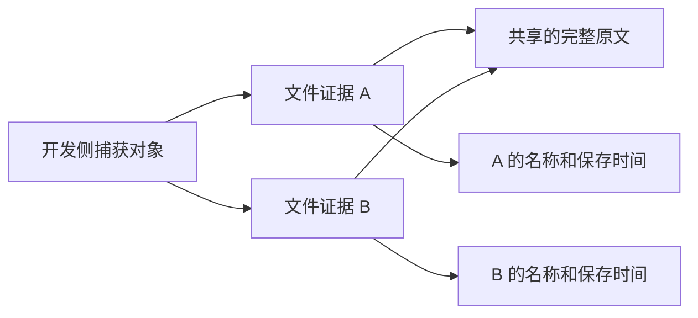

# 内部原文共享与状态失效：独立原型设计

2026-10-21，第八十六轮。承接[性能基线](fee-performance-baseline-validation.md)。本轮仅在开发工具中验证一种受限格式，运行工具、正式项目/账单/附件/封套及客户输出均保持；没有把原型接入费用或恢复入口。

## 决策与适用范围

选择“共享相同的完整字符串，保留每个持有者”。不按摘要、文件名或业务编号合并来源，不解析字符串中的JSON，也不把相同原文解释为同一文件、已确认来源或同一次读取。未识别的原文和扩展仍逐字保留。

这是原型格式的示意，当前浏览器状态并未改用该格式。原文字符串逐UTF-8字节还原；捕获对象按同一`JSON.stringify`结果比较。它不是保存任意JavaScript对象、原型、函数、访问器或对象身份的序列化器。

## 重复路径与所有者边界

| 当前路径 | 保留的独立事实 | 原型处理 |
|---|---|---|
| [完整捕获](../src/ui/app.ts)中的五类`sources` | 当前项目、账单、配对、成分和精度各自的完整原文 | 仅相同完整字符串可共享 |
| [文件证据](../src/ui/file-evidence.ts)的六个文件位置 | `name`、`saved_raw`、`saved_at`及未知null；下载与保存确认分开 | 不合并证据对象或补造名称/时间 |
| [成分控制器](../src/ui/fee-tax-attachment-controller.ts)及[精度控制器](../src/ui/fee-precision-selection-controller.ts) | 来源快照、未提交编辑、预览/恢复、读取代次及观察到的存储 | 值可以编码，不能据此安装或继承确认 |
| [封套控制器](../src/ui/fee-envelope-controller.ts)的当前/原始/历史原文 | 业务历史、保存证据、读取token和取消状态 | 保留位置及值；相同文本不等于同一代次 |
| `retained_json` | 控制器、工作区、完整存储、客户及待输入状态 | **仍作为不透明字符串**，不猜生产者结构或重排内部原文 |
| 存储快照及未提交控件 | 原文、可访问性、空值与false，以及仍未提交的输入 | 与已提交来源保持区分 |
| [状态所有者](../src/ui/workbench-state.ts)的检查点 | 私有签发身份、根及修订；A→B→A仍失效 | JSON副本不能取得原检查点资格 |
| [预览](../src/ui/fee-workbench-preview.ts)与[十组准备](../src/ui/fee-workbench-candidate.ts) | 当前完整来源、原代次、私有签发预览/候选及客户重新确认 | 原型不签发候选、不准备补丁或应用费用 |

既有备份中的字段引用仅为检查资料。其[压缩与256/48/64 MiB预算](../src/data/runtime-fee-backup.ts)和完整捕获的128 MiB保护是不同边界，不能互相替代。

## 格式与拒绝规则

[实现](../tools/fee-text-sharing-prototype.ts)位于`tools/`，通过Node运行。根标记为`INTERNAL_FEE_TEXT_SHARING_PROTOTYPE`、版本`0.1`，强制`financial_writes:0`、`import_authority:false`、`confirmation_authority:false`。不复用正式文件kind，所有表和节点都在同一文档内，没有URL、外部路径或可执行引用。

- `texts`只存UTF-8长度至少1024字节的完整字符串，按首次遇到的顺序编号；采用完整字符串相等判断，不以哈希替代相等。
- `nodes`是扁平的带标签元组，保留null、boolean、number、negative-zero、短text、长文本ref、array和object。对象以有序键/子节点对保存，标记形状的用户值也是普通数据。
- 对象/数组节点只能有一个父节点，按先序排列。循环、结构别名、越界/外部引用、遗漏节点、未使用或重复文本、重复对象键及未知标签均拒绝。仅字符串叶值共享。
- `__proto__`等键通过`Object.fromEntries`还原为自有数据，不赋值到原型。普通JSON验证继续拒绝访问器、函数、稀疏数组、日期、非有限数及孤立代理项。
- 原型保存原始捕获对象的JSON字节数与SHA-256；解码时重算。摘要只检查JSON内容，不证明来源、状态签发身份或业务资格。JSON的0/-0文本相同，不能把该摘要当全部JavaScript语义或唯一快照身份。

编码先经过[原严格复制器](../src/data/fee-envelope-json.ts)，没有绕过原输入保护；扁平wire也经过原严格JSON解析器，保留重复键和Unicode检查。wire额外语法节点同样计入原300000节点预算，因此原型可能比普通捕获更早拒绝复杂结构，不承诺覆盖所有原输入。

## 预算与还原顺序

| 预算 | 本轮固定值 |
|---|---:|
| 编码后JSON UTF-8 | 128 MiB |
| 还原对象的JSON UTF-8 | 128 MiB |
| 语义节点 / 深度 | 300000 / 32 |
| 长文本表数量 | 4096 |
| 长文本入表下限 | 1024字节 |

解码先检查wire语法及表结构，再检查引用闭包、顺序、循环、结构别名、语义深度和**实际还原字节数**。通过后才构造还原对象并重算JSON摘要。不能信任头部声明的大小，也不能因为编码文件小而允许巨大展开；测试以一份1 MiB原文的129个引用覆盖这一边界。

没有持久化缓存或跨调用的候选复用。局部字符串长度表只在本次校验中存在，不保存来源有效性或财务结果。还原得到的对象必须继续走原来源、历史、代次和明确确认门槛；恢复出来的检查点或摘要不进入原私有签发表。

## 结论与下一阶段

整串叶值共享能减少一部分重复，但没有处理`retained_json`内的多层嵌套原文。1/4/8合成结果及实际测试见[验收](fee-text-sharing-validation.md)。本轮**不放大还原预算，4/8笔仍受限，也未接入运行工具**。

下一阶段先为原文生产者设计显式的只读来源视图：逐项界定原文、持有者元数据、未提交状态与取消代次，不解析未知原文来猜测结构。明确共享图、独立文件读取、诊断还原和编码/展开预算之间的关系，完成坏引用、未知扩展、A→B→A及迟到读取的独立验证后再决定接入。不能直接用本轮解码器替换运行捕获。
